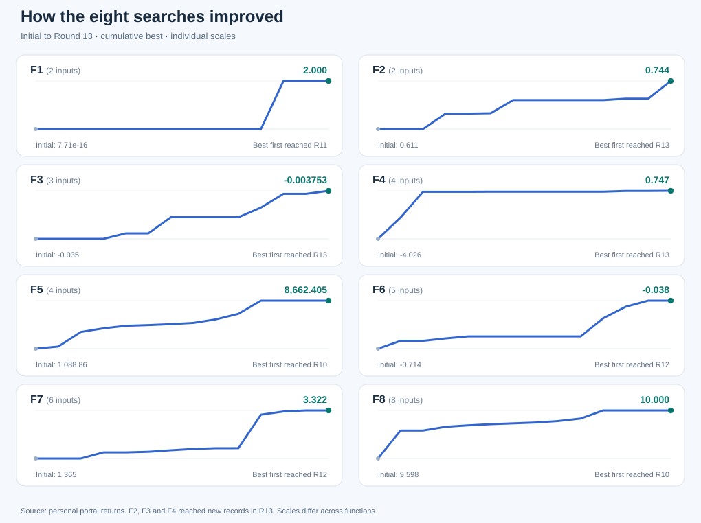

# Model Card | Adaptive Black-Box Optimisation

**Eight unknown functions. Thirteen rounds. Learning to make better decisions under uncertainty.**

*Imperial College London · Professional Certificate in Machine Learning and Artificial Intelligence*

**Developer:** Tamer El-Tonsy  
**Model type:** Function-specific, human-guided Bayesian optimisation workflow  
**Research completed:** 9 November 2026  
**Card version:** Final capstone research record · November 2026  
**Status:** Educational and research use

[← Project home](README.md) · [Dataset datasheet](DATASHEET.md) · [Eight function investigations](functions/README.md) · [Methods and implementation](docs/methods.md) · [Final notebook](notebooks/Capstone_Final_Walkthrough.ipynb)

This card follows the nine-part structure proposed by **Mitchell et al. (2019), *Model Cards for Model Reporting*** and satisfies Imperial College's Module 25 model-card template: description (input, output and architecture), performance (graph, metrics and data), limitations and trade-offs.

**Scope:** The project developed a changing, **human-guided set of function-specific optimisation methods**, not one fixed model trained once and deployed unchanged. The [function investigations](functions/README.md) are the authoritative accounts of weekly decisions, actual queries, code, plots, mathematical analysis and learning. This card reports on the **modelling and decision-making approach as a whole**, without retelling those thirteen rounds.

## 1. Model Details

### Developer, model type and purpose

Tamer El-Tonsy developed this sequential, model-assisted optimisation workflow for the Imperial College capstone. The task was to maximise eight unknown numerical functions with **one new paid portal evaluation per function per round**, in thirteen rounds, without access to the underlying equations or gradients.

**Input:** A function identifier (F1–F8), a continuous numerical candidate vector of 2–8 dimensions, and the input/output observations available **at the point of a decision**. The submitted portal coordinates are restricted to six decimal places within the legal range 0 to 0.999999. Each function is modelled separately.

**Output:** A surrogate produces a **predicted scalar score and a model-dependent uncertainty estimate**. An acquisition function or controlled experiment proposes a candidate input vector. Only the external course portal returns an **actual measured objective score**. Model predictions, simulated results and portal measurements are distinct.

**Model Architecture:** The core workflow uses **Gaussian Process (GP) regression**, with function-specific RBF or Matérn kernel alternatives and automatic relevance determination (ARD) lengthscales. Acquisition functions such as **Expected Improvement (EI)**, **Probability of Improvement (PI)** and **Upper Confidence Bound (UCB)** balance potential reward with uncertainty. Candidate selection also considered controlled coordinate experiments, local or wider searches, alternative surrogate models and mathematical hypotheses when supported by the evidence.

The full decision loop is: fit on evidence available so far → estimate mean and uncertainty → compare proposed candidates → make a human-reviewed selection → submit one input to the portal → record the observed result → update the next decision.

There was **no single, unchanging kernel, acquisition rule, hyperparameter configuration or fully automated candidate selector** used for all eight functions or all thirteen rounds.

### Software and research artefacts

| Component | Primary reference |
|---|---|
| GP surrogate implementations | [Surrogate modelling source](src/bbo/surrogates.py) |
| EI, PI and UCB implementations | [Acquisition functions](src/bbo/acquisition.py) |
| Candidate search and challenger mechanisms | [Optimiser source](src/bbo/optimizer.py) |
| Historical decisions and associated code | [Round-by-round research](journey/README.md) |
| Function-specific analyses | [Eight function investigations](functions/README.md) |
| Reproducible numerical examples | [Final Jupyter walkthrough](notebooks/Capstone_Final_Walkthrough.ipynb) |

Some historical methods were **HEBO-inspired** or **TuRBO-style**, rather than implementations of the full reference algorithms. A separate [official HEBO and BoTorch TuRBO-1 benchmark](research/full_optimisers/README.md) was added **after** the capstone. Its simulated feedback must not be treated as actual evaluations of the undisclosed portal objectives or as the mechanism behind historical selections.

**Availability and licences:** The original software and documentation are provided under the [MIT Licence](LICENSE), subject to ownership of the relevant rights. Course observations and third-party material have separate rights: see [usage and permissions](USAGE_AND_PERMISSIONS.md). Corrections and questions can be raised via [GitHub Issues](https://github.com/tatonsyML/bbo-capstone-imperial-college/issues).

## 2. Intended Use

**Primary uses:** Educational and research exploration of black-box and Bayesian optimisation, sample-efficient experiment design, model calibration, exploration/exploitation, and the relationship between predictive performance and candidate-selection quality.

**Intended users:** Students, ML researchers, scientific-computing practitioners and developers interested in optimisation with small numerical datasets.

**Out of scope:** Autonomous safety-critical optimisation, personnel or medical decisions, certified global optimisation, automatic inference of the hidden source code, generalisation to previously unseen functions without validation, and claims that post-capstone benchmarks produced any of the original thirteen rounds.

The project is a **research exercise**, not a production-ready decision or control system.

## 3. Factors Affecting Performance

The relevant evaluation factors are **technical attributes of the numerical optimisation tasks**:

| Factor | Influence on modelling and decision quality |
|---|---|
| Input dimensionality | Functions span 2–8 dimensions; higher dimensions increase unsampled volume relative to the available observations. |
| Response geometry | Narrow peaks, competing regions, boundary trends, interaction effects and local sensitivity favour different strategies. |
| Output magnitude | Near-zero values (F1) and unusually large values (F5) challenge scaling and numerical GP fits. |
| Initial data volume | Starting samples vary from 10 to 40 observations. |
| Adaptive data collection | Later queries concentrate around previously promising regions and can distort estimates of global predictive performance. |
| Kernel and noise assumptions | RBF/Matérn choices, ARD lengthscales, regularisation and target transforms change predicted means and uncertainty. |
| Search-region policy | Local refinement may improve an incumbent efficiently but exclude better distant regions. |
| Decision stage | The available evidence and chosen modelling policy changed across rounds. |

**Evaluation groups:** F1–F8 are the meaningful breakdown for this capstone. Human demographic and intersectional fairness comparisons are not applicable to the anonymous mathematical objectives: the models use no personal or protected-characteristic inputs and predict no attributes of people.

## 4. Metrics

### Optimisation performance

The primary outcome is **best observed portal score so far**, separately for each function. If the original observations and all returns through round *t* are indexed by the available set *D(t)*, this is:

**Best(t) = max { observed f(x) : x is in D(t) }**

Further useful measures include improvement over the starting best, improvement from an individual paid query and the number of evaluations spent before reaching the best recorded point. For objectives with negative scores, higher values remain better.

**Raw scores are not aggregated across F1–F8** because the objective scales differ substantially.

### Predictive performance

For forecasts made **before** a return was observed, measure the **absolute error = |observed score − predicted score|**. When enough comparable chronological forecasts exist, bias, mean absolute error and empirical uncertainty coverage offer further diagnostic measures.

An accurate prediction is **not** itself evidence of an effective next-query decision. The project therefore reports predictive fit and optimisation gain separately.

### Uncertainty, variability and decision thresholds

GP predictive intervals are conditional on a chosen surrogate and its assumptions. They are not certified bounds on the undisclosed objective.

Repeated evaluations at identical or near-identical points give **local consistency evidence**, not general noise estimates.

There is **no universal binary decision threshold** or common confidence metric across the whole workflow. Each function had one portal evaluation per round, so the practical choice was which proposed experiment justified spending the limited query budget.

## 5. Evaluation Data

The primary evaluation evidence is the **279-row measured dataset**: 175 course-provided initial observations plus 104 personal portal returns (13 rounds × 8 functions). Its source, schema, completeness, sampling biases and data rights are documented in [DATASHEET.md](DATASHEET.md).

**Evaluation protocol:** Judge a candidate prediction against a later portal return using only information available when the forecast was made. A chronological split is preferred because adaptively selected later points can otherwise leak information into an earlier decision.

**Distinct retrospective test:** For F8, a 17-parameter additive quadratic was separately fitted to the **40 initial F8 observations** and tested on the **13 later F8 returns**, excluded from coefficient fitting. This is held-out prediction validation carried out retrospectively; it does **not** imply that the quadratic model was discovered or used in Round 1.

Externally reported peer observations, model-derived synthetic scores and simulated post-capstone HEBO/TuRBO feedback are **not** members of the original 279-row portal dataset.

## 6. Training Data

The GP surrogates used function-specific observations **available at each decision stage**, not one fixed dataset or one shared cross-function model. Starting dataset sizes ranged from 10 (F1/F2) to 40 (F8); each subsequent real portal return added one observation per function.

Model-specific experiments considered input scaling, target standardisation, signed-log or Yeo–Johnson transforms, RBF and Matérn kernel families, ARD lengthscales, noise/regularisation, GP fitting restarts and acquisition settings. Local polynomial fits, small neural-network challengers, controlled experiments and structural equations were investigated where useful.

**These transformations and fits belong to modelling, not the original observation CSV.** The [datasheet](DATASHEET.md) describes the original and consolidated data. The [methods guide](docs/methods.md) and [function stories](functions/README.md) describe documented modelling choices; no uniform historical parameter configuration is asserted where the record does not support one.

Adaptive observations are concentrated around chosen regions, so small training error or a narrow GP uncertainty interval does not guarantee reliable out-of-region predictions.

## 7. Quantitative Analyses

### 7.1 Measured optimisation results, broken down by objective

The following are the **best actual personally submitted portal outcomes**, not surrogate predictions or simulated scores.

| Function | Input dimensions | Best confirmed portal output | First reached |
|---|---:|---:|---|
| [F1](functions/F1/README.md) | 2 | 1.9999999996761817 | R11 |
| [F2](functions/F2/README.md) | 2 | 0.7442504263021256 | R13 |
| [F3](functions/F3/README.md) | 3 | −0.0037530969187192596 | R13 |
| [F4](functions/F4/README.md) | 4 | 0.7468979113807426 | R13 |
| [F5](functions/F5/README.md) | 4 | 8662.405001248297 | R10 |
| [F6](functions/F6/README.md) | 5 | −0.03751864724436928 | R12 |
| [F7](functions/F7/README.md) | 6 | 3.3223680113931557 | R12 |
| [F8](functions/F8/README.md) | 8 | 10.0 | R10 |

*The graph is derived from recorded observations and uses an independent vertical scale per function. Its lines are not model predictions. For exact inputs, output precision and round-by-round reasoning, open the relevant function page.*

**Attribution:** These maxima assess the **combined human-guided optimisation process**. They do not establish a single GP's predictive accuracy or an unbiased competition between EI, UCB, HEBO and TuRBO.

### 7.2 Predictive evidence and decision quality

| Investigation | Documented outcome | What it tests |
|---|---|---|
| **F2: prospective forecast** | Predicted approximately 0.730502; returned 0.505526; absolute error about **0.225**. | A promising local surrogate did not generalise to this proposed point. |
| **F4: prospective local forecast** | Error around **1.6 × 10⁻⁹**, while tiny search steps left progress near 0.659. | Accurate local prediction did not necessarily identify a valuable experiment. |
| **F7: structural forecast** | Predicted approximately **3.32236801** before the portal returned **3.3223680113931557**. | A testable mathematical hypothesis matched a later measured observation closely. |
| **F8: retrospective hold-out** | The 17-coefficient quadratic fitted on 40 starting observations predicted 13 later returns with maximum absolute error below **2 × 10⁻¹⁴**. | Strong validation for the selected mathematical representation over those observations, not proof of discovery in the early rounds. |

These examples use **different objectives, model classes and validation conditions**; they are not pooled into a single accuracy or calibration score. Their detailed derivations and experimental context are in the [function stories](functions/README.md).

### 7.3 Performance across relevant conditions

- **F1:** Very small early outputs limited the usefulness of a conventional smooth local GP search.
- **F2, F3 and F6:** Local models sometimes extrapolated poorly or made unreliable regional predictions.
- **F4:** Local predictive precision was exceptional without producing proportionate optimisation improvement.
- **F5:** Controlled experiments supported productive movement towards a permitted boundary.
- **F7:** A structural hypothesis generated a closely matched prospective result.
- **F8:** A simple additive quadratic explained the recorded outcomes especially well.

These are **observed differences between tasks**, not a statistically controlled ranking of optimisation algorithms.

## 8. Ethical Considerations

**Privacy and fairness:** The dataset contains numerical coordinates and function scores, not personal or demographic attributes. Human-group disparities and their intersections are not applicable to this evaluation task.

**Attribution and rights:** The author's MIT-licensed code does not confer unrestricted rights to 175 course-provided observations or third-party materials. Public submission was required by the programme; broader data reuse rights remain unconfirmed. See [usage and permissions](USAGE_AND_PERMISSIONS.md).

**Transparency:** Distinguish measured portal results, saved forecasts, later mathematical reconstructions and post-capstone simulations. A retrospective equation must not be described as the reason an earlier query was chosen unless supported by contemporaneous evidence.

**Downstream risk:** The anonymous objectives lack operating constraints, human impacts or failure costs. Similar methods used in consequential domains would need independent validation, formal constraints, monitoring and human accountability. This capstone provides no production safety assurance.

## 9. Caveats and Recommendations

### Main limitations

- **Small evaluation budgets:** Thirteen personal returns per function, plus the initial samples, provide incomplete coverage of their domains.
- **Conditional GP uncertainty:** Kernel misspecification, inadequate regularisation and adaptive sampling can produce overconfident predictions.
- **Human-guided policies:** Strategies and hyperparameters evolved over time; there was no one frozen optimiser for controlled benchmarking.
- **Local versus global evidence:** Repeatability, accurate local forecasts and fitted structural equations do not independently authenticate the undisclosed source implementation or certify a global maximum.
- **Benchmark distinction:** Full official HEBO and BoTorch TuRBO-1 work was performed after the capstone on simulated feedback; no claim is made that those algorithms selected the historical queries.

### Decision and model trade-offs

| Trade-off | Benefit | Cost or failure mode |
|---|---|---|
| Exploration versus exploitation | Explore alternative regions or refine the current best | Too much local refinement misses better regions; too much exploration consumes scarce evaluations |
| Flexible GP versus interpretable equation | Model complex responses or test a compact structural hypothesis | Flexible models can be poorly calibrated; incorrectly chosen equations can also fit locally and mislead |
| Local trust region versus global search | Efficient refinement around an incumbent | A narrow region can exclude much stronger candidates |
| Predictive accuracy versus decision value | Reliable forecasts help understand a local neighbourhood | Precisely predicting a low-value step does not improve the objective |
| Replication versus new locations | Repeats assess consistency at a measured point | They consume evaluations without broadening domain coverage |
| Human review versus a frozen algorithm | Challenge models and incorporate structural reasoning | Adds subjectivity and complicates controlled algorithm comparisons |

### Recommendations

For future research, compare candidate-selection methods under equal evaluation budgets, use stricter chronological validation and prospective uncertainty-calibration checks, test alternative regions earlier when local progress stalls, and consider simple polynomial or other interpretable structure before escalating model complexity.

Any application outside this capstone requires representative data, explicit safety and feasibility constraints, independent performance testing and monitored failure handling.

### Reproduce the supported analyses

Start with the [final notebook](notebooks/Capstone_Final_Walkthrough.ipynb), [methods and code guide](docs/methods.md) and [eight function investigations](functions/README.md). The [dataset datasheet](DATASHEET.md) covers evidence provenance, composition and permissions. The [historical journey](journey/README.md) preserves the available development sequence.

---

## Module 25 template coverage

| Supplied template requirement | Location in this card |
|---|---|
| **Model description:** inputs, outputs, architecture | Section 1 |
| **Performance:** graph, metrics, how measured, evaluation data | Sections 4, 5 and 7 |
| **Limitations** | Sections 8 and 9 |
| **Trade-offs and performance issues** | Sections 3, 7 and 9 |

## References

Mitchell, M., Wu, S., Zaldivar, A., Barnes, P., Vasserman, L., Hutchinson, B., Spitzer, E., Raji, I. D., & Gebru, T. (2019). *Model Cards for Model Reporting*. Proceedings of the Conference on Fairness, Accountability, and Transparency (FAccT '19), 220–229. https://doi.org/10.1145/3287560.3287596

Gebru, T., Morgenstern, J., Vecchione, B., Vaughan, J. W., Wallach, H., Daumé III, H., & Crawford, K. (2021). *Datasheets for Datasets*. *Communications of the ACM*, 64(12), 86–92. https://doi.org/10.1145/3458723

[← Project home](README.md) · [Full function investigations](functions/README.md)
