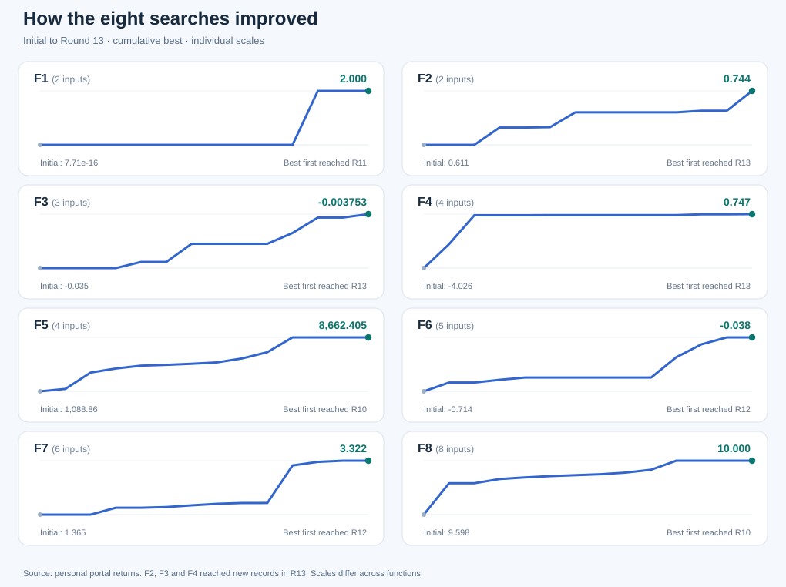
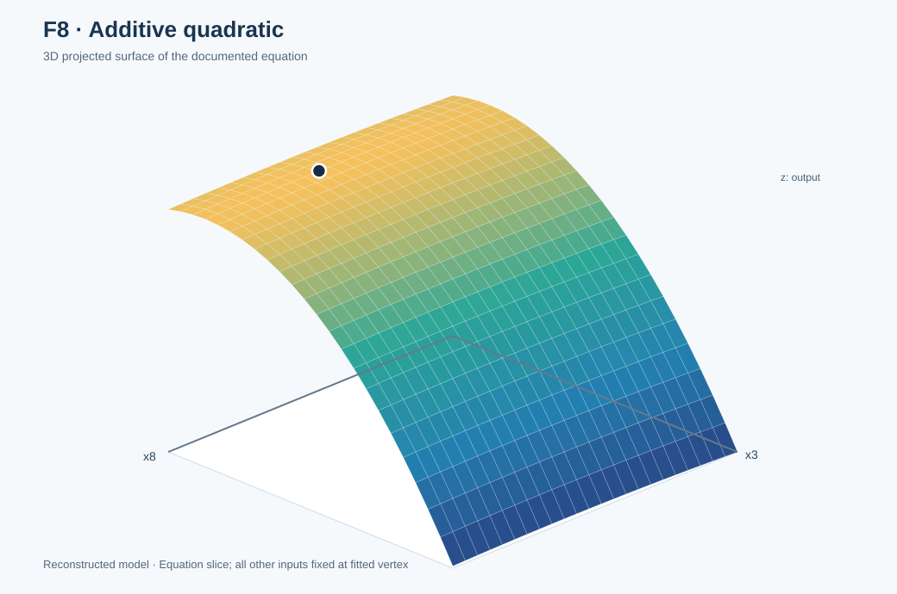
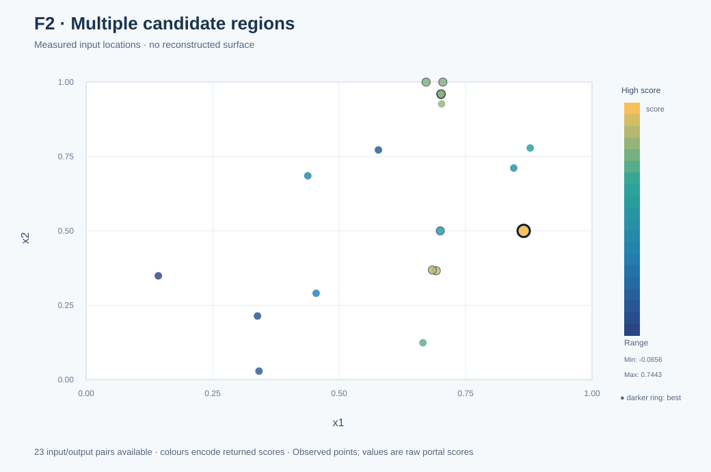

# Black-Box Optimisation: Learning to Make Better Decisions

**Imperial College London · Professional Certificate in Machine Learning and Artificial Intelligence**

[](https://github.com/tatonsyML/bbo-capstone-imperial-college/actions/workflows/core-tests.yml)

**8 hidden functions** · **2–8 input dimensions** · **13 completed rounds** · **279 recorded evaluations**

> **The question:** With only one evaluation per function per round, how do you decide which experiment is worth running next?

This project documents an evidence-led black-box optimisation capstone. I started with Gaussian-process-based Bayesian optimisation, tested alternative models and acquisition rules, and eventually used mathematical reconstruction where the observations supported it. The central result is not a single winning algorithm: **predicting a point accurately, searching the right region and understanding the underlying structure are different achievements.**

**Final evidence status (9 November 2026):** 175 course-provided initial observations plus 104 returned personal evaluations (13 rounds × eight functions) = **279 records**, including repeats. All eight final outputs have been verified.

## Choose your reading route

| If you want to… | Start here |
|---|---|
| Understand the project in two minutes | [Plain-English introduction](#the-challenge-in-plain-english) and [results](#results-at-a-glance) |
| Explore all eight 2D/3D visualisations | **[Visual gallery: known versus uncertain](docs/visual_gallery.md)** |
| Find the best input for a function | [Function-by-function guide](docs/function_guide.md) |
| Understand what changed across rounds | [Project journey](docs/project_journey.md) |
| Examine the strongest evidence | [Round 13 evidence](docs/round13_evidence.md) · [Validation and strategy](docs/strategy_and_validation.md) · [Reconstructed functions](docs/structural_reconstruction.md) |
| Understand the code, HEBO and TuRBO | **[Optimisation algorithms and code guide](docs/optimisation_algorithms.md)** |
| Run the checked mathematical experiment | [Reproduction guide](docs/reproduce.md) |
| Review assessed work and historical material | [Assessment archive](submissions/README.md) |
| Check data origin, bias or limitations | [Data guide](data/README.md) · [Provenance](docs/evidence_provenance.md) |

## The challenge in plain English

Imagine eight sealed machines, each with between two and eight controls. You choose a setting, submit it and receive one score. You cannot inspect the hidden mechanism or calculate its gradient. You have **one new query for each machine per round**, so wasting an evaluation matters.

I used **Gaussian processes (GPs)** to predict results and uncertainty from the observations available at each stage. **Expected Improvement (EI)** and **Upper Confidence Bound (UCB)** helped suggest where to explore or refine. I compared those proposals with local experiments, model challengers and eventually equations reconstructed from the measured behaviour. Not every method worked on every function.

For readers new to Bayesian optimisation: the model proposes where to experiment; the portal returns the real score; the next decision should depend on how well the model's expectations survived that test.

## Results at a glance



The diagram tracks the **best observed score so far** from the initial data to Round 13. **Each tile has a separate vertical scale**: it shows *progress*, not a valid numerical comparison between functions.

| Function | Inputs | Initial best | Final best through R13 | First attained | Evidence |
|:--|--:|--:|--:|:--:|:--|
| [F1](docs/function_guide.md#f1--finding-a-narrow-signal) | 2 | 7.71 × 10⁻¹⁶ | **1.999999999676** | R11 | Portal |
| [F2](docs/function_guide.md#f2--an-unreliable-local-forecast) | 2 | 0.611205 | **0.744250** | R13 | Portal |
| [F3](docs/function_guide.md#f3--improving-a-negative-valued-objective) | 3 | −0.034835 | **−0.003753** | R13 | Portal |
| [F4](docs/function_guide.md#f4--accurate-prediction-poor-search) | 4 | −4.025542 | **0.746898** | R13 | Portal |
| [F5](docs/function_guide.md#f5--the-feasible-boundary) | 4 | 1,088.860 | **8,662.405** | R10 | Portal |
| [F6](docs/function_guide.md#f6--challenging-unstable-local-models) | 5 | −0.714265 | **−0.037519** | R12 | Portal |
| [F7](docs/function_guide.md#f7--a-structural-forecast-confirmed) | 6 | 1.364968 | **3.322368** | R12 | Portal |
| [F8](docs/function_guide.md#f8--the-17-coefficient-quadratic) | 8 | 9.598482 | **10.000000** | R10 | Portal |

The final round established **three additional personal bests**: F2, F3 and F4. The other five were first achieved in R10–R12. These are best-so-far observations, not one-round scores. Their scales differ and must not be added or averaged.

[Final bests and inputs (CSV)](reports/current_best_after_week13.csv) · [Round 13 portal returns](data/portal_rounds_13.csv) · [Final-round evidence](docs/round13_evidence.md)

## Visualise the eight functions

The **[2D and 3D gallery](docs/visual_gallery.md)** includes reconstructed mathematical slices for F5, F7 and F8, and actual observation-only plots for F1, F2, F3, F4 and F6. Each function has a plain-English explanation of its characteristics and the remaining uncertainty.

<table><tr>
<td width="50%"><a href="docs/visual_gallery.md#f8-a-testable-additive-quadratic"></a><p><strong>F8:</strong> documented model slice</p></td>
<td width="50%"><a href="docs/visual_gallery.md#f2-a-different-region-succeeds"></a><p><strong>F2:</strong> measured observations only</p></td>
</tr></table>

[Explore all eight functions](docs/visual_gallery.md) · [Rebuild the graphics](scripts/build_visual_gallery.mjs)

## Three discoveries worth reading

**Final-round update:** F2 **0.695337 → 0.744250**; F3 **−0.005709 → −0.003753**; F4 **0.730459 → 0.746898**. [Read the R13 result audit](docs/round13_evidence.md).

**1. A failed forecast does not prove convergence (F2).** A prediction of **0.730502** returned **0.505526**, but a different R13 region subsequently returned **0.744250**. Model trust and search coverage must be checked separately.

**2. An accurate forecast can still lead to the wrong decision (F4).** A local prediction missed by only about **1.6 × 10⁻⁹**, yet microscopic steps kept the search near **0.659**. A wider R11 move returned **0.730459**, followed by another improvement to **0.746898** in R13.

**3. The simplest suitable model can outperform further search (F8).** A fitted **17-coefficient additive quadratic** identified an interior vertex with value **10**. A *separate retrospective check* fitted that model to **only 40 starting observations** and predicted the next **13 personal portal returns** to numerical precision. The fit from only the starting data was performed *after* the optimisation, not during Round 1.

[Read the complete case studies](docs/function_guide.md) · [Read the evidence and chronology](docs/round12_evidence.md)

## Methods, in one view

| Approach | Role in this project | Lesson |
|---|---|---|
| GP with RBF/Matérn kernels and ARD | Baseline predictions, uncertainty and local comparisons | Validate unseen predictions, not just training fit |
| EI, UCB and local probes | Query selection and exploration–exploitation choices | Search width matters as much as acquisition settings |
| Small neural-network and polynomial challengers | Test whether the GP representation remains suitable | More complex is not always better |
| HEBO-inspired committees and TuRBO-style trust regions | Original lightweight challenger mechanisms | **Not full official algorithms; see separate post-capstone benchmark** |
| Structural reconstruction on F1/F5/F7/F8 | Explain observed patterns and propose justified test points | Distinguish prospective successes from retrospective explanations |

[Algorithm and source-code guide](docs/optimisation_algorithms.md) · [Approach and validation](docs/strategy_and_validation.md) · [Mathematical evidence](docs/structural_reconstruction.md) · [Decision record](docs/decision_log.md)

## Source code and algorithm comparison

For the instructor, start with the **[annotated optimisation code guide](docs/optimisation_algorithms.md)**. It explains the original GP/EI/UCB pipeline, the **HEBO-inspired versus official HEBO** distinction, the original **TuRBO-style versus full TuRBO-1** distinction, and why a fair comparison is not the same as claiming a better portal score.

The [post-capstone HEBO and TuRBO-1 benchmark](benchmarks/full_optimisers/README.md) provides commented source and tests for an **equal-budget simulation on the F8 reconstructed quadratic**. The full optional engines have not been executed in this runtime, so no simulated comparison scores are claimed.

[Historical source](src/bbo/README.md) · [Reference comparison source](benchmarks/full_optimisers/benchmark.py) · [Reproduction guide](docs/reproduce.md)

## Reproduce the strongest reproducible result

The checked experiment fits the F8 quadratic using **40 initial observations only**, tests its predictions against **13 later portal returns**, and verifies the F5 permitted-corner value.

```bash
python -m pip install -r requirements.txt
PYTHONPATH=src python -m bbo.structural_validation
PYTHONPATH=src python -m pytest -q
```

Run these commands from the repository root in a Unix-like shell. See [reproduction and scope](docs/reproduce.md) for the expected output, other platforms and the distinction between executable tests and archived exploratory work.

## Where everything lives

```text
assets/        Data-derived progress visual
configs/       Historical optimisation settings
data/          Initial-data descriptions and observed query histories
docs/          Reading guide, methods, evidence, model card and datasheet
experiments/   Dated query/return records for rounds 1–13
notebooks/     Exploratory analysis; some notebooks are historical snapshots
reports/       Verified results, scientific 2D/3D plots and forecast audits
scripts/       Reproduce the scientific visual gallery
src/bbo/       Commented historical GP/acquisition code and structural validation
benchmarks/    Post-capstone full HEBO / BoTorch TuRBO-1 comparison (not run)
submissions/   Archived Stage 1 and Stage 2 assessment material
tests/         Automated checks
```

[Full documentation index](docs/README.md) · [Visual gallery](docs/visual_gallery.md) · [Reports index](reports/README.md) · [Assessment archive](submissions/README.md)

## Limitations and responsible interpretation

- **Not every equation is solved.** F1, F5, F7 and F8 have supported reconstructed forms, with different evidence strengths; F2, F3, F4 and F6 remain unresolved.
- **Source matters.** Course-supplied starting observations, personal portal returns, prospective predictions, retrospective analysis and external published observations are not interchangeable. External results informed some choices but do not count as my personal evaluations.
- **History is not overwritten.** Early model cards, submissions and notebooks are dated snapshots and can contain statements that were correct when written but are superseded by later returns.
- **Known gaps are visible.** The exact Round 11 F7 input is missing from the retained log. Round 13 outcomes are verified. The GP pipeline demonstration uses an earlier data cut, not the complete 13-round history.

[Data provenance](docs/evidence_provenance.md) · [Evidence limitations](docs/round12_evidence.md) · [Reproduction scope](docs/reproduce.md)

---

*Project focus: learn how to select, validate and explain the next expensive experiment, not only how to maximise a score.*
