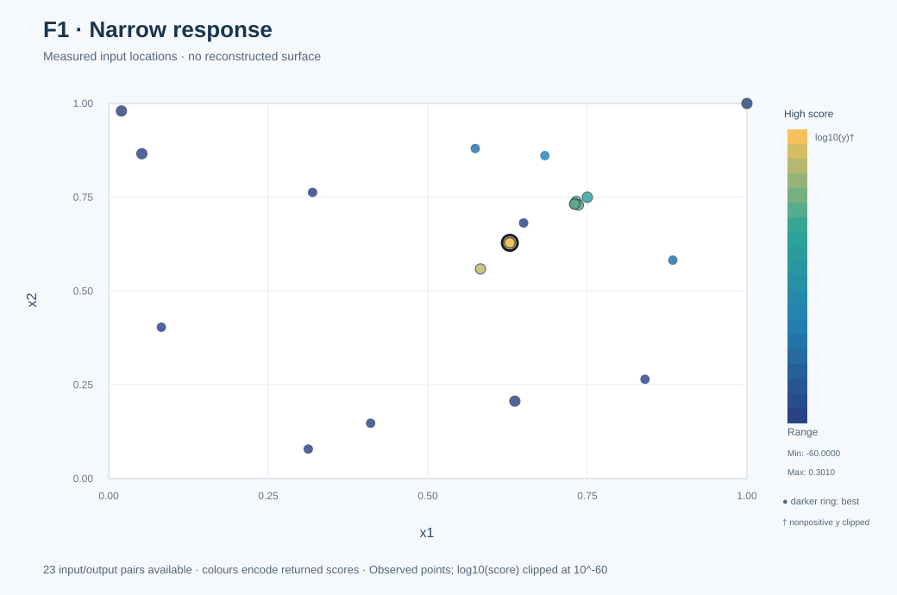
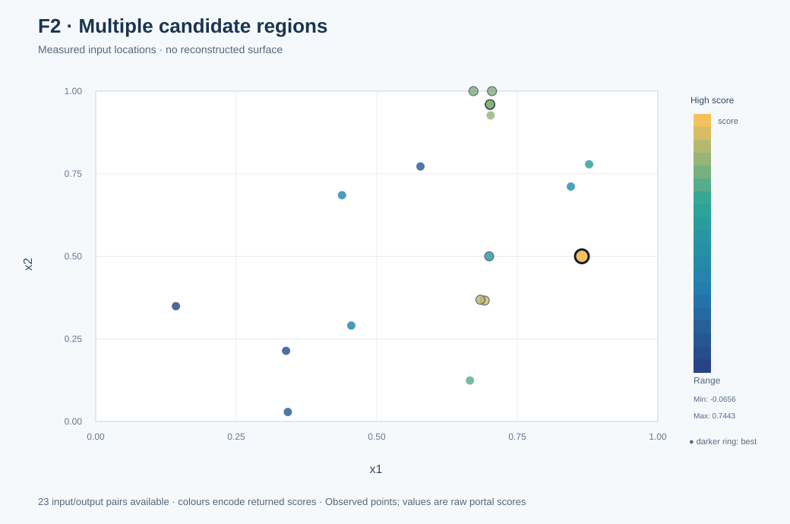
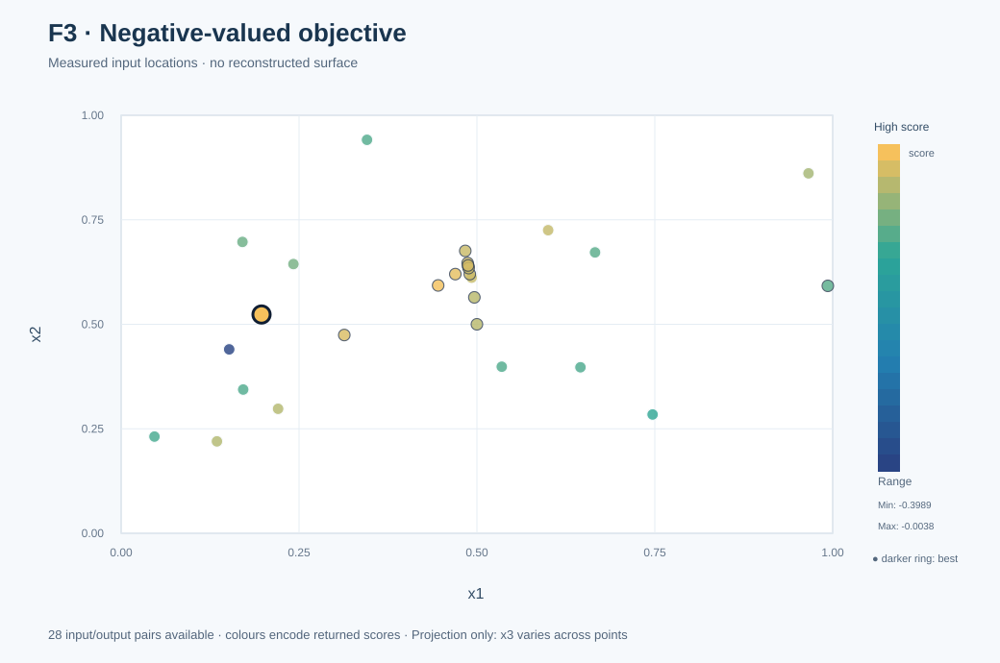
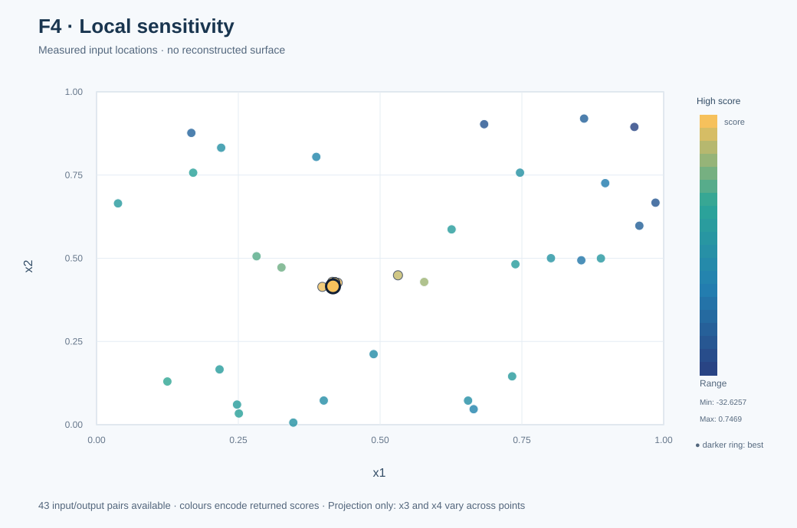
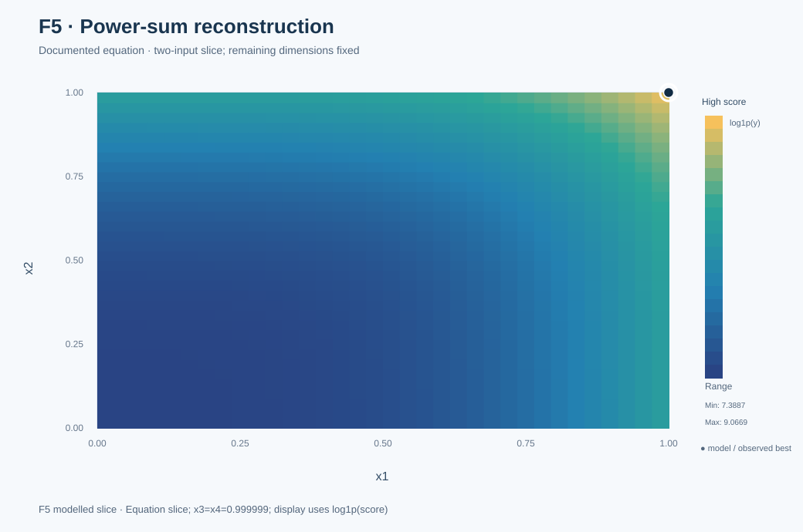
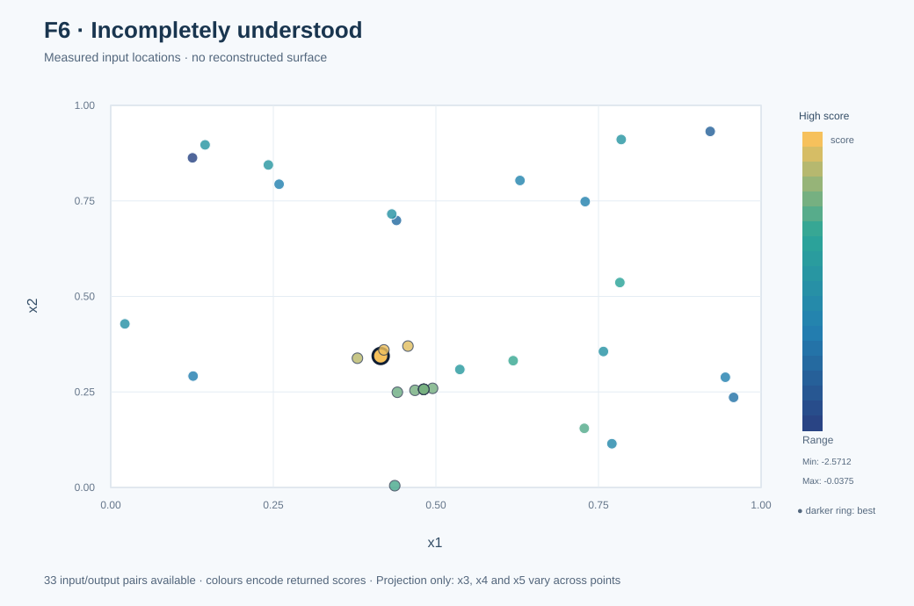
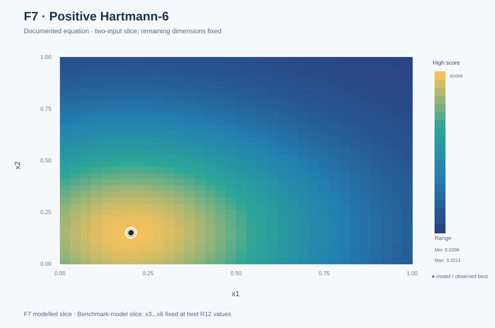
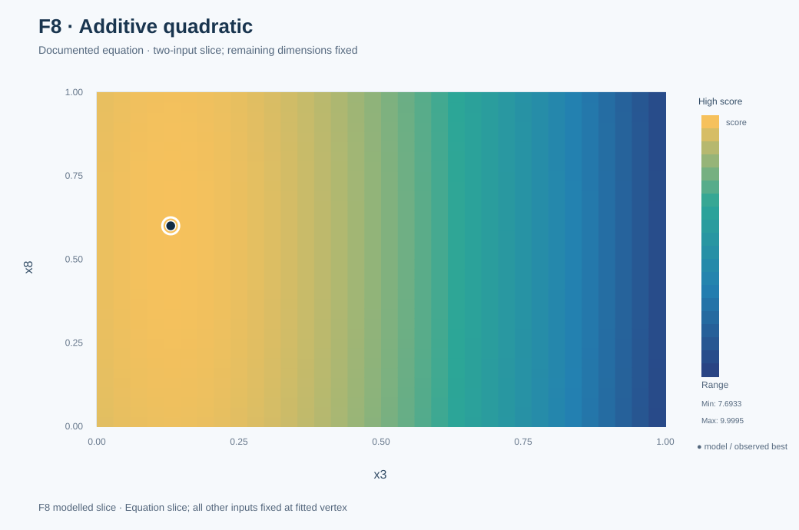

# Eight functions | Observations, models and what remains unknown

[Project homepage](../README.md) · [Development journey](../journey/README.md) · [Reproducible notebook](../notebooks/Capstone_Final_Walkthrough.ipynb) · [Methods](methods.md)

This is the **single function-by-function guide** for the final 13-round capstone. **Measured points are not interpolated into fictional equations.** Mathematical reconstructions for F5, F7 and F8 are supported by numerical checks but are not authenticated copies of the hidden source code. F1 has a strong observed peak without complete retained public parameters. F2/F3/F4/F6 remain unresolved.

## Evidence and chart interpretation

| Function group | What is plotted | Limitation |
|---|---|---|
| **F1, F2, F3, F4, F6** | Observed input/output points only | 2D/3D projections omit other input coordinates, which may vary between observations |
| **F5, F7, F8** | Fixed-coordinate slices of a documented fitted equation | Slices do not show the entire high-dimensional function |

The dataset has **279 returned or supplied scores** but only **278 known input vectors**. F7's Round 11 return is known, but its input was not retained. The F1 display uses a clipped log10 scale; F5's model uses log1p(score), with labels on the published figures.

| Function | Best verified | First achieved | Central problem | Visuals |
|---|---:|---:|---|---|
| F1 | 1.999999999676 | R11 | Near-zero signal hid sharp structure | [2D](../results/figures/f1_2d.svg) · [3D](../results/figures/f1_3d.svg) |
| F2 | **0.744250** | **R13** | Local forecasts could fail severely | [2D](../results/figures/f2_2d.svg) · [3D](../results/figures/f2_3d.svg) |
| F3 | **−0.003753** | **R13** | Negative-valued response and difficult search | [2D](../results/figures/f3_2d.svg) · [3D](../results/figures/f3_3d.svg) |
| F4 | **0.746898** | **R13** | Accurate local prediction did not imply adequate search | [2D](../results/figures/f4_2d.svg) · [3D](../results/figures/f4_3d.svg) |
| F5 | 8,662.405 | R10 | Feasible boundary was more productive than local interior | [2D](../results/figures/f5_2d.svg) · [3D](../results/figures/f5_3d.svg) |
| F6 | −0.037519 | R12 | Weak models required fresh candidate regions | [2D](../results/figures/f6_2d.svg) · [3D](../results/figures/f6_3d.svg) |
| F7 | 3.322368 | R12 | Structural, prospective prediction succeeded | [2D](../results/figures/f7_2d.svg) · [3D](../results/figures/f7_3d.svg) |
| F8 | 10.000000 | R10 | Simple quadratic explained an 8D objective | [2D](../results/figures/f8_2d.svg) · [3D](../results/figures/f8_3d.svg) |

## F1

**Best observed:** `1.9999999996761817` in R11 at `0.628540-0.628540`.

The GP initially saw almost no useful differences among near-zero outputs. A later reconstruction of Gaussian-modulated oscillatory responses helped identify a much stronger region. This mathematical reconstruction used supplementary information and is **not claimed to be inferred from personal queries alone**.

**Lesson:** reconsider the target scale and representation before spending further queries rescuing a poor fit.

### Visual evidence

[](../results/figures/f1_2d.svg)

[2D figure](../results/figures/f1_2d.svg) · [3D figure](../results/figures/f1_3d.svg). **What we know:** The two-input function returns near-zero scores over much of the tested domain, while the Round 11 point (0.628540, 0.628540) returned 1.9999999996761817. The documented Gaussian-modulated oscillatory explanation was informed by supplementary evidence.

**What remains uncertain:** There is no complete parameterised F1 equation in the public repository. The measured-point maps use a clipped log10 scale and do not invent a continuous response surface.

**Decision lesson:** An almost-flat-looking response can hide useful structure.

### Supported mathematical reconstruction (retrospective where indicated)

A numerically validated oscillatory response with two narrow, Gaussian-modulated peaks guided a Round 11 query to (0.628540, 0.628540), returning **1.9999999996761817**. This wider reconstruction used supplementary published information or recognised benchmark patterns. It is not claimed as independently inferred from personal portal queries alone.

## F2

**Best observed:** `0.7442504263021256` in R13 at `0.864900-0.500000`.

A recorded forecast of `0.730502` returned only `0.505526`. This is a serious observed error at that location, but insufficient alone to diagnose the noise process. R13's different input region improved the earlier incumbent of `0.6953368270741286`.

**Lesson:** check forecasts against later returns; model authority depends on predictive performance.

### Visual evidence

[](../results/figures/f2_2d.svg)

[2D figure](../results/figures/f2_2d.svg) · [3D figure](../results/figures/f2_3d.svg). **What we know:** The Round 13 input (0.864900, 0.500000) beat the R12 best of 0.6953368270741286. Both input dimensions are visible in the scatter map, which shows measured scores without interpolation.

**What remains uncertain:** A prior local forecast of 0.730502 returned 0.505526. This does not establish a particular noise law, smoothness assumption, global shape or optimum.

**Decision lesson:** An apparent plateau does not prove global convergence.

## F3

**Best observed:** `-0.0037530969187192596` in R13 at `0.197280-0.523429-0.470094`.

Several early search attempts underperformed. External published observations were considered separately from personal data when investigating alternative regions. The final score improved on R11's `-0.005709220275560069`. No exact F3 equation has been verified.

**Lesson:** a model's plausible extrapolation is not a substitute for returned evidence.

### Visual evidence

[](../results/figures/f3_2d.svg)

[2D figure](../results/figures/f3_2d.svg) · [3D figure](../results/figures/f3_3d.svg). **What we know:** The final-round point (0.197280, 0.523429, 0.470094) improved the previous best −0.005709220275560069. The charts project measured scores onto x1 and x2.

**What remains uncertain:** The third input differs between observations. These are projections, not fixed-x3 slices, and the data do not prove an exact response equation or global ceiling of zero.

**Decision lesson:** A better measured result is valuable even when the global model remains unresolved.

## F4

**Best observed:** `0.7468979113807426` in R13 at `0.416903-0.415704-0.360320-0.415205`.

One local forecast was accurate to approximately `1.6e-9`, but a series of tiny steps achieved only marginal gains around `0.659`. A wider R11 proposal returned `0.7304594213260924`; R13 refined the result to `0.7468979113807426`.

**Lesson:** predictive success at one point does **not** validate the search policy or the neighbourhood it explores.

### Visual evidence

[](../results/figures/f4_2d.svg)

[2D figure](../results/figures/f4_2d.svg) · [3D figure](../results/figures/f4_3d.svg). **What we know:** A GP forecast matched one local return to around 1.6 × 10⁻⁹, but microscopic steps stayed near 0.659. A wider move reached 0.730459 in R11 and a further R13 step returned 0.7468979113807426.

**What remains uncertain:** Two of four inputs are omitted from the x1–x2 plots and vary between points. The scatter does not determine a unique response surface or its curvature.

**Decision lesson:** Good point predictions and a good search policy are separate achievements.

## F5

**Best observed:** `8662.405001248297` in R10 at four coordinates of `0.999999`.

A controlled probe increasing one coordinate improved the return from about `4295.87` to `4694.32`. Later, the permitted upper corner was tested and produced a major gain. The interacting power-sum equation was reconstructed **after** that successful query.

At `(1,1,1,1)` the reconstructed equation predicts `8662.4825`, but the effective permitted portal upper bound is `0.999999`, yielding `8662.405001248297`.

**Lesson:** evaluate promising legal boundaries, and distinguish retrospective explanation from prospective query selection.

### Visual evidence

[](../results/figures/f5_2d.svg)

[2D figure](../results/figures/f5_2d.svg) · [3D figure](../results/figures/f5_3d.svg). **What we know:** The plotted equation holds x3 = x4 = 0.999999 while x1 and x2 vary over the permitted domain. Its boundary value 8662.405001248297 matches the R10 portal return. Squared power sums couple coordinates and produce a steep boundary response.

**What remains uncertain:** The mathematical reconstruction was obtained after the successful boundary query. The charts use log1p(score) to reveal shape. The exact corner (1,1,1,1), predicted to return 8662.4825, lies outside the permitted submitted coordinates.

**Decision lesson:** The boundary and variable interactions matter, but this is retrospective explanation rather than a claim of having known the equation earlier.

### Supported mathematical reconstruction (retrospective where indicated)

f5(x) = 0.01 × Σ[k=1..4] (Σ[j=1..4] (4 × x[j])^k - b[k])²,

where b = (7.5, 16, 40, 120). Squared power sums introduce interactions between coordinates. At the *permitted* upper corner x=(0.999999,0.999999,0.999999,0.999999), the equation produces **8662.405001248297**, matching the returned portal result. The complete equation was reconstructed **after** the successful boundary query using additional published observations; it explained, but did not generate, that choice.

## F6

**Best observed:** `-0.03751864724436928` in R12 at `0.415080-0.344119-0.644062-0.776818-0.076258`.

Earlier local forecasts and proposals were weak. An externally informed supplementary GP comparison contributed to a revised R10 candidate; subsequent local work improved the return in R11 and R12. F6's underlying equation remains unverified.

**Final check:** R13's `-0.07698028695699928` fell below the R12 best `-0.03751864724436928`.

**Lesson:** let sustained failure trigger alternative regions or models, without inventing a solved structure.

### Visual evidence

[](../results/figures/f6_2d.svg)

[2D figure](../results/figures/f6_2d.svg) · [3D figure](../results/figures/f6_3d.svg). **What we know:** The best result remains −0.03751864724436928 from R12. The R13 input returned −0.07698028695699928 and did not improve it. The two charts display measured x1 and x2 coordinates and observed outputs.

**What remains uncertain:** x3, x4 and x5 differ between observations, so the displays are projections, not slices or GP-estimated surfaces. The hidden noise and interaction structure is unverified.

**Decision lesson:** A failed final experiment still belongs in an auditable search history.

## F7

**Best observed:** `3.3223680113931557` in R12 at `0.201689-0.150011-0.476874-0.275332-0.311652-0.657301`.

The best after R9 was `1.786338`. A revised R10 candidate returned `3.149459`; the R11 result was `3.27896792623`; and the R12 portal result matched a **pre-recorded positive Hartmann-6 prediction** of `3.32236801`.

**Known gap:** the exact R11 F7 input coordinate was not preserved in the retained source. This does not invalidate the output, but prevents precise reproduction of that query.

**Final check:** R13 shifted x1 from `0.201689` to `0.201690`, returning `3.322368011392718`, approximately `4.38 × 10⁻¹³` below the R12 value.

**Lesson:** a prospective structural forecast provides stronger evidence than post-hoc fitting.

### Visual evidence

[](../results/figures/f7_2d.svg)

[2D figure](../results/figures/f7_2d.svg) · [3D figure](../results/figures/f7_3d.svg). **What we know:** The standard positive Hartmann-6 expression exactly reproduces the R12 and R13 returns at their documented inputs. The figure varies x1 and x2 while x3–x6 are fixed at (0.476874, 0.275332, 0.311652, 0.657301). A structural forecast preceded the R12 return.

**What remains uncertain:** The [Hartmann-6 benchmark reference](https://www.sfu.ca/~ssurjano/hart6.html) defines the usual minimisation function; the plotted expression uses the corresponding **positive** value for this maximisation challenge. Agreement at tested inputs does not authenticate the hidden source everywhere. The two-dimensional slice does not show all six-dimensional basins. The missing R11 F7 input has not been invented or plotted.

**Decision lesson:** A pre-result structural forecast is stronger evidence than a retrospective match alone.

### Supported mathematical reconstruction (retrospective where indicated)

The [Hartmann-6 benchmark reference](https://www.sfu.ca/~ssurjano/hart6.html) describes the conventional minimisation form; the reconstructed response uses its sign-reversed positive maximisation form. Its benchmark coefficients are documented in the [reproducible figure script](../results/figures/build_visual_gallery.mjs).

The function agrees numerically with the positive Hartmann-6 benchmark in the tested observations. The Round 12 structural candidate predicted **3.32236801 before evaluation**; the portal returned **3.3223680113931557**. The R13 query shifted x1 by 0.000001 and returned 3.322368011392718, approximately 4.38 × 10⁻¹³ below the R12 result. This is supported prediction and numerical agreement, not proof of identity everywhere.

## F8

**Best observed:** `10` in R10 at `0.100000-0.150000-0.130000-0.150000-0.800000-0.500000-0.200000-0.600000`.

An additive quadratic with eight linear, eight squared and one constant coefficient fitted the response and identified this vertex. Five publicly shared outputs supported the model before the R10 query; they were not counted as personal queries.

**Retrospective check:** fitted to only the original **40 observations**, the same model structure predicted **13 later returned scores** to floating-point precision. This analysis was performed later, not in R1. A two-component PCA captured **48.8% of the input variance** but did not preserve the modelled optimum.

**Lesson:** when a simple interpretable model predicts unseen observations, it may be more useful than further acquisition tuning.

---

### Visual evidence

[](../results/figures/f8_2d.svg)

[2D figure](../results/figures/f8_2d.svg) · [3D figure](../results/figures/f8_3d.svg). **What we know:** The 17-coefficient additive quadratic fitted to the original 40 supplied observations predicts 13 later personal portal returns to numerical precision. The slice varies x3 and x8, holding the other inputs at the fitted vertex. Its maximum is 10.

**What remains uncertain:** The initial-40-only model recovery was performed retrospectively. The figures explain the fitted equation, not the original undisclosed source code. The curvature weight of x3 is 30 times that of x8.

**Decision lesson:** Try simple, interpretable challengers early when out-of-sample evidence justifies them.

### Supported mathematical reconstruction (retrospective where indicated)

f8(x) = 10 - Σ[j=1..8] w[j] (x[j] - c[j])²

**c** = (0.10, 0.15, 0.13, 0.15, 0.80, 0.50, 0.20, 0.60)

**w** = (2, 1, 3, 1, 0.5, 1, 2, 0.1)

An additive eight-variable quadratic has 17 linear regression coefficients: a constant, eight linear terms and eight squared terms. Since all weights are positive, the fitted equation's unique maximum on the legal domain is **10** at c.

**Chronology:** A model was fitted using accumulated personal records and corroborated with five public external input-output records before submitting the predicted vertex in Round 10; the portal confirmed 10. *Retrospectively*, refitting the same structure on only the **original 40 course observations** predicted the 13 later personal returns with maximum absolute prediction error **below 2 × 10⁻¹⁴** across 13 later returns (floating-point rounding may vary by environment). This did not happen before Round 1.

**Reproduce:** run PYTHONPATH=src python -m bbo.structural_validation with the [53-row evidence file](../data/accumulated/function_8/observations_through_week13.csv). The code fits with the initial records only and reports held-out residuals.

## Remaining limitations and reproducibility

## Unresolved objectives and reproducibility scope

F2 and F3 have unstable regions and unverified structural alternatives; F4 remains model-disagreement-sensitive; F6 has imperfect approximate fits. None is labelled mathematically solved.

**Executable in this repository:** F8's initial-data-only fit and 13-return check, plus F5's boundary equation check. The historical fitting procedures for F1/F5/F7 are documented findings, not claimed to be wholly reproducible from this newly added script. The types and roles of external research are documented in the [anonymised Round 10 revision audit](../results/round10_revision_audit.md); identifying source references should be retained separately for authorised attribution.

## Visualisation scope

[See the full 2D/3D gallery](functions.md). F5, F7 and F8 are calculated **model slices** with all other coordinates fixed. For F1, the full fitted oscillatory coefficients are not publicly retained: the charts show observed points instead. F2/F3/F4/F6 similarly show only measured evidence, not invented model surfaces. The [figure generator](../results/figures/build_visual_gallery.mjs) includes the standard positive Hartmann-6 numerical coefficients and validates the F7 R12 score.

## Recreate and inspect all sixteen graphics

The full set of [sixteen SVGs](../results/figures/) remains available, including the 3D evidence views. From the repository root:

```bash
node results/figures/build_visual_gallery.mjs
```

The generator reads the versioned CSVs and verifies the reconstructed F5/F7/F8 values. For unresolved functions, it plots **actual observations only**. The 3D views are static projections, not interactive surfaces. [Plot manifest](../results/figures/gallery_manifest.json).
