# Visualising the hidden functions

**Eight functions, 16 reproducible 2D/3D charts, and a clear statement of what is known so far.** This gallery separates *measured observations* from *calculated slices of proposed mathematical models*.

[Project overview](../README.md) · [Full function guide](function_guide.md) · [Source data](../data/README.md) · [Reproduce the figures](reproduce.md#regenerate-the-visual-gallery)

## How to read the plots

| Category | Functions | What the pictures mean |
|---|---|---|
| **Measured observations only** | F1, F2, F3, F4, F6 | 2D locations and 3D point clouds. **No continuous function is estimated** between observations. |
| **Reconstructed model slices** | F5, F7, F8 | 2D heatmaps and projected 3D surfaces computed from documented mathematical expressions. Remaining variables have **specified fixed values**. |

For F1 the historic oscillatory explanation lacks complete public parameters, so the plotted evidence is empirical despite its strong final score. For F3, F4 and F6 the points are projected onto x1 and x2, but the remaining variables **vary**: these are not genuine two-dimensional function slices. F5 plots transform score with log1p; F1 point plots use clipped log10(score). Other displayed values use their native scales.

**Data provenance:** 175 initial course observations + 104 returned personal queries = 279 scored evaluations. **278 measured input/output points** can be positioned: the Round 11 F7 output is known, but its submitted input was not preserved. This point is excluded from coordinate plots, not from the final result count. No unavailable position has been guessed.

## F1: A narrow, nearly invisible response

**Evidence status:** Qualitative reconstruction; plots use observations only. **Best returned score:** 1.9999999996761817.

| 2D observed-point map | 3D measured-point projection |
|---|---|
| [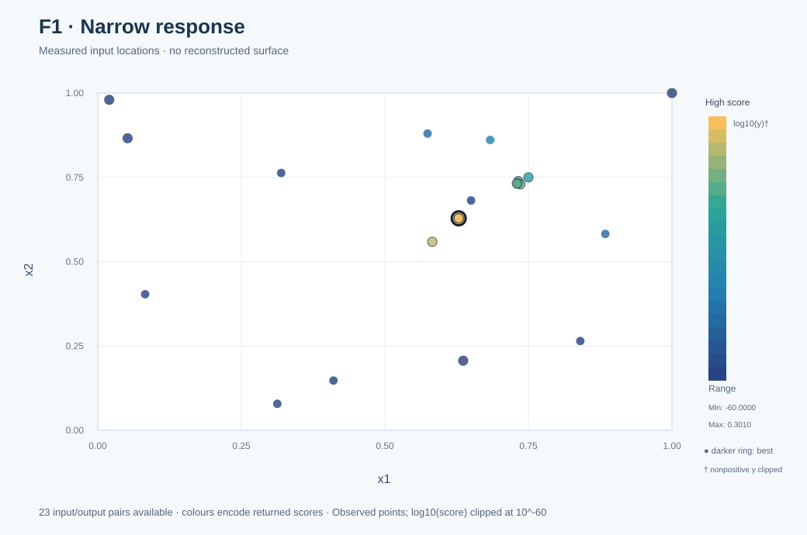](../results/figures/f1_2d.svg) | [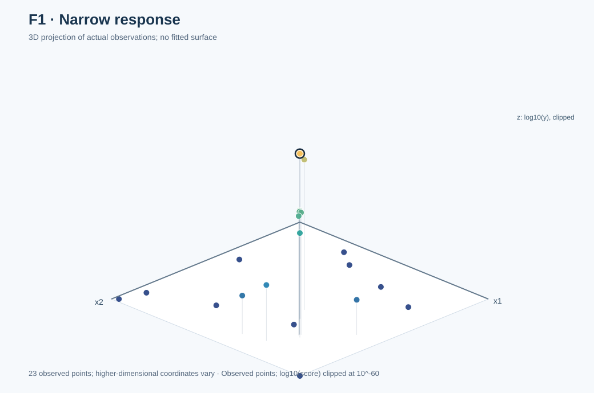](../results/figures/f1_3d.svg) |

**What we know so far.** The two-input function returns near-zero scores over much of the tested domain, while the Round 11 point (0.628540, 0.628540) returned 1.9999999996761817. The documented Gaussian-modulated oscillatory explanation was informed by supplementary evidence.

**What remains uncertain.** There is no complete parameterised F1 equation in the public repository. The measured-point maps use a clipped log10 scale and do not invent a continuous response surface.

**Optimisation lesson.** An almost-flat-looking response can hide useful structure.

[Detailed F1 discussion](function_guide.md#f1--finding-a-narrow-signal) · [2D image](../results/figures/f1_2d.svg) · [3D image](../results/figures/f1_3d.svg)

---

## F2: A different region succeeds

**Evidence status:** Unknown equation; plots use observations only. **Best returned score:** 0.7442504263021256.

| 2D observed-point map | 3D measured-point projection |
|---|---|
| [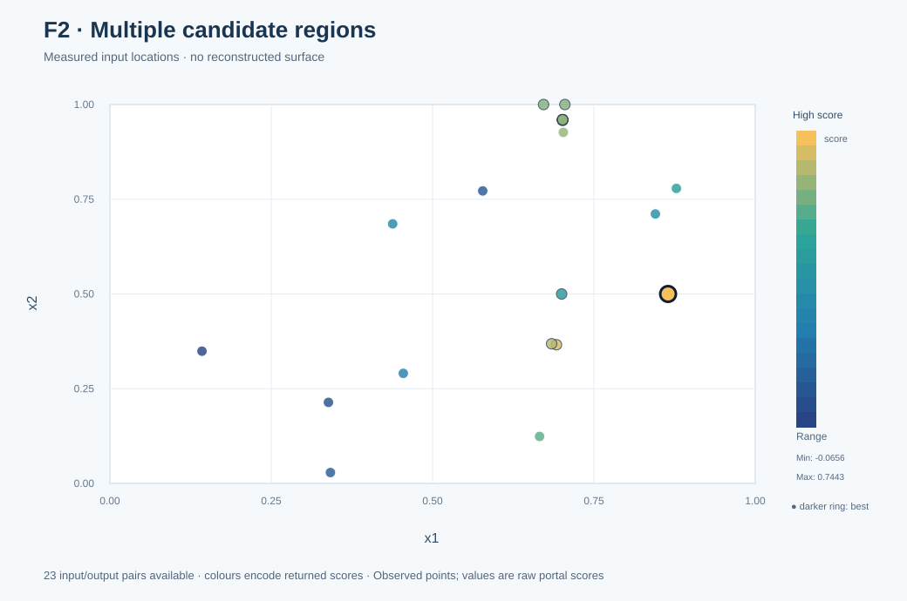](../results/figures/f2_2d.svg) | [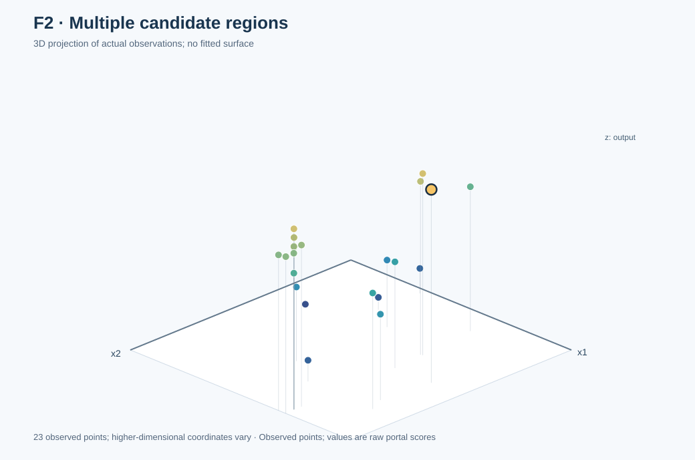](../results/figures/f2_3d.svg) |

**What we know so far.** The Round 13 input (0.864900, 0.500000) beat the R12 best of 0.6953368270741286. Both input dimensions are visible in the scatter map, which shows measured scores without interpolation.

**What remains uncertain.** A prior local forecast of 0.730502 returned 0.505526. This does not establish a particular noise law, smoothness assumption, global shape or optimum.

**Optimisation lesson.** An apparent plateau does not prove global convergence.

[Detailed F2 discussion](function_guide.md#f2--an-unreliable-local-forecast) · [2D image](../results/figures/f2_2d.svg) · [3D image](../results/figures/f2_3d.svg)

---

## F3: Improvement without a recovered equation

**Evidence status:** Unknown equation; plots use observations only. **Best returned score:** −0.0037530969187192596.

| 2D observed-point map | 3D measured-point projection |
|---|---|
| [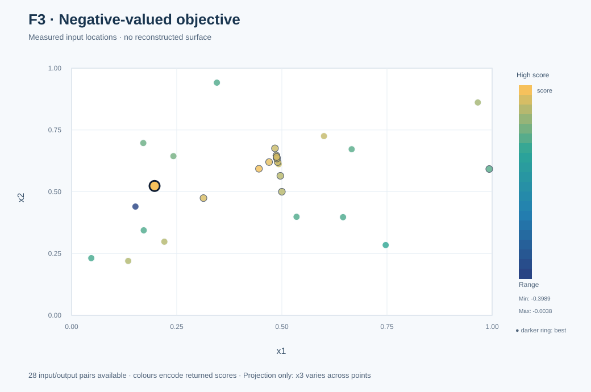](../results/figures/f3_2d.svg) | [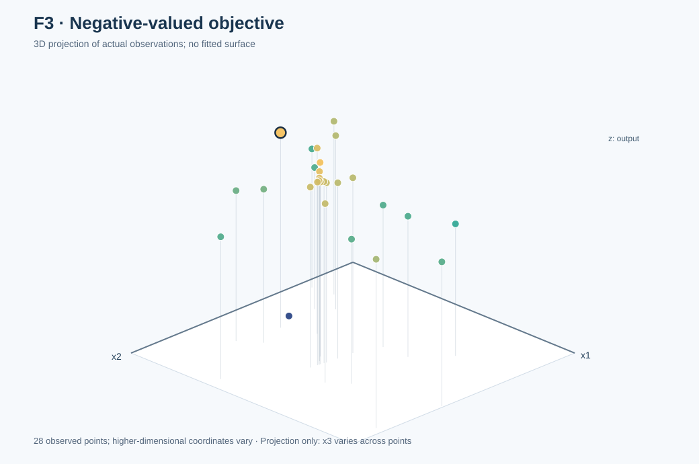](../results/figures/f3_3d.svg) |

**What we know so far.** The final-round point (0.197280, 0.523429, 0.470094) improved the previous best −0.005709220275560069. The charts project measured scores onto x1 and x2.

**What remains uncertain.** The third input differs between observations. These are projections, not fixed-x3 slices, and the data do not prove an exact response equation or global ceiling of zero.

**Optimisation lesson.** A better measured result is valuable even when the global model remains unresolved.

[Detailed F3 discussion](function_guide.md#f3--improving-a-negative-valued-objective) · [2D image](../results/figures/f3_2d.svg) · [3D image](../results/figures/f3_3d.svg)

---

## F4: Accurate local forecasts, incomplete search

**Evidence status:** Unknown equation; plots use observations only. **Best returned score:** 0.7468979113807426.

| 2D observed-point map | 3D measured-point projection |
|---|---|
| [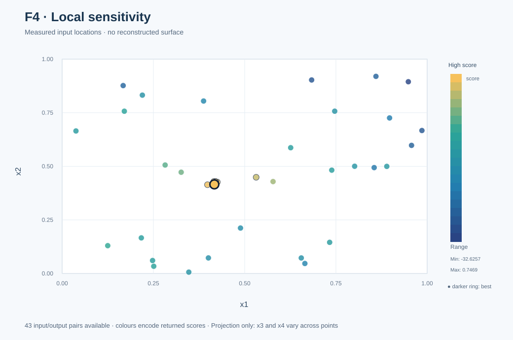](../results/figures/f4_2d.svg) | [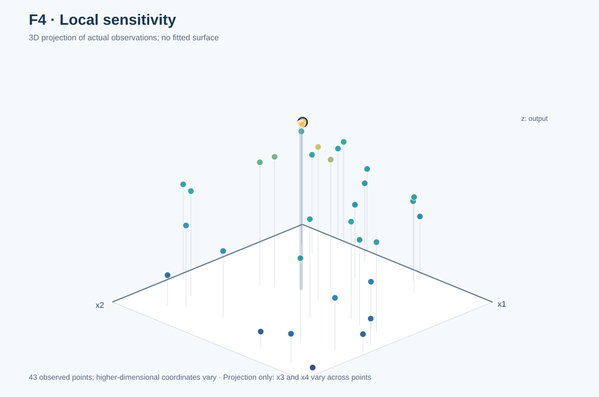](../results/figures/f4_3d.svg) |

**What we know so far.** A GP forecast matched one local return to around 1.6 × 10⁻⁹, but microscopic steps stayed near 0.659. A wider move reached 0.730459 in R11 and a further R13 step returned 0.7468979113807426.

**What remains uncertain.** Two of four inputs are omitted from the x1–x2 plots and vary between points. The scatter does not determine a unique response surface or its curvature.

**Optimisation lesson.** Good point predictions and a good search policy are separate achievements.

[Detailed F4 discussion](function_guide.md#f4--accurate-prediction-poor-search) · [2D image](../results/figures/f4_2d.svg) · [3D image](../results/figures/f4_3d.svg)

---

## F5: Interacting power-sum surface

**Evidence status:** Numerically reconstructed model slice; source not authenticated. **Best returned score:** 8662.405001248297.

| 2D model heatmap | 3D model surface |
|---|---|
| [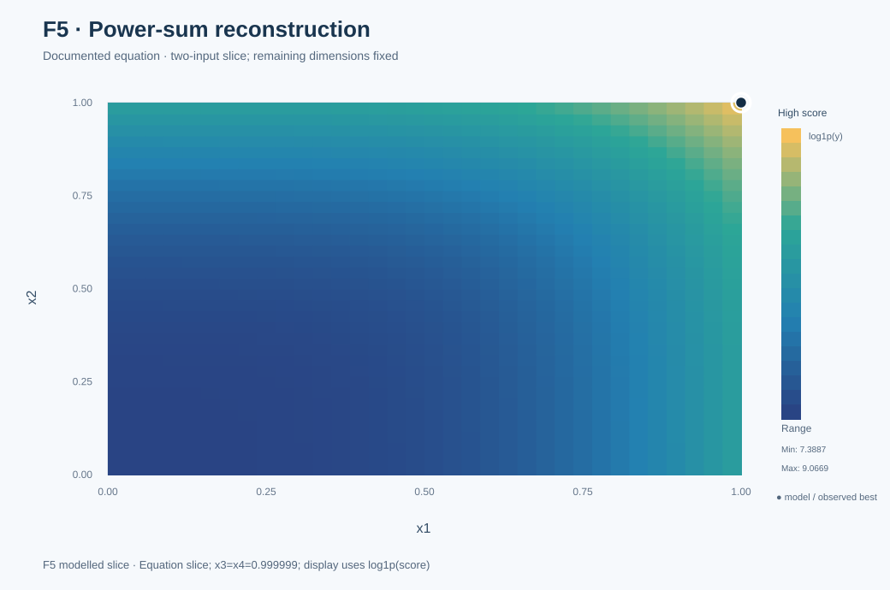](../results/figures/f5_2d.svg) | [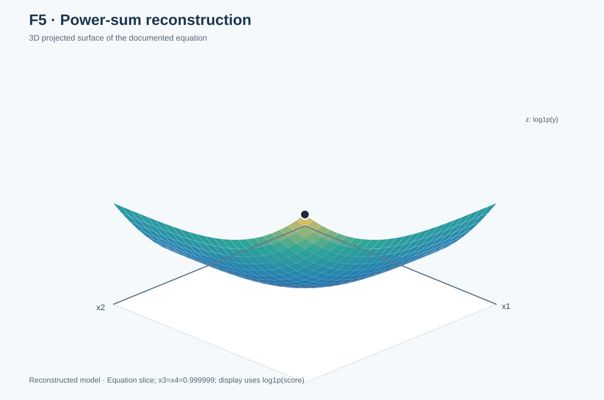](../results/figures/f5_3d.svg) |

**What we know so far.** The plotted equation holds x3 = x4 = 0.999999 while x1 and x2 vary over the permitted domain. Its boundary value 8662.405001248297 matches the R10 portal return. Squared power sums couple coordinates and produce a steep boundary response.

**What remains uncertain.** The mathematical reconstruction was obtained after the successful boundary query. The charts use log1p(score) to reveal shape. The exact corner (1,1,1,1), predicted to return 8662.4825, lies outside the permitted submitted coordinates.

**Optimisation lesson.** The boundary and variable interactions matter, but this is retrospective explanation rather than a claim of having known the equation earlier.

[Detailed F5 discussion](function_guide.md#f5--the-feasible-boundary) · [2D image](../results/figures/f5_2d.svg) · [3D image](../results/figures/f5_3d.svg)

---

## F6: An unresolved five-input response

**Evidence status:** Unknown equation; plots use observations only. **Best returned score:** −0.03751864724436928.

| 2D observed-point map | 3D measured-point projection |
|---|---|
| [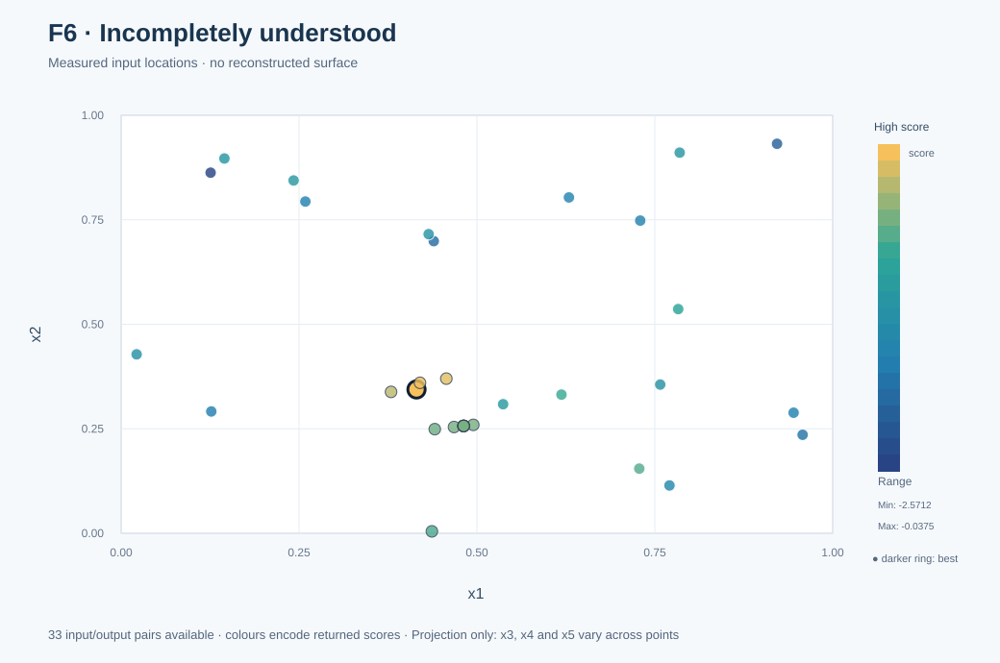](../results/figures/f6_2d.svg) | [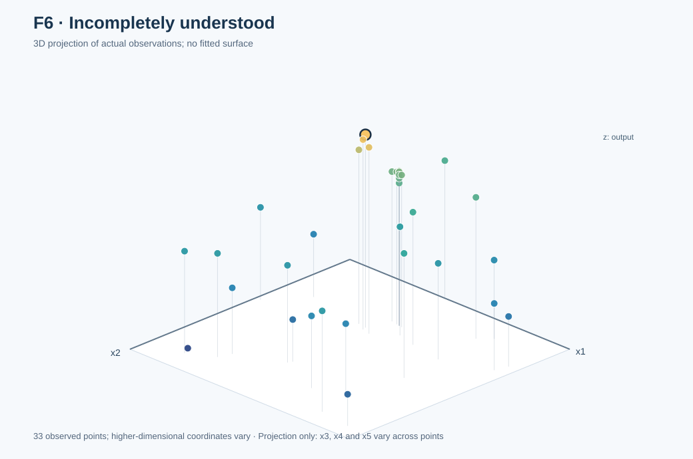](../results/figures/f6_3d.svg) |

**What we know so far.** The best result remains −0.03751864724436928 from R12. The R13 input returned −0.07698028695699928 and did not improve it. The two charts display measured x1 and x2 coordinates and observed outputs.

**What remains uncertain.** x3, x4 and x5 differ between observations, so the displays are projections, not slices or GP-estimated surfaces. The hidden noise and interaction structure is unverified.

**Optimisation lesson.** A failed final experiment still belongs in an auditable search history.

[Detailed F6 discussion](function_guide.md#f6--challenging-unstable-local-models) · [2D image](../results/figures/f6_2d.svg) · [3D image](../results/figures/f6_3d.svg)

---

## F7: Positive Hartmann-6 agreement

**Evidence status:** Numerically supported benchmark slice; source not authenticated. **Best returned score:** 3.3223680113931557.

| 2D model heatmap | 3D model surface |
|---|---|
| [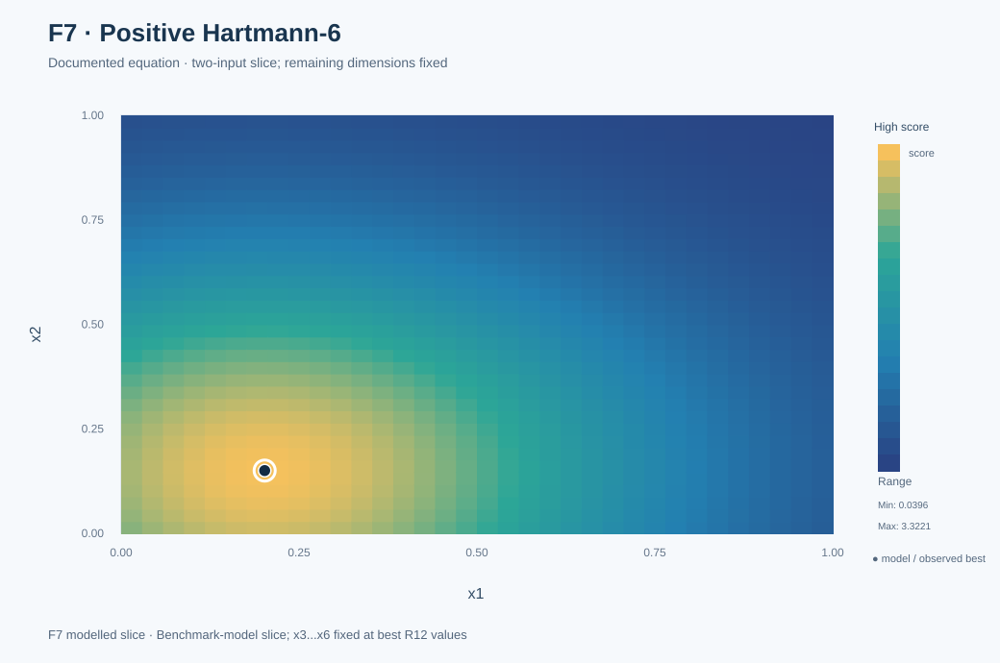](../results/figures/f7_2d.svg) | [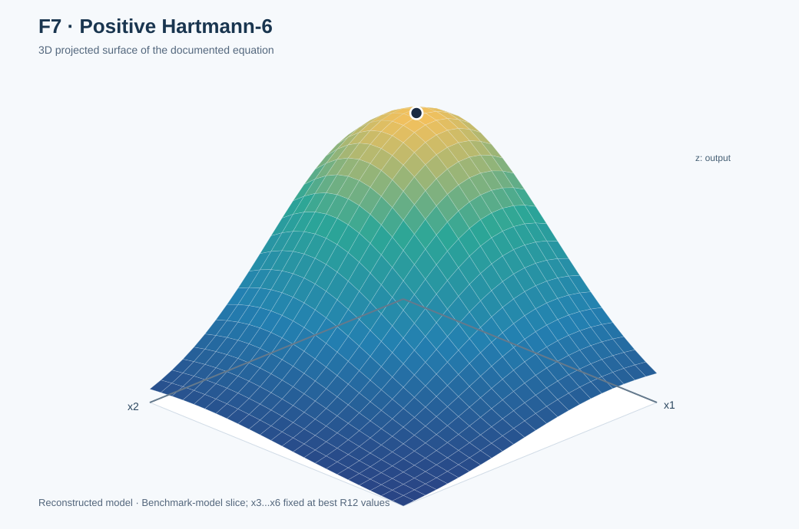](../results/figures/f7_3d.svg) |

**What we know so far.** The standard positive Hartmann-6 expression exactly reproduces the R12 and R13 returns at their documented inputs. The figure varies x1 and x2 while x3–x6 are fixed at (0.476874, 0.275332, 0.311652, 0.657301). A structural forecast preceded the R12 return.

**What remains uncertain.** The [Hartmann-6 benchmark reference](https://www.sfu.ca/~ssurjano/hart6.html) defines the usual minimisation function; the plotted expression uses the corresponding **positive** value for this maximisation challenge. Agreement at tested inputs does not authenticate the hidden source everywhere. The two-dimensional slice does not show all six-dimensional basins. The missing R11 F7 input has not been invented or plotted.

**Optimisation lesson.** A pre-result structural forecast is stronger evidence than a retrospective match alone.

[Detailed F7 discussion](function_guide.md#f7--a-structural-forecast-confirmed) · [2D image](../results/figures/f7_2d.svg) · [3D image](../results/figures/f7_3d.svg)

---

## F8: A testable additive quadratic

**Evidence status:** High-confidence validated mathematical slice; source not authenticated. **Best returned score:** 10.

| 2D model heatmap | 3D model surface |
|---|---|
| [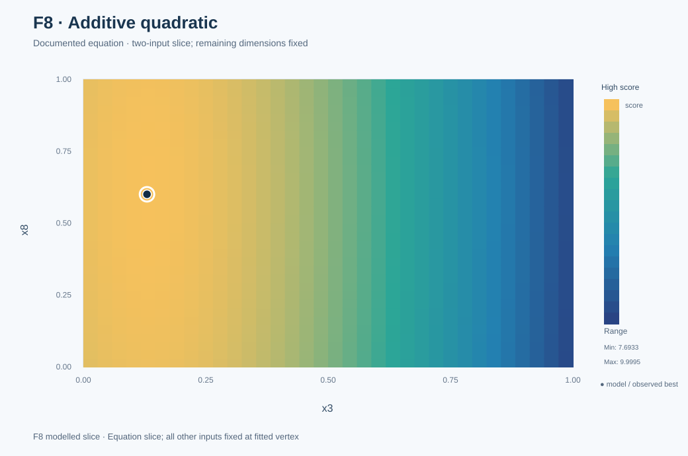](../results/figures/f8_2d.svg) | [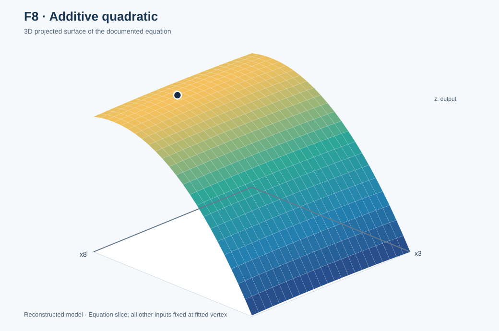](../results/figures/f8_3d.svg) |

**What we know so far.** The 17-coefficient additive quadratic fitted to the original 40 supplied observations predicts 13 later personal portal returns to numerical precision. The slice varies x3 and x8, holding the other inputs at the fitted vertex. Its maximum is 10.

**What remains uncertain.** The initial-40-only model recovery was performed retrospectively. The figures explain the fitted equation, not the original undisclosed source code. The curvature weight of x3 is 30 times that of x8.

**Optimisation lesson.** Try simple, interpretable challengers early when out-of-sample evidence justifies them.

[Detailed F8 discussion](function_guide.md#f8--the-17-coefficient-quadratic) · [2D image](../results/figures/f8_2d.svg) · [3D image](../results/figures/f8_3d.svg)

---

## Reproducing and interpreting the images

All 16 SVG figures are built from the repository's versioned observation CSVs and the F5/F7/F8 reconstructed expressions with a dependency-free Node.js generator:

```bash
node results/figures/build_visual_gallery.mjs
```

Run from the repository root with Node.js 18+. The script rebuilds the [figure manifest](../results/figures/gallery_manifest.json) and checks the F5, F7 and F8 expressions against confirmed portal returns. The 3D charts are static projected views, not interactive rotation controls. Full source: [results/figures/build_visual_gallery.mjs](../results/figures/build_visual_gallery.mjs).

**Do not relabel these charts as the original hidden equations.** The structural expressions are supported reconstructions, and five functions are plotted only as empirical evidence. [Back to README](../README.md).
