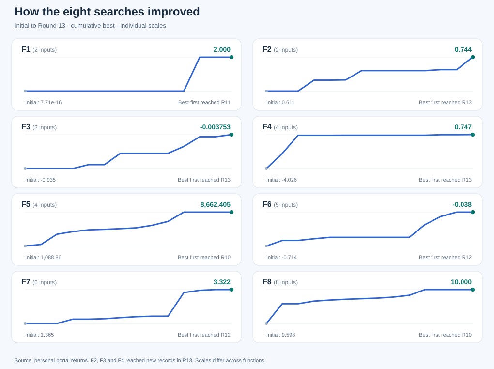

# Visual gallery

[← Project overview](../README.md) · [Functions](../functions/README.md) · [How these plots are constructed](../docs/functions.md)

## Best measured score across 13 rounds

[Open SVG](../results/figures/progress.svg)

Each line shows the cumulative best **measured** score, including supplied starting observations. Functions have different vertical scales.

## Two-dimensional and three-dimensional investigations

| Function | 2D view | 3D view | What is shown |
|---|---|---|---|
| [F1](../functions/F1/README.md) | [Observed 2D](../results/figures/f1_2d.svg) · [Model 2D](../results/figures/f1_model_2d.svg) | [Observed 3D](../results/figures/f1_3d.svg) · [Model 3D](../results/figures/f1_model_3d.svg) | Observed points kept distinct from reconstructed model estimates |
| [F2](../functions/F2/README.md) | [2D](../results/figures/f2_2d.svg) | [3D](../results/figures/f2_3d.svg) | Observed points |
| [F3](../functions/F3/README.md) | [2D](../results/figures/f3_2d.svg) | [3D](../results/figures/f3_3d.svg) | Observed projection |
| [F4](../functions/F4/README.md) | [2D](../results/figures/f4_2d.svg) | [3D](../results/figures/f4_3d.svg) | Observed projection |
| [F5](../functions/F5/README.md) | [2D](../results/figures/f5_2d.svg) | [3D](../results/figures/f5_3d.svg) | Reconstructed power-sum slice |
| [F6](../functions/F6/README.md) | [2D](../results/figures/f6_2d.svg) | [3D](../results/figures/f6_3d.svg) | Observed projection |
| [F7](../functions/F7/README.md) | [2D](../results/figures/f7_2d.svg) | [3D](../results/figures/f7_3d.svg) | Positive Hartmann-6 model slice |
| [F8](../functions/F8/README.md) | [2D](../results/figures/f8_2d.svg) | [3D](../results/figures/f8_3d.svg) | Fitted quadratic slice |

**Interpretation:** observed projections and reconstructed surfaces are different kinds of evidence. Where only two coordinates are plotted, higher-dimensional variables are either omitted from the projection or held fixed in a model slice. Do not interpret any surface as a complete depiction of the hidden function.

[Observed-figure generation script](../results/figures/build_visual_gallery.mjs) · [F1 reconstructed-figure generator](../results/figures/build_f1_reconstruction.mjs) · [Data and numerical records](../data/all_observations.csv) · [Reconstruction methods](reconstruction.md)
