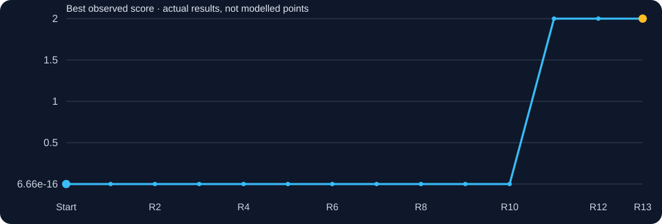
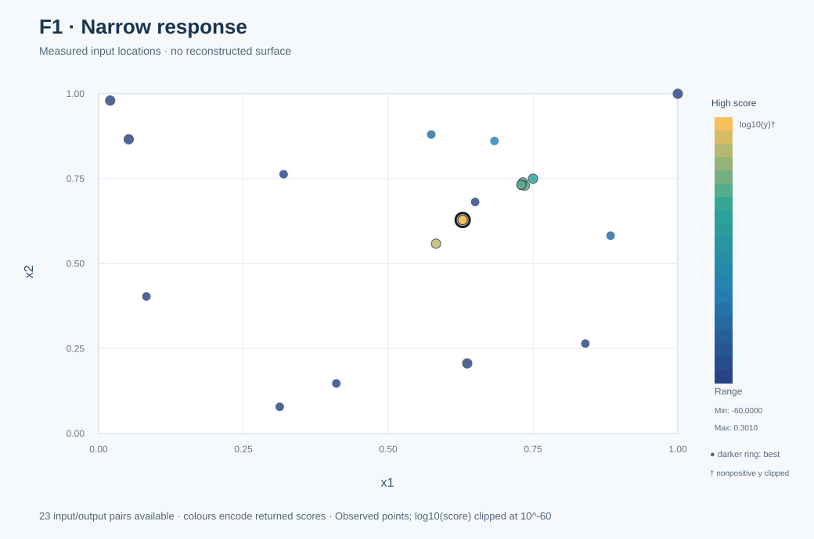
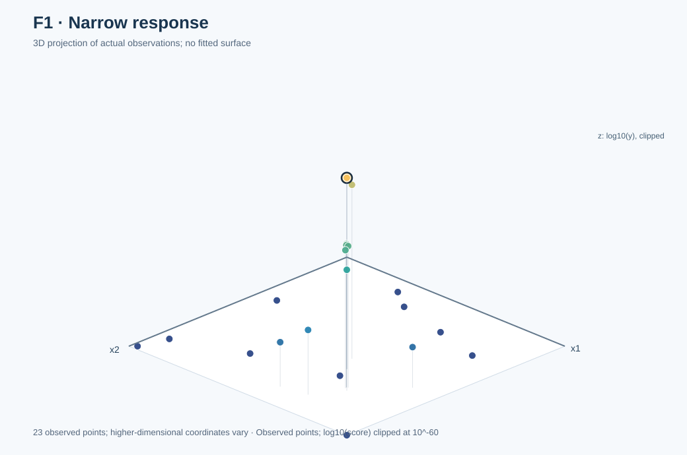
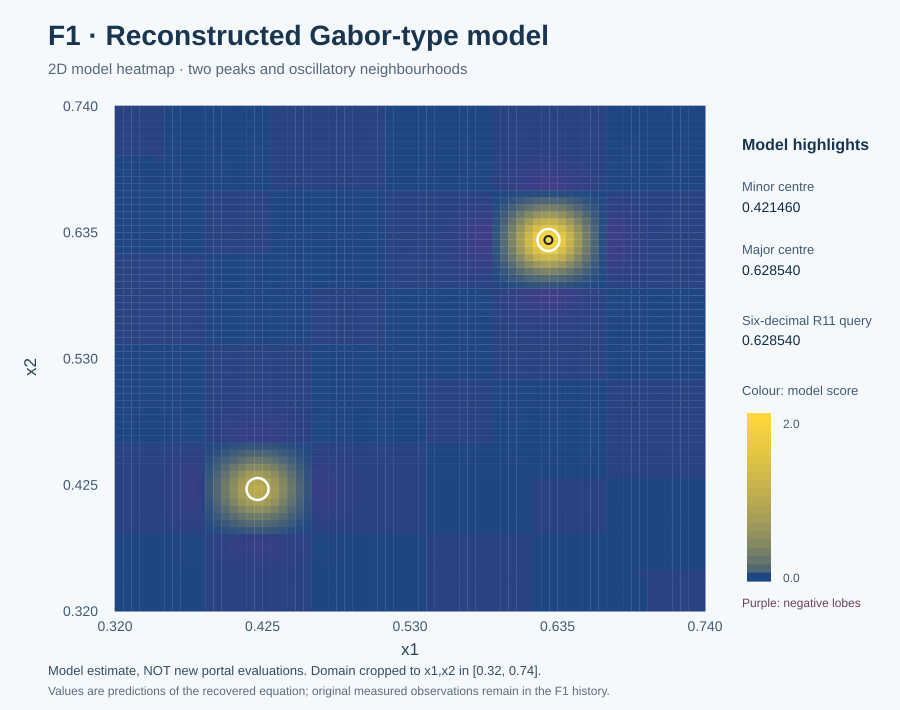
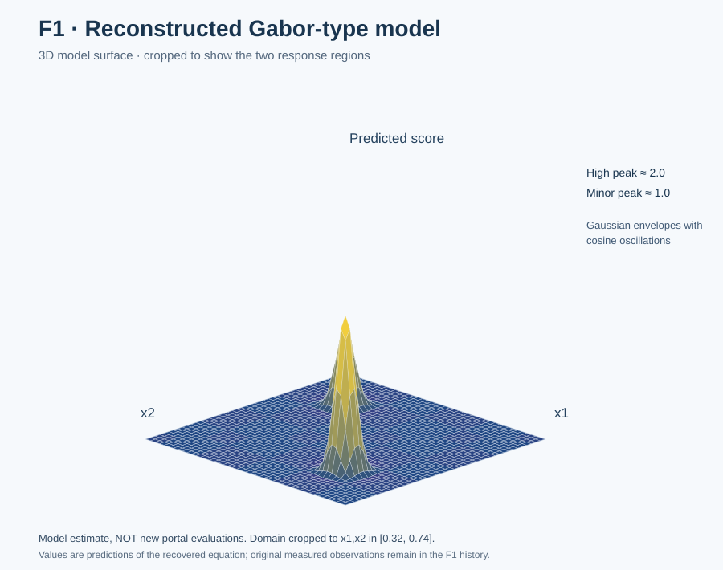

# Function 1 · Finding a signal in apparent numerical silence

[← All functions](../README.md) · [Project home](../../README.md) · [Observed inputs and outputs](observations.csv) · [Complete decision ledger](selection_history.csv)

**2 inputs · 10 starting observations · 13 rounds**

| Initial best | Final best | First achieved | Best input |
|---:|---:|:---:|---|
| `7.710875114502849e-16` | **`1.9999999996761817`** | **Round 11** | `0.628540-0.628540` |

## Understanding this function

Almost every early response was extremely close to zero. The first GP and UCB proposals could not locate a useful region, and local improvements around a weak incumbent were misleading. Contemporary notes describe a Gaussian-modulated structural hypothesis and some external exploration around Round 10–11; those historical records are preserved below. **A separate retrospective reconstruction is now fully reproducible using only my own recorded F1 observations.** Its mathematical form came from subsequently recovered working code; this new experiment must not be mistaken for the original Round 11 candidate generator.

### Score progression from real evaluations

The chart tracks measured best-so-far results. A flat interval means no improvement to the incumbent, not that a model predicted a constant function.

## Weekly development · expand a round

Each round shows **what was known or being tested, what was submitted, what returned, and what was learnt**. The original 52-page weekly reflection is the narrative foundation; the decision ledger, surviving code and official portal records establish what was actually submitted. An exact historic kernel/seed/forecast appears only if retained. Where early rationale was reconstructed later, it is explicitly labelled in the ledger.

<strong>Round 1 · Opening hypothesis</strong> — 0.00000000

**Original learning context:** The first reflection described F1 as nearly all zero and chose an under-sampled area because no useful local peak had been established.

**Strategy / candidate-selection evidence:** GP and acquisition baseline (retrospective) *(early-round attribution partly retrospective)*.

**Submitted input:** `0.02-0.98`  
**Actual portal result:** `0.0`  
**Best observed before → after:** `7.710875114502849e-16` → `7.710875114502849e-16`.

**Pre-result numerical forecast:** Not retained as a numerical forecast in the original decision ledger; no value has been invented.

**After the result:** The submitted point did not beat the incumbent. Second round: GP/UCB with per-function exploration weights; deterministic candidate grids or pools.

**Supporting material:** [Round 1 evidence](../../journey/round_01/README.md) · No exact original candidate-selection script retained · [Numerical provenance](selection_history.csv).

<strong>Round 2 · GP and UCB working package</strong> — -1.96324543e-233

**Original learning context:** After the first query returned zero, the original Week 2 reflection gave F1 the largest UCB exploration weight, κ=3.0, and considered a future signal/no-signal classifier without claiming it was already implemented.

**Strategy / candidate-selection evidence:** GP and UCB working package *(early-round attribution partly retrospective)*.

**Submitted input:** `0.052001-0.865999`  
**Actual portal result:** `-1.9632454298284602e-233`  
**Best observed before → after:** `7.710875114502849e-16` → `7.710875114502849e-16`.

**Pre-result numerical forecast:** Not retained as a numerical forecast in the original decision ledger; no value has been invented.

**After the result:** The submitted point did not beat the incumbent. Third round: function-specific EI/UCB policy; 1%-of-output-SD EI margin and GP fitting restarts documented at pipeline level.

**Supporting material:** [Round 2 evidence](../../journey/round_02/README.md) · [Related surviving script/notebook](../../journey/round_02/week2_ucb_course_aligned.py) (related historical script not verified exact, not necessarily the exact historical candidate generator) · [Numerical provenance](selection_history.csv).

<strong>Round 3 · Function-specific EI or wider search (retrospective)</strong> — 2.69213109e-65

**Original learning context:** Third round: function-specific EI/UCB policy; 1%-of-output-SD EI margin and GP fitting restarts documented at pipeline level.

**Strategy / candidate-selection evidence:** Function-specific EI or wider search (retrospective) *(early-round attribution partly retrospective)*.

**Submitted input:** `0.636406-0.206433`  
**Actual portal result:** `2.69213108614911e-65`  
**Best observed before → after:** `7.710875114502849e-16` → `7.710875114502849e-16`.

**Pre-result numerical forecast:** Not retained as a numerical forecast in the original decision ledger; no value has been invented.

**After the result:** The submitted point did not beat the incumbent. Fourth round: GP paired with SVM good/bad checks and small neural-network gradient challengers, not hard classifier exclusion.

**Supporting material:** [Round 3 evidence](../../journey/round_03/README.md) · No exact original candidate-selection script retained · [Numerical provenance](selection_history.csv).

<strong>Round 4 · GP, SVM and neural-network diagnostics</strong> — 1.51764873e-192

**Original learning context:** Fourth round: GP paired with SVM good/bad checks and small neural-network gradient challengers, not hard classifier exclusion.

**Strategy / candidate-selection evidence:** GP, SVM and neural-network diagnostics *(early-round attribution partly retrospective)*.

**Submitted input:** `0.999999-0.999999`  
**Actual portal result:** `1.517648729565899e-192`  
**Best observed before → after:** `7.710875114502849e-16` → `7.710875114502849e-16`.

**Pre-result numerical forecast:** Not retained as a numerical forecast in the original decision ledger; no value has been invented.

**After the result:** The submitted point did not beat the incumbent. Fifth round: use controlled coordinate differences to avoid confusing a multi-variable shift with a causal single-input effect.

**Supporting material:** [Round 4 evidence](../../journey/round_04/README.md) · [Related surviving script/notebook](../../journey/round_04/capstone_bbo_week4_module15.py) (related historical analysis not verified exact, not necessarily the exact historical candidate generator) · [Numerical provenance](selection_history.csv).

<strong>Round 5 · Controlled coordinate probes (retrospective)</strong> — 1.33191455e-22

**Original learning context:** Fifth round: use controlled coordinate differences to avoid confusing a multi-variable shift with a causal single-input effect.

**Strategy / candidate-selection evidence:** Controlled coordinate probes (retrospective) *(early-round attribution partly retrospective)*.

**Submitted input:** `0.75-0.75`  
**Actual portal result:** `1.3319145509281447e-22`  
**Best observed before → after:** `7.710875114502849e-16` → `7.710875114502849e-16`.

**Pre-result numerical forecast:** Not retained as a numerical forecast in the original decision ledger; no value has been invented.

**After the result:** The submitted point did not beat the incumbent. Sixth round: compare GP and MLP using five-fold cross-validated error; treat extra model flexibility as something to justify.

**Supporting material:** [Round 5 evidence](../../journey/round_05/README.md) · No exact original candidate-selection script retained · [Numerical provenance](selection_history.csv).

<strong>Round 6 · GP, ridge and MLP comparison; controlled local fit</strong> — 3.25547512e-17

**Original learning context:** Sixth round: compare GP and MLP using five-fold cross-validated error; treat extra model flexibility as something to justify.

**Strategy / candidate-selection evidence:** GP, ridge and MLP comparison; controlled local fit *(early-round attribution partly retrospective)*.

**Submitted input:** `0.732524-0.7389`  
**Actual portal result:** `3.2554751168755075e-17`  
**Best observed before → after:** `7.710875114502849e-16` → `7.710875114502849e-16`.

**Pre-result numerical forecast:** Not retained as a numerical forecast in the original decision ledger; no value has been invented.

**After the result:** The submitted point did not beat the incumbent. Near-zero results still held almost no meaningful signal; the Week 7 paper prioritised ARD kernels and checking how well forecasts survived the next portal return.

**Supporting material:** [Round 6 evidence](../../journey/round_06/README.md) · [Related surviving script/notebook](../../journey/round_06/Capstone_BBO_Module17_Week6.ipynb) (related notebook original fitter missing, not necessarily the exact historical candidate generator) · [Numerical provenance](selection_history.csv).

<strong>Round 7 · ARD and local forecast investigations (retrospective)</strong> — 1.31425296e-15 ★ new best

**Original learning context:** Near-zero results still held almost no meaningful signal; the Week 7 paper prioritised ARD kernels and checking how well forecasts survived the next portal return.

**Strategy / candidate-selection evidence:** ARD and local forecast investigations (retrospective) *(early-round attribution partly retrospective)*.

**Submitted input:** `0.730874-0.7318`  
**Actual portal result:** `1.3142529628112004e-15`  
**Best observed before → after:** `7.710875114502849e-16` → `1.3142529628112004e-15`.

**Pre-result numerical forecast:** Not retained as a numerical forecast in the original decision ledger; no value has been invented.

**After the result:** The submitted point established a new personal best. Eighth round: separate LLM hypothesis generation from deterministic numerical validation and check candidate precision.

**Supporting material:** [Round 7 evidence](../../journey/round_07/README.md) · No exact original candidate-selection script retained · [Numerical provenance](selection_history.csv).

<strong>Round 8 · Rank-GP local consensus around the new Week 7 best; stay inside the near-zer…</strong> — 4.19700395e-16

**Original learning context:** Eighth round: separate LLM hypothesis generation from deterministic numerical validation and check candidate precision.

**Strategy / candidate-selection evidence:** Rank-GP local consensus around the new Week 7 best; stay inside the near-zero basin while testing a small x1-up/x2-down move..

**Submitted input:** `0.735874-0.729467`  
**Actual portal result:** `4.1970039548686525e-16`  
**Best observed before → after:** `1.3142529628112004e-15` → `1.3142529628112004e-15`.

**Pre-result numerical forecast:** Not retained as a numerical forecast in the original decision ledger; no value has been invented.

**After the result:** The submitted point did not beat the incumbent. A cautious one-coordinate change was chosen while the output scale remained pathological; I had not yet located the main positive-response region.

**Supporting material:** [Round 8 evidence](../../journey/round_08/README.md) · [Related surviving script/notebook](../../journey/round_08/capstone_bbo_module19_round8.py) (related historical analysis not verified exact, not necessarily the exact historical candidate generator) · [Numerical provenance](selection_history.csv).

<strong>Round 9 · One-coordinate probe: move x1 down by 0.001 from the Week 7 incumbent while…</strong> — 1.92128079e-15 ★ new best

**Original learning context:** A cautious one-coordinate change was chosen while the output scale remained pathological; I had not yet located the main positive-response region.

**Strategy / candidate-selection evidence:** One-coordinate probe: move x1 down by 0.001 from the Week 7 incumbent while holding x2 fixed. The updated rank-GP committee favours lower x1, but the output scale is too pathological for a trustworthy numeric forecast..

**Submitted input:** `0.729874-0.7318`  
**Actual portal result:** `1.921280788064022e-15`  
**Best observed before → after:** `1.3142529628112004e-15` → `1.921280788064022e-15`.

**Pre-result numerical forecast:** Not retained as a numerical forecast in the original decision ledger; no value has been invented.

**After the result:** The submitted point established a new personal best. The original Round 10 plan explicitly left the repeated (0.73,0.73) neighbourhood, using external evidence to challenge the stale local hypothesis.

**Supporting material:** [Round 9 evidence](../../journey/round_09/README.md) · [Related surviving script/notebook](../../journey/round_09/round9_controlled_fits.py) (related historical analysis not verified exact, not necessarily the exact historical candidate generator) · [Numerical provenance](selection_history.csv).

<strong>Round 10 · Targeted positive-response region; exploratory near-peer evidence; unobserved</strong> — 0.00000726400118 ★ new best

**Original learning context:** The original Round 10 plan explicitly left the repeated (0.73,0.73) neighbourhood, using external evidence to challenge the stale local hypothesis.

**Strategy / candidate-selection evidence:** Targeted positive-response region; exploratory near-peer evidence; unobserved.

**Submitted input:** `0.582552-0.558941`  
**Actual portal result:** `0.000007264001184177771`  
**Best observed before → after:** `1.921280788064022e-15` → `0.000007264001184177771`.

**Pre-result numerical forecast:** Not retained as a numerical forecast in the original decision ledger; no value has been invented.

**After the result:** The submitted point established a new personal best. A two-component Gaussian-modulated oscillatory explanation was checked against prior recorded observations before selecting the new point.

**Supporting material:** [Round 10 evidence](../../journey/round_10/README.md) · [Related surviving script/notebook](../../src/bbo/optimizer.py) (related challenger not verified exact, not necessarily the exact historical candidate generator) · [Numerical provenance](selection_history.csv).

<strong>Round 11 · Alternative-region exploration and structural investigations</strong> — 2.00000000 ★ new best

**Original learning context:** A two-component Gaussian-modulated oscillatory explanation was checked against prior recorded observations before selecting the new point.

**Strategy / candidate-selection evidence:** Alternative-region exploration and structural investigations.

**Submitted input:** `0.628540-0.628540`  
**Actual portal result:** `1.9999999996761817`  
**Best observed before → after:** `0.000007264001184177771` → `1.9999999996761817`.

**Pre-result numerical forecast:** Not retained as a numerical forecast in the original decision ledger; no value has been invented.

**After the result:** The submitted point established a new personal best. The same high-scoring coordinates were deliberately repeated, providing little new coverage.

**Supporting material:** [Round 11 evidence](../../journey/round_11/README.md) · No exact original candidate-selection script retained · [Numerical provenance](selection_history.csv).

<strong>Round 12 · Controlled probes, repeats and structural investigations</strong> — 2.00000000

**Original learning context:** The same high-scoring coordinates were deliberately repeated, providing little new coverage.

**Strategy / candidate-selection evidence:** Controlled probes, repeats and structural investigations.

**Submitted input:** `0.628540-0.628540`  
**Actual portal result:** `1.9999999996761817`  
**Best observed before → after:** `1.9999999996761817` → `1.9999999996761817`.

**Pre-result numerical forecast:** Not retained as a numerical forecast in the original decision ledger; no value has been invented.

**After the result:** The submitted point did not beat the incumbent. The Week 13 reflection discussed allocating the final budget according to immediate benefit; the submitted point was a repeat of the R11 best.

**Supporting material:** [Round 12 evidence](../../journey/round_12/README.md) · No exact original candidate-selection script retained · [Numerical provenance](selection_history.csv).

<strong>Round 13 · Final decision</strong> — 2.00000000

**Original learning context:** The Week 13 reflection discussed allocating the final budget according to immediate benefit; the submitted point was a repeat of the R11 best.

**Strategy / candidate-selection evidence:** Final exploitation and regional probes.

**Submitted input:** `0.628540-0.628540`  
**Actual portal result:** `1.9999999996761817`  
**Best observed before → after:** `1.9999999996761817` → `1.9999999996761817`.

**Pre-result numerical forecast:** Not retained as a numerical forecast in the original decision ledger; no value has been invented.

**After the result:** The submitted point did not beat the incumbent. A weak GP on a numerically compressed target is a reason to challenge the representation, not endlessly tune one local model.

**Supporting material:** [Round 13 evidence](../../journey/round_13/README.md) · No exact original candidate-selection script retained · [Numerical provenance](selection_history.csv).

## Visual analysis

<table><tr><td width="50%"></td><td width="50%"></td></tr></table>

**Observed points only.** These 2D/3D views project the real inputs and their returned scores; no smooth objective surface has been invented. Both original input coordinates are displayed.

[How the visualisations were produced](../../docs/functions.md) · [Graph-generation code](../../results/figures/build_visual_gallery.mjs)

## Mathematical evidence and its limits

The recoverable model is the **two-component Gaussian-modulated cosine (Gabor-type) hypothesis**:

$
\hat f_1(x_1,x_2)=\sum_{(c,A)\in\{(c_1,1),(c_2,2)\}} A\,e^{-1600[(x_1-c)^2+(x_2-c)^2]}\cos[40(x_1-c)]\cos[40(x_2-c)].
$

Its centre coordinates are

$
c_1=0.5-\frac{\pi}{40}\approx0.421460183660255,\qquad
c_2=0.55+\frac{\pi}{40}\approx0.628539816339745.
$

| Coefficient | Value | Meaning |
|---|---:|---|
| Minor component amplitude | 1 | Smaller response region |
| Major component amplitude | 2 | Higher response region |
| Gaussian decay | 1600 | Rapid fall-off away from the centres |
| Cosine frequency | 40 | Oscillatory sign changes |
| Minor centre | 0.421460183660255 | Both inputs |
| Major centre | 0.628539816339745 | Both inputs |

**New retrospective validation, no peer observations:** [the executable fitting script](../../src/bbo/f1_reconstruction.py) fits these **six free parameters** using only the **10 course-supplied F1 observations in my dataset**, then evaluates **all 13 later personal portal results** without using those results for parameter fitting. The fit uses an **informed starting guess and an already proposed functional family**, not an uninformed discovery of a mathematical form. It reproduces the observations to approximately floating-point precision, including the zero return. [Automated regression tests](../../tests/test_f1_reconstruction.py) preserve the numerical check.

The returned Round 11 score at `[0.628540, 0.628540]` was **1.9999999996761817**. The reconstructed expression predicts the same value to the published precision. This is a **strong observational match**, not proof of identity with the undisclosed course source at every possible input, nor a certified global maximum on the full search domain.

The provided model family originated in separately recovered working code. **Its original derivation and authorship are not independently verified.** Historic Round 10–11 notes include earlier use of external exploratory evidence; these retrospective coefficient-fitting and validation tests **exclude all peer data** and do not rewrite the original chronology.

### Reconstructed function: modelled 2D/3D views

<table><tr><td width="50%"></td><td width="50%"></td></tr></table>

**Predicted values only:** these mathematical-model plots zoom to `0.32 ≤ x1,x2 ≤ 0.74` so both response regions are visible. They are **not additional portal measurements**. Compare with the observed-data plots immediately above. [Rebuild model figures](../../results/figures/build_f1_reconstruction.mjs) · [Reconstruction index](../../reconstruction/README.md).

## Lessons to carry forward

A weak GP on a numerically compressed target is a reason to challenge the representation, not endlessly tune one local model.

**Source discipline:** The originally submitted weekly reflections informed the learning context; the portal results and preserved files establish what actually happened. Historical experiments, post-outcome explanations and model-generated graph values are not interchangeable.

[← All eight functions](../README.md) · [Dataset description](../../DATASHEET.md) · [Model card](../../MODEL_CARD.md)
