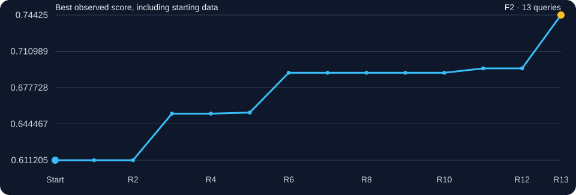
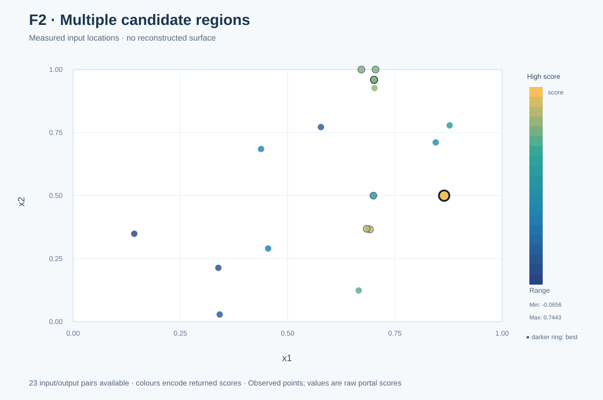
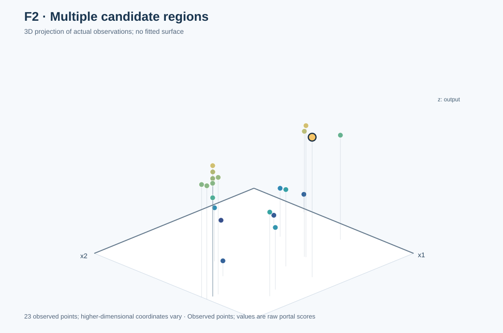

# Function 2 · When a convincing forecast was wrong

**Function navigation (2/8):** [← Previous: F1](../F1/README.md) · [All eight functions](../README.md) · [Next: F3 →](../F3/README.md)
[← All functions](../README.md) · [Project home](../../README.md) · [Source observations](observations.csv) · [Full decision ledger](selection_history.csv)

**2 inputs · 10 starting observations · 13 rounds**

| Initial best | Final best | First achieved | Actual final input |
|---:|---:|:---:|---|
| `0.6112052158` | **`0.7442504263021256`** | **Round 13** | `0.864900-0.500000` |

## Understanding this function

Two inputs, a narrow and unpredictable high-scoring region, and a local forecast that failed by 0.225. The most useful change was to stop treating a stalled neighbourhood as the whole search space. A different region in Round 13 raised the best score to **0.744250426302**. An exact underlying equation was not established.

### Score progression from real evaluations

The line uses **real observed scores only**, starting with the course-provided best. A flat section means the incumbent did not improve, not that the proposed model predicted a flat surface.

## Weekly development · expand a round

Open a round to follow the question, submitted input, measured score and what changed in the next decision. Stars mark new personal bests.

<strong>Round 1 · Is there one promising ridge or two?</strong> — 0.379063270

**Why this input:** The original reflection noted similar x1 values among the best observations but very different x2 values. The first query tested a midpoint rather than assuming a continuous basin.

**Approach considered:** An intermediate x2 probe between strong starting points tested whether they belonged to one ridge or separate regions; GP/EI were decision ideas, not an authenticated first-round generator.

**Submitted input:** `0.7-0.5`  
**Actual portal result:** `0.379063270240082`  
**Best observed before → after:** `0.6112052157614438` → `0.6112052157614438`.

**What I learnt:** A midpoint was less successful than the initial best. The first question remained unresolved; simple interpolation had little support. Next decision: Try a wider GP/UCB search, giving uncertainty more weight.

**Code and data:** [Round notes](../../journey/round_01/README.md) · [Inputs](../../journey/round_01/queries.txt) · [Outputs](../../journey/round_01/outputs.txt) · [Coursework notebook](../../journey/round_01/supporting_coursework/Required_assignment_12_1_Tamer_ready.ipynb).

<strong>Round 2 · Should I explore after the midpoint failed?</strong> — 0.586054705

**Why this input:** The Week 2 reflection recorded **UCB κ=2.5**, using a dense 501×501 search in two dimensions. The exploration policy was deliberately stronger than for improving functions.

**Approach considered:** GP/UCB with κ=2.5 on a 501×501 grid put extra weight on uncertainty after the failed midpoint.

**Submitted input:** `0.672-0.999999`  
**Actual portal result:** `0.5860547049641637`  
**Best observed before → after:** `0.6112052157614438` → `0.6112052157614438`.

**What I learnt:** The new point still failed to beat 0.611205. A wider search was not by itself an improvement. Next decision: Introduce function-specific Expected Improvement rather than keep one global rule.

**Code and data:** [Round notes](../../journey/round_02/README.md) · [Inputs](../../journey/round_02/queries.txt) · [Outputs](../../journey/round_02/outputs.txt) · [GP/UCB Python code](../../journey/round_02/week2_ucb_course_aligned.py) · [Saved candidates](../../journey/round_02/week2_ucb_results.csv) · [Notebook](../../journey/round_02/Capstone_BBO_Week2_UCB_only.ipynb).

<strong>Round 3 · Can global EI identify a better region?</strong> — 0.653867607 ★ new best

**Why this input:** The Week 3 reflection described **global EI**, with an exploration margin of 1% of output standard deviation, target normalisation and eight GP optimiser restarts. Its methodology is documented; the exact historical candidate-generator script is not retained.

**Approach considered:** Global Expected Improvement, target normalisation and an exploration margin of 1% of observed-output SD; exact historical candidate-generation code is not preserved.

**Submitted input:** `0.7015-0.957999`  
**Actual portal result:** `0.653867607133911`  
**Best observed before → after:** `0.6112052157614438` → `0.653867607133911`.

**What I learnt:** The portal returned the first improvement above the supplied best, to 0.653868. Next decision: Keep GP-led proposals while challenging their boundaries with simpler models.

**Code and data:** [Round notes](../../journey/round_03/README.md) · [Inputs](../../journey/round_03/queries.txt) · [Outputs](../../journey/round_03/outputs.txt).

<strong>Round 4 · Would an upper-edge probe be better?</strong> — 0.591285660

**Why this input:** After the first new best, I investigated competing candidate shapes using GP predictions, SVM good/bad classification and small neural-network gradients. These were supporting diagnostics, not replacements for the portal.

**Approach considered:** GP predictions remained primary; soft-margin SVM good/bad classification and small-network gradients were supporting checks, not an automatic exclusion rule.

**Submitted input:** `0.705-0.999999`  
**Actual portal result:** `0.5912856598404541`  
**Best observed before → after:** `0.653867607133911` → `0.653867607133911`.

**What I learnt:** The selected near-boundary x2=0.999999 point returned 0.591286 and lost to the incumbent. Next decision: Return to a controlled, local x2 test.

**Code and data:** [Round notes](../../journey/round_04/README.md) · [Inputs](../../journey/round_04/queries.txt) · [Outputs](../../journey/round_04/outputs.txt) · [Python analysis](../../journey/round_04/capstone_bbo_week4_module15.py) · [Notebook](../../journey/round_04/Capstone_BBO_Week4_Module15.ipynb).

<strong>Round 5 · Does a tiny x2 movement help?</strong> — 0.654849871 ★ new best

**Why this input:** The Week 5 reflection emphasised measuring single-coordinate effects while avoiding a claim that every input acts independently. The chosen input held x1 at 0.7015.

**Approach considered:** Controlled x2 refinement held x1 fixed to test a local response while avoiding an unsupported smoothness assumption.

**Submitted input:** `0.7015-0.959409`  
**Actual portal result:** `0.6548498709022528`  
**Best observed before → after:** `0.653867607133911` → `0.6548498709022528`.

**What I learnt:** A small x2 change improved the best to 0.654850, only modestly. Next decision: Continue controlled refinement but measure whether the extra precision pays.

**Code and data:** [Round notes](../../journey/round_05/README.md) · [Inputs](../../journey/round_05/queries.txt) · [Outputs](../../journey/round_05/outputs.txt).

<strong>Round 6 · How trustworthy is local improvement?</strong> — 0.691314866 ★ new best

**Why this input:** Five-fold comparisons after Round 5 showed a small MLP was slightly better than the GP on F2, unlike F7/F8. I retained uncertainty-aware GP guidance while comparing alternatives.

**Approach considered:** GP-led local refinement was cross-checked against a small MLP, which performed slightly better on F2 in five-fold validation; the GP was not replaced automatically.

**Submitted input:** `0.7015-0.959816`  
**Actual portal result:** `0.6913148663237587`  
**Best observed before → after:** `0.6548498709022528` → `0.6913148663237587`.

**What I learnt:** The nearby query produced 0.691315, a useful new best but not proof that the local surface was smooth. Next decision: Introduce stronger chronological prediction checks and perturb the local region.

**Code and data:** [Round notes](../../journey/round_06/README.md) · [Inputs](../../journey/round_06/queries.txt) · [Outputs](../../journey/round_06/outputs.txt) · [Notebook](../../journey/round_06/Capstone_BBO_Module17_Week6.ipynb) · [Eight selected inputs](../../journey/round_06/results/round6_queries.csv) · [Decision notes](../../journey/round_06/results/round6_query_rationale.csv).

<strong>Round 7 · Is the fitted neighbourhood stable?</strong> — 0.589347608

**Why this input:** The Week 7 reflection prioritised GP kernel family (RBF/Matérn), lengthscales, noise and rolling-origin forecast checks. F2's prior improvement had differed from its GP forecast.

**Approach considered:** RBF/Matérn kernels, ARD, noise and rolling-origin checks examined unstable local predictions before trusting another small step.

**Submitted input:** `0.7015-0.960223`  
**Actual portal result:** `0.5893476079120687`  
**Best observed before → after:** `0.6913148663237587` → `0.6913148663237587`.

**What I learnt:** Moving x2 by only 0.000407 reduced the result to 0.589348. The model had not earned blind confidence. Next decision: Use a controlled three-point bracket around the observed spike.

**Code and data:** [Round notes](../../journey/round_07/README.md) · [Inputs](../../journey/round_07/queries.txt) · [Outputs](../../journey/round_07/outputs.txt) · [Forecast comparison](../../journey/round_08/results/week7_audit.csv).

<strong>Round 8 · Where does a local quadratic predict the crest?</strong> — 0.613086131

**Why this input:** The saved Round 8 decision fitted a quadratic through neighbouring x2 positions, selecting x2≈0.959720 while holding x1 fixed. It tested a specific local interpolation hypothesis.

**Approach considered:** Three-point x2 quadratic interpolation held x1 fixed and tested a local crest hypothesis; the pre-result forecast was recorded.

**Submitted input:** `0.7015-0.95972`  
**Actual portal result:** `0.6130861312279376`  
**Best observed before → after:** `0.6913148663237587` → `0.6913148663237587`.

**Pre-result forecast:** approximately `0.695189` (local quadratic for the submitted F2 point; see [Round 8 forecast table](../../journey/round_08/README.md)).

**What I learnt:** Actual 0.613086 was much lower than the 0.691315 incumbent. Smooth-looking interpolation did not ensure a gain. Next decision: Test a symmetric position, with the prediction recorded in advance.

**Code and data:** [Round notes](../../journey/round_08/README.md) · [Inputs](../../journey/round_08/queries.txt) · [Outputs](../../journey/round_08/outputs.txt) · [Python analysis](../../journey/round_08/capstone_bbo_module19_round8.py) · [Saved candidates](../../journey/round_08/results/round8_queries.csv).

<strong>Round 9 · Will a symmetric microstep beat the incumbent?</strong> — 0.505525516

**Why this input:** The Round 9 local fit proposed x2=0.959912, opposite the earlier microstep, and recorded a **pre-result prediction of 0.730502334656**.

**Approach considered:** A symmetric x2 microstep tested the local fitted curve with a numerical forecast recorded before the portal result.

**Submitted input:** `0.7015-0.959912`  
**Actual portal result:** `0.5055255161847483`  
**Best observed before → after:** `0.6913148663237587` → `0.6913148663237587`.

**Pre-result forecast:** `0.7305023346561939` (recorded before return).

**What I learnt:** The portal returned **0.505525516185**, an error of about **0.225**. This was a direct challenge to the local GP/curve hypothesis. Next decision: Demote this local forecast and compare a diagnostic point with other regions.

**Code and data:** [Round notes](../../journey/round_09/README.md) · [Inputs](../../journey/round_09/queries.txt) · [Outputs](../../journey/round_09/outputs.txt) · [Candidate forecasts](../../journey/round_09/results/round9_queries.csv) · [Original controlled local-fitting code](../../journey/round_09/round9_controlled_fits.py).

<strong>Round 10 · Should the suspect local model get another chance?</strong> — 0.617259927

**Why this input:** The original Week 10 assignment records a *tight diagnostic point* rather than trusting a wider failed forecast. HEBO-inspired kernel/acquisition committees and a TuRBO-style box were alternatives, not full package implementations.

**Approach considered:** A tight diagnostic step tested the questioned local region; HEBO-inspired committees and a fixed-box TuRBO-style challenger were considered, not full algorithms credited with this query.

**Submitted input:** `0.701500-0.959796`  
**Actual portal result:** `0.617259927400158`  
**Best observed before → after:** `0.6913148663237587` → `0.6913148663237587`.

**What I learnt:** The output, 0.617260, remained below the incumbent. Further refinement in the same narrow region looked unproductive. Next decision: Test another promising region instead of declaring convergence.

**Code and data:** [Round notes](../../journey/round_10/README.md) · [Inputs](../../journey/round_10/queries.txt) · [Outputs](../../journey/round_10/outputs.txt) · [Candidate list](../../journey/round_10/round10_candidates.csv) · [Search plan](../../journey/round_10/optimisation.yaml) · [Related optimiser code](../../src/bbo/optimizer.py).

<strong>Round 11 · What does a competing region reveal?</strong> — 0.695336827 ★ new best

**Why this input:** The Week 11 reflections describe changing F2 to an alternative portion of a promising ridge and using DBSCAN input-density diagnostics with care. Clustering was not equated with a good objective value.

**Approach considered:** An alternative part of the observed ridge was tested; DBSCAN input-density analysis was a diagnostic, not a rule that dense clusters must contain high scores.

**Submitted input:** `0.692000-0.366000`  
**Actual portal result:** `0.6953368270741286`  
**Best observed before → after:** `0.6913148663237587` → `0.6953368270741286`.

**What I learnt:** The new location x=(0.692,0.366) returned **0.695337**, improving the incumbent despite a large change in x2. Next decision: Check whether that new region supports nearby refinement.

**Code and data:** [Round notes](../../journey/round_11/README.md) · [Portal results](../../data/portal_rounds_11_12.csv) · [Clustering analysis (later reproduction)](../../research/diagnostics/clustering/clustering_audit.py).

<strong>Round 12 · Can a nearby point refine the new ridge?</strong> — 0.660671151

**Why this input:** The Week 12 reflection prioritised forecast validation, bounded alternatives and the value of scarce remaining queries. The local move was a test, not evidence that nearby locations were better.

**Approach considered:** A bounded local probe examined the improved Round 11 region without assuming the ridge was smooth or that the next point must improve.

**Submitted input:** `0.684399-0.368552`  
**Actual portal result:** `0.660671151390024`  
**Best observed before → after:** `0.6953368270741286` → `0.6953368270741286`.

**What I learnt:** The response of 0.660671 was below the current best. The apparent ridge remained unreliable. Next decision: With the final evaluation, favour an alternative with credible immediate upside.

**Code and data:** [Round notes](../../journey/round_12/README.md) · [Round 12 Python](../../journey/round_12/original/review_round12.py) · [Robustness Python](../../journey/round_12/original/robust_and_warp.py) · [Dated candidate rationale](../../journey/round_12/original/week12_full_review_2026-11-02.md).

<strong>Round 13 · Is one final alternative worth the risk?</strong> — 0.744250426 ★ new best

**Why this input:** The Week 13 reflection explicitly preferred a competing F2 peak: with no later round, a new region needed a chance of improving the best **now**, not merely providing information.

**Approach considered:** A competing peak was selected for immediate possible improvement in the final evaluation rather than information useful only in a later round.

**Submitted input:** `0.864900-0.500000`  
**Actual portal result:** `0.7442504263021256`  
**Best observed before → after:** `0.6953368270741286` → `0.7442504263021256`.

**What I learnt:** The submitted point x=(0.8649,0.5) returned **0.744250426302**, the final personal best. For future work: Do not claim the underlying maximum has been found; validate uncertain forecasts and maintain competing regions.

**Code and data:** [Round notes](../../journey/round_13/README.md) · [Inputs](../../journey/round_13/queries.txt) · [Outputs](../../journey/round_13/outputs.txt) · [Final reflection](../../journey/final_reflection/README.md).

## Visual analysis

<table><tr><td width="50%"></td><td width="50%"></td></tr></table>

**Left:** recorded input positions (x1, x2), coloured or labelled by measured outcome. **Right:** 3D scatter of the actual (x1, x2, score) samples. **These are observed points, not a fitted smooth surface.** The lower-dimensional setting makes this projection interpretable.

[Visualisation methodology](../../docs/functions.md) · [Rebuild the gallery](../../results/figures/build_visual_gallery.mjs)

## Mathematical evidence and its limits

**No underlying equation has been established.** RBF/Matérn GPs, locally fitted quadratics and small neural-network challengers were investigated as *surrogates*, not copies of the hidden source. Some short-range predictions failed dramatically, notably R9's 0.730502 forecast versus the actual 0.505526. The observed maximum of **0.744250** is a personal best, **not** proof of a global maximum.

**What is supported:** 10 original observations, 13 returned portal queries, contemporaneous discussion of exploration settings and preserved local candidate fits. A large held-out error warns against publishing an invented continuous surface or numerical confidence percentage.

## Lessons to carry forward

**A confident model is not necessarily a useful decision-maker.** Chronological forecast checking and a competing search region mattered more than repeated tiny steps.

[← Function index](../README.md) · [Data provenance](../../DATASHEET.md) · [Model limitations](../../MODEL_CARD.md)

**Function navigation (2/8):** [← Previous: F1](../F1/README.md) · [All eight functions](../README.md) · [Next: F3 →](../F3/README.md)
