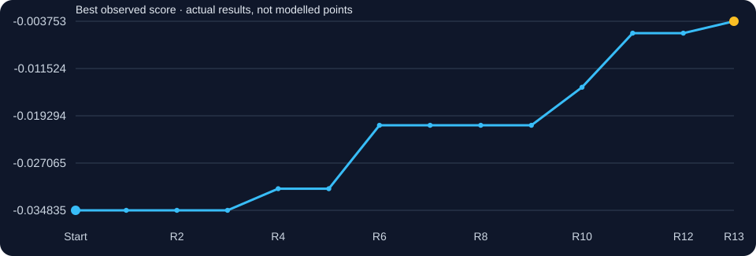
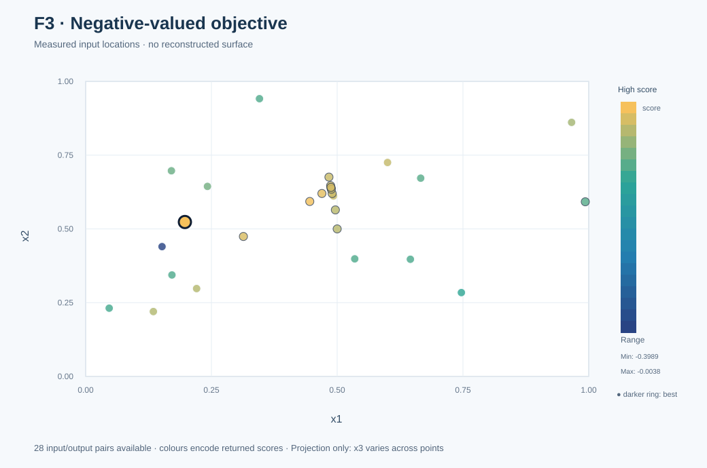
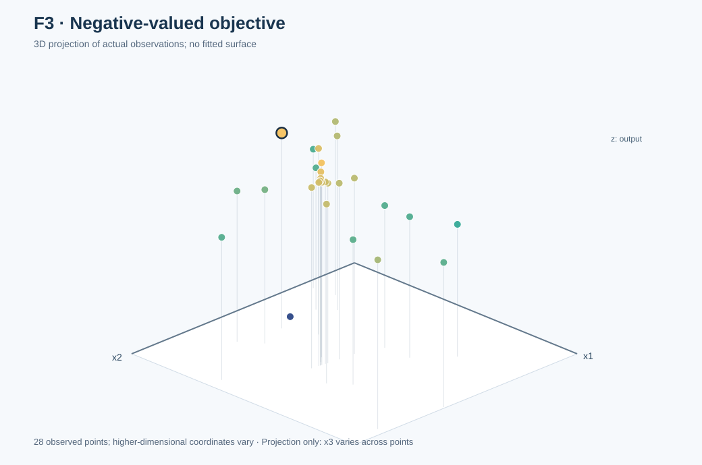

# Function 3 · Learning when a fitted local peak is misleading

[← All functions](../README.md) · [Project home](../../README.md) · [Observed inputs and outputs](observations.csv) · [Complete decision ledger](selection_history.csv)

**3 inputs · 15 starting observations · 13 rounds**

| Initial best | Final best | First achieved | Best input |
|---:|---:|:---:|---|
| `-0.034835313350078584` | **`-0.0037530969187192596`** | **Round 13** | `0.197280-0.523429-0.470094` |

## Understanding this function

The response is negative, so higher (closer to zero) is better. Local searches found partial gains but repeatedly failed to generalise. Alternative regional inputs in R10/R11 and again in R13 improved the best substantially. No underlying analytical formula was established.

### Score progression from real evaluations

The chart tracks measured best-so-far results. A flat interval means no improvement to the incumbent, not that a model predicted a constant function.

## Weekly development · expand a round

Each round shows **what was known or being tested, what was submitted, what returned, and what was learnt**. The original 52-page weekly reflection is the narrative foundation; the decision ledger, surviving code and official portal records establish what was actually submitted. An exact historic kernel/seed/forecast appears only if retained. Where early rationale was reconstructed later, it is explicitly labelled in the ledger.

<strong>Round 1 · Opening hypothesis</strong> — -0.0437772385

**Original learning context:** The original first reflection noted that the best outputs were already close to zero and favoured cautious exploitation while retaining a promising coordinate.

**Strategy / candidate-selection evidence:** GP and acquisition baseline (retrospective) *(early-round attribution partly retrospective)*.

**Submitted input:** `0.5-0.5-0.345`  
**Actual portal result:** `-0.0437772384849064`  
**Best observed before → after:** `-0.034835313350078584` → `-0.034835313350078584`.

**Pre-result numerical forecast:** Not retained as a numerical forecast in the original decision ledger; no value has been invented.

**After the result:** The submitted point did not beat the incumbent. Second round: GP/UCB with per-function exploration weights; deterministic candidate grids or pools.

**Supporting material:** [Round 1 evidence](../../journey/round_01/README.md) · No exact original candidate-selection script retained · [Numerical provenance](selection_history.csv).

<strong>Round 2 · GP and UCB working package</strong> — -0.106495098

**Original learning context:** The first return was close to, but worse than, the starting best; Week 2 used a balanced UCB setting κ=2.0.

**Strategy / candidate-selection evidence:** GP and UCB working package *(early-round attribution partly retrospective)*.

**Submitted input:** `0.993188-0.591985-0.00028`  
**Actual portal result:** `-0.1064950977729621`  
**Best observed before → after:** `-0.034835313350078584` → `-0.034835313350078584`.

**Pre-result numerical forecast:** Not retained as a numerical forecast in the original decision ledger; no value has been invented.

**After the result:** The submitted point did not beat the incumbent. The Week 3 plan explicitly selected local predicted-mean optimisation for F3, not the globally exploratory EI used for F2.

**Supporting material:** [Round 2 evidence](../../journey/round_02/README.md) · [Related surviving script/notebook](../../journey/round_02/week2_ucb_course_aligned.py) (related historical script not verified exact, not necessarily the exact historical candidate generator) · [Numerical provenance](selection_history.csv).

<strong>Round 3 · Function-specific EI or wider search (retrospective)</strong> — -0.0427365724

**Original learning context:** The Week 3 plan explicitly selected local predicted-mean optimisation for F3, not the globally exploratory EI used for F2.

**Strategy / candidate-selection evidence:** Function-specific EI or wider search (retrospective) *(early-round attribution partly retrospective)*.

**Submitted input:** `0.496377-0.564413-0.34369`  
**Actual portal result:** `-0.0427365723752823`  
**Best observed before → after:** `-0.034835313350078584` → `-0.034835313350078584`.

**Pre-result numerical forecast:** Not retained as a numerical forecast in the original decision ledger; no value has been invented.

**After the result:** The submitted point did not beat the incumbent. After the model comparison, the original reflection noted new records in F3 among others, supporting GP-led adaptation with SVM checks as secondary evidence.

**Supporting material:** [Round 3 evidence](../../journey/round_03/README.md) · No exact original candidate-selection script retained · [Numerical provenance](selection_history.csv).

<strong>Round 4 · GP, SVM and neural-network diagnostics</strong> — -0.0312815968 ★ new best

**Original learning context:** After the model comparison, the original reflection noted new records in F3 among others, supporting GP-led adaptation with SVM checks as secondary evidence.

**Strategy / candidate-selection evidence:** GP, SVM and neural-network diagnostics *(early-round attribution partly retrospective)*.

**Submitted input:** `0.49-0.62-0.36`  
**Actual portal result:** `-0.0312815968234451`  
**Best observed before → after:** `-0.034835313350078584` → `-0.0312815968234451`.

**Pre-result numerical forecast:** Not retained as a numerical forecast in the original decision ledger; no value has been invented.

**After the result:** The submitted point established a new personal best. Fifth round: use controlled coordinate differences to avoid confusing a multi-variable shift with a causal single-input effect.

**Supporting material:** [Round 4 evidence](../../journey/round_04/README.md) · [Related surviving script/notebook](../../journey/round_04/capstone_bbo_week4_module15.py) (related historical analysis not verified exact, not necessarily the exact historical candidate generator) · [Numerical provenance](selection_history.csv).

<strong>Round 5 · Controlled coordinate probes (retrospective)</strong> — -0.0334231088

**Original learning context:** Fifth round: use controlled coordinate differences to avoid confusing a multi-variable shift with a causal single-input effect.

**Strategy / candidate-selection evidence:** Controlled coordinate probes (retrospective) *(early-round attribution partly retrospective)*.

**Submitted input:** `0.483623-0.675587-0.37631`  
**Actual portal result:** `-0.0334231088352711`  
**Best observed before → after:** `-0.0312815968234451` → `-0.0312815968234451`.

**Pre-result numerical forecast:** Not retained as a numerical forecast in the original decision ledger; no value has been invented.

**After the result:** The submitted point did not beat the incumbent. Original five-fold validation found that a small MLP slightly outperformed the GP on F3, unlike F7/F8. This challenged uncritical model preference.

**Supporting material:** [Round 5 evidence](../../journey/round_05/README.md) · No exact original candidate-selection script retained · [Numerical provenance](selection_history.csv).

<strong>Round 6 · GP, ridge and MLP comparison; controlled local fit</strong> — -0.0208561545 ★ new best

**Original learning context:** Original five-fold validation found that a small MLP slightly outperformed the GP on F3, unlike F7/F8. This challenged uncritical model preference.

**Strategy / candidate-selection evidence:** GP, ridge and MLP comparison; controlled local fit *(early-round attribution partly retrospective)*.

**Submitted input:** `0.487816-0.639038-0.365586`  
**Actual portal result:** `-0.0208561545295093`  
**Best observed before → after:** `-0.0312815968234451` → `-0.0208561545295093`.

**Pre-result numerical forecast:** Not retained as a numerical forecast in the original decision ledger; no value has been invented.

**After the result:** The submitted point established a new personal best. Seventh round: compare RBF and Matérn, ARD, noise and rolling-origin forecast accuracy rather than fitting alone.

**Supporting material:** [Round 6 evidence](../../journey/round_06/README.md) · [Related surviving script/notebook](../../journey/round_06/Capstone_BBO_Module17_Week6.ipynb) (related notebook original fitter missing, not necessarily the exact historical candidate generator) · [Numerical provenance](selection_history.csv).

<strong>Round 7 · ARD and local forecast investigations (retrospective)</strong> — -0.0279111486

**Original learning context:** Seventh round: compare RBF and Matérn, ARD, noise and rolling-origin forecast accuracy rather than fitting alone.

**Strategy / candidate-selection evidence:** ARD and local forecast investigations (retrospective) *(early-round attribution partly retrospective)*.

**Submitted input:** `0.486949-0.646592-0.367803`  
**Actual portal result:** `-0.0279111486430777`  
**Best observed before → after:** `-0.0208561545295093` → `-0.0208561545295093`.

**Pre-result numerical forecast:** Not retained as a numerical forecast in the original decision ledger; no value has been invented.

**After the result:** The submitted point did not beat the incumbent. The original Week 8 reflection reported a failed F3 local prediction and increased emphasis on pre-recorded forecasts and numerical checks.

**Supporting material:** [Round 7 evidence](../../journey/round_07/README.md) · No exact original candidate-selection script retained · [Numerical provenance](selection_history.csv).

<strong>Round 8 · Week 7 overshot the Week 6 local best. A quadratic through the left bracket…</strong> — -0.0296632774

**Original learning context:** The original Week 8 reflection reported a failed F3 local prediction and increased emphasis on pre-recorded forecasts and numerical checks.

**Strategy / candidate-selection evidence:** Week 7 overshot the Week 6 local best. A quadratic through the left bracket, Week 6 best and Week 7 point places the local vertex back at t≈0.260 on the controlled path..

**Submitted input:** `0.488344-0.634434-0.364235`  
**Actual portal result:** `-0.0296632773887996`  
**Best observed before → after:** `-0.0208561545295093` → `-0.0208561545295093`.

**Pre-result numerical forecast:** Not retained as a numerical forecast in the original decision ledger; no value has been invented.

**After the result:** The submitted point did not beat the incumbent. The original Week 9 reflection warned that an optimistic F3 forecast near -0.01968 had returned around -0.02966.

**Supporting material:** [Round 8 evidence](../../journey/round_08/README.md) · [Related surviving script/notebook](../../journey/round_08/capstone_bbo_module19_round8.py) (related historical analysis not verified exact, not necessarily the exact historical candidate generator) · [Numerical provenance](selection_history.csv).

<strong>Round 9 · Updated local-path quadratic using Week 8, Week 6 and Week 7 places the vert…</strong> — -0.0258164064

**Original learning context:** The original Week 9 reflection warned that an optimistic F3 forecast near -0.01968 had returned around -0.02966.

**Strategy / candidate-selection evidence:** Updated local-path quadratic using Week 8, Week 6 and Week 7 places the vertex near this point, predicting about -0.02011. This is a tighter bracket after two forecast misses..

**Submitted input:** `0.487611-0.640821-0.366109`  
**Actual portal result:** `-0.0258164064206346`  
**Best observed before → after:** `-0.0208561545295093` → `-0.0208561545295093`.

**Pre-result numerical forecast:** `-0.02011192237870145` (recorded before return).

**After the result:** The submitted point did not beat the incumbent. The Week 10 submission describes rejecting a speculative restart in favour of an alternative x3 region, partly informed by separately attributed external data.

**Supporting material:** [Round 9 evidence](../../journey/round_09/README.md) · [Related surviving script/notebook](../../journey/round_09/round9_controlled_fits.py) (related historical analysis not verified exact, not necessarily the exact historical candidate generator) · [Numerical provenance](selection_history.csv).

<strong>Round 10 · Alternative-region local interpolation; external evidence; uncertain</strong> — -0.0146028106 ★ new best

**Original learning context:** The Week 10 submission describes rejecting a speculative restart in favour of an alternative x3 region, partly informed by separately attributed external data.

**Strategy / candidate-selection evidence:** Alternative-region local interpolation; external evidence; uncertain.

**Submitted input:** `0.469634-0.620072-0.416672`  
**Actual portal result:** `-0.014602810625106634`  
**Best observed before → after:** `-0.0208561545295093` → `-0.014602810625106634`.

**Pre-result numerical forecast:** Not retained as a numerical forecast in the original decision ledger; no value has been invented.

**After the result:** The submitted point established a new personal best. Eleventh round: analyse density with DBSCAN but do not confuse sampled clusters with high-performing regions.

**Supporting material:** [Round 10 evidence](../../journey/round_10/README.md) · [Related surviving script/notebook](../../src/bbo/optimizer.py) (related challenger not verified exact, not necessarily the exact historical candidate generator) · [Numerical provenance](selection_history.csv).

<strong>Round 11 · Alternative-region exploration and structural investigations</strong> — -0.00570922028 ★ new best

**Original learning context:** Eleventh round: analyse density with DBSCAN but do not confuse sampled clusters with high-performing regions.

**Strategy / candidate-selection evidence:** Alternative-region exploration and structural investigations.

**Submitted input:** `0.445500-0.593000-0.420000`  
**Actual portal result:** `-0.005709220275560069`  
**Best observed before → after:** `-0.014602810625106634` → `-0.005709220275560069`.

**Pre-result numerical forecast:** Not retained as a numerical forecast in the original decision ledger; no value has been invented.

**After the result:** The submitted point established a new personal best. The R12 candidate returned a worse value than the R11 incumbent, showing that a wider search also incurs cost.

**Supporting material:** [Round 11 evidence](../../journey/round_11/README.md) · No exact original candidate-selection script retained · [Numerical provenance](selection_history.csv).

<strong>Round 12 · Controlled probes, repeats and structural investigations</strong> — -0.0226526646

**Original learning context:** The R12 candidate returned a worse value than the R11 incumbent, showing that a wider search also incurs cost.

**Strategy / candidate-selection evidence:** Controlled probes, repeats and structural investigations.

**Submitted input:** `0.313581-0.474345-0.485191`  
**Actual portal result:** `-0.0226526646178297`  
**Best observed before → after:** `-0.005709220275560069` → `-0.005709220275560069`.

**Pre-result numerical forecast:** Not retained as a numerical forecast in the original decision ledger; no value has been invented.

**After the result:** The submitted point did not beat the incumbent. With only one evaluation left, the selected regional input delivered the best of -0.003753; no claim of achieving zero is justified.

**Supporting material:** [Round 12 evidence](../../journey/round_12/README.md) · [Recovered original Round 12 model and candidate-selection code](../../journey/round_12/original/review_round12.py) · [Original TPE and local-model comparisons](../../journey/round_12/original/tpe_local.py) · [Dated candidate rationale](../../journey/round_12/original/week12_full_review_2026-11-02.md) · [Numerical provenance](selection_history.csv).

<strong>Round 13 · Final decision</strong> — -0.00375309692 ★ new best

**Original learning context:** With only one evaluation left, the selected regional input delivered the best of -0.003753; no claim of achieving zero is justified.

**Strategy / candidate-selection evidence:** Final exploitation and regional probes.

**Submitted input:** `0.197280-0.523429-0.470094`  
**Actual portal result:** `-0.0037530969187192596`  
**Best observed before → after:** `-0.005709220275560069` → `-0.0037530969187192596`.

**Pre-result numerical forecast:** Not retained as a numerical forecast in the original decision ledger; no value has been invented.

**After the result:** The submitted point established a new personal best. A smooth local curve and an accurate-looking mean can still select an unproductive region. Holdout evidence and alternative basins matter.

**Supporting material:** [Round 13 evidence](../../journey/round_13/README.md) · No exact original candidate-selection script retained · [Numerical provenance](selection_history.csv).

## Visual analysis

<table><tr><td width="50%"></td><td width="50%"></td></tr></table>

**Observed points only.** These 2D/3D views project the real inputs and their returned scores; no smooth objective surface has been invented. Only x1 and x2 appear on the horizontal axes; x3–x3 vary across observations and the plots do not control for them.

[How the visualisations were produced](../../docs/functions.md) · [Graph-generation code](../../results/figures/build_visual_gallery.mjs)

## Mathematical evidence and its limits

**No validated hidden-function equation is available.** RBF and Matérn GPs, local fits and neural-network challengers are approximate predictive tools, not claims to know the underlying source. The observed maximum in the table is **a personal best**, not a proved global optimum.

## Lessons to carry forward

A smooth local curve and an accurate-looking mean can still select an unproductive region. Holdout evidence and alternative basins matter.

**Source discipline:** The originally submitted weekly reflections informed the learning context; the portal results and preserved files establish what actually happened. Historical experiments, post-outcome explanations and model-generated graph values are not interchangeable.

[← All eight functions](../README.md) · [Dataset description](../../DATASHEET.md) · [Model card](../../MODEL_CARD.md)
