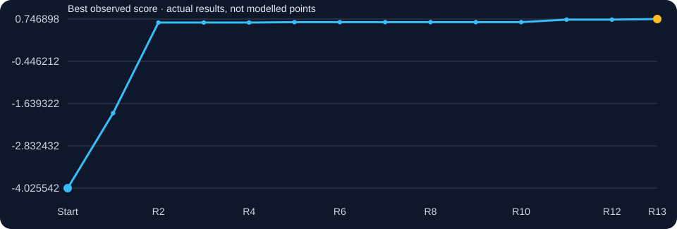
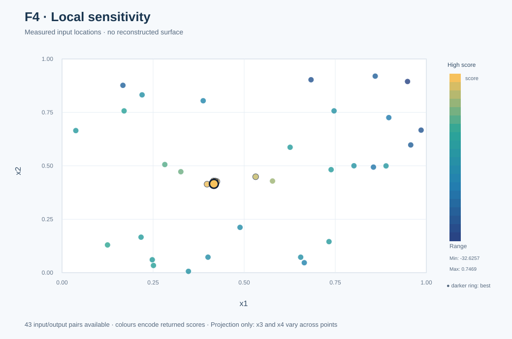
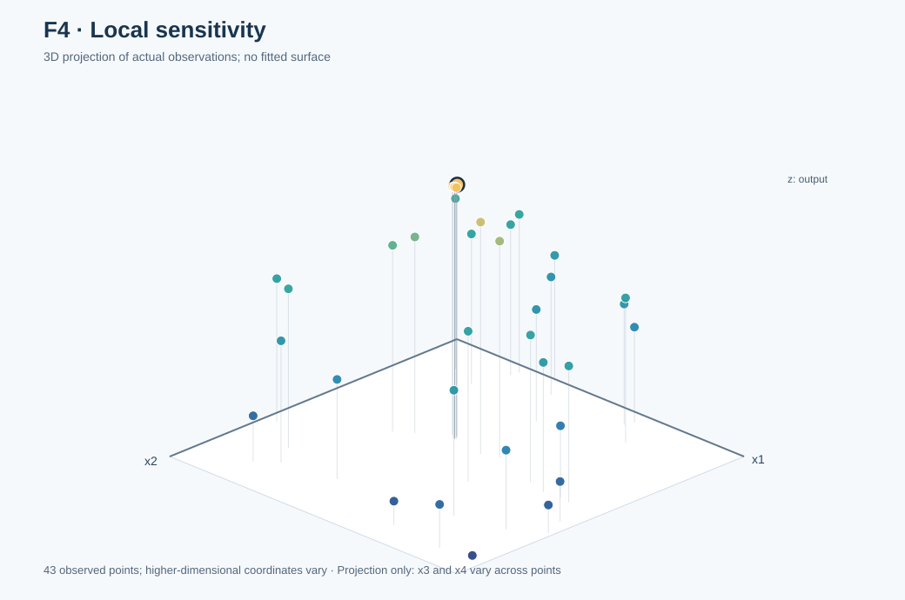

# Function 4 · When prediction accuracy became the wrong objective

**Function navigation (4/8):** [← Previous: F3](../F3/README.md) · [All eight functions](../README.md) · [Next: F5 →](../F5/README.md)
[← All functions](../README.md) · [Project home](../../README.md) · [Observed inputs and outputs](observations.csv) · [Complete decision ledger](selection_history.csv)

**4 inputs · 30 starting observations · 13 rounds**

| Initial best | Final best | First achieved | Best input |
|---:|---:|:---:|---|
| `-4.025542281908162` | **`0.7468979113807426`** | **Round 13** | `0.416903-0.415704-0.360320-0.415205` |

## Understanding this function

F4 improved markedly in the early rounds, then spent several weeks near a best of 0.659. Micro-steps were predicted astonishingly accurately yet gained almost nothing. Widening the local region in R11 returned 0.730459; a further R13 move returned 0.746898. No complete hidden-function equation has been validated.

### Score progression from real evaluations

The chart tracks measured best-so-far results. A flat interval means no improvement to the incumbent, not that a model predicted a constant function.

## Weekly development · expand a round

<strong>Round 1 · Opening hypothesis</strong> — -1.91054424 ★ new best

**Why this input:** Week 1 identified possible multiple good regions and selected a nearby but not identical configuration to test the neighbourhood of an existing observation.

**Approach considered:** Manual exploration informed by the starting observations.

**Submitted input:** `0.5315-0.448817-0.362651-0.331977`  
**Actual portal result:** `-1.910544236949021`  
**Best observed before → after:** `-4.025542281908162` → `-1.910544236949021`.

**What I learnt:** The first query improved the initial incumbent, although the response remained negative.

**Code and data:** [Round notes](../../journey/round_01/README.md) · [Inputs](../../journey/round_01/queries.txt) · [Outputs](../../journey/round_01/outputs.txt) · [Coursework notebook](../../journey/round_01/supporting_coursework/Required_assignment_12_1_Tamer_ready.ipynb).

<strong>Round 2 · GP and UCB working package</strong> — 0.647554265 ★ new best

**Why this input:** The first query lifted the best from -4.0255 to -1.9105, so the Week 2 reflection reduced exploration to UCB κ=1.0 to refine the promising region.

**Approach considered:** GP and UCB working package

**Submitted input:** `0.415636-0.429159-0.368928-0.413098`  
**Actual portal result:** `0.6475542651940924`  
**Best observed before → after:** `-1.910544236949021` → `0.6475542651940924`.

**What I learnt:** The GP/UCB search found a much stronger positive score, establishing a region worth testing.

**Code and data:** [Round notes](../../journey/round_02/README.md) · [Inputs](../../journey/round_02/queries.txt) · [Outputs](../../journey/round_02/outputs.txt) · [GP/UCB Python code](../../journey/round_02/week2_ucb_course_aligned.py) · [Saved candidates](../../journey/round_02/week2_ucb_results.csv) · [Notebook](../../journey/round_02/Capstone_BBO_Week2_UCB_only.ipynb).

<strong>Round 3 · Function-specific EI or wider search</strong> — 0.314899862

**Why this input:** The Week 3 methodology used local EI, exploiting the newly productive area.

**Approach considered:** Function-specific EI or wider search

**Submitted input:** `0.398136-0.414095-0.370552-0.440336`  
**Actual portal result:** `0.3148998621282755`  
**Best observed before → after:** `0.6475542651940924` → `0.6475542651940924`.

**What I learnt:** A nearby proposal performed markedly worse than the incumbent, revealing local sensitivity.

**Code and data:** [Round notes](../../journey/round_03/README.md) · [Inputs](../../journey/round_03/queries.txt) · [Outputs](../../journey/round_03/outputs.txt).

<strong>Round 4 · GP, SVM and neural-network diagnostics</strong> — 0.646639136

**Why this input:** The earlier positive result near 0.648 was not reliably reproduced by nearby moves, so I used further model comparisons to investigate the region.

**Approach considered:** GP, SVM and neural-network diagnostics

**Submitted input:** `0.425128-0.426376-0.368659-0.411895`  
**Actual portal result:** `0.646639136105915`  
**Best observed before → after:** `0.6475542651940924` → `0.6475542651940924`.

**What I learnt:** The query approached the positive incumbent without exceeding it; closeness in inputs was not enough.

**Code and data:** [Round notes](../../journey/round_04/README.md) · [Inputs](../../journey/round_04/queries.txt) · [Outputs](../../journey/round_04/outputs.txt) · [Python analysis](../../journey/round_04/capstone_bbo_week4_module15.py) · [Notebook](../../journey/round_04/Capstone_BBO_Week4_Module15.ipynb).

<strong>Round 5 · Controlled coordinate probes</strong> — 0.658926959 ★ new best

**Why this input:** After mixed nearby results in Rounds 3 and 4, I used a controlled coordinate probe to refine the promising region.

**Approach considered:** Controlled coordinate probes

**Submitted input:** `0.420382-0.427768-0.368794-0.412497`  
**Actual portal result:** `0.6589269585907762`  
**Best observed before → after:** `0.6475542651940924` → `0.6589269585907762`.

**What I learnt:** The controlled probe raised the best to about 0.658927, making the local region promising.

**Code and data:** [Round notes](../../journey/round_05/README.md) · [Inputs](../../journey/round_05/queries.txt) · [Outputs](../../journey/round_05/outputs.txt).

<strong>Round 6 · GP, ridge and MLP comparison; controlled local fit</strong> — 0.658922504

**Why this input:** Sixth round: compare GP and MLP using five-fold cross-validated error; treat extra model flexibility as something to justify.

**Approach considered:** GP, ridge and MLP comparison; controlled local fit

**Submitted input:** `0.42029-0.427795-0.368797-0.412509`  
**Actual portal result:** `0.6589225038891553`  
**Best observed before → after:** `0.6589269585907762` → `0.6589269585907762`.

**What I learnt:** The finer adjustment did not improve the incumbent and began a prolonged plateau.

**Code and data:** [Round notes](../../journey/round_06/README.md) · [Inputs](../../journey/round_06/queries.txt) · [Outputs](../../journey/round_06/outputs.txt) · [Notebook](../../journey/round_06/Capstone_BBO_Module17_Week6.ipynb) · [Eight selected inputs](../../journey/round_06/results/round6_queries.csv) · [Decision notes](../../journey/round_06/results/round6_query_rationale.csv).

<strong>Round 7 · ARD and local forecast investigations</strong> — 0.658924003

**Why this input:** The Week 7 reflection acknowledged diminishing returns: 0.658923 was effectively identical to the previous best of 0.658927.

**Approach considered:** ARD and local forecast investigations

**Submitted input:** `0.420383-0.427768-0.368794-0.412497`  
**Actual portal result:** `0.6589240028704428`  
**Best observed before → after:** `0.6589269585907762` → `0.6589269585907762`.

**What I learnt:** Another local point failed to improve the best, despite additional modelling work.

**Code and data:** [Round notes](../../journey/round_07/README.md) · [Inputs](../../journey/round_07/queries.txt) · [Outputs](../../journey/round_07/outputs.txt) · [Forecast comparison](../../journey/round_08/results/week7_audit.csv).

<strong>Round 8 · Testing a smaller x1 step</strong> — 0.658929913 ★ new best

**Why this input:** The incumbent had stalled near 0.659. I tested a one-millionth x1 change while holding the remaining coordinates fixed.

**Approach:** Week 7 tested x1 one micro-step to the right of the incumbent and was slightly worse. Test one micro-step to the left while holding the other coordinates fixed.

**Submitted input:** `0.420381-0.427768-0.368794-0.412497`  
**Actual portal result:** `0.6589299133743123`  
**Best observed before → after:** `0.6589269585907762` → `0.6589299133743123`.

**What I learnt:** The one-millionth-step experiment improved the score by only a few millionths.

**Code and data:** [Round notes](../../journey/round_08/README.md) · [Inputs](../../journey/round_08/queries.txt) · [Outputs](../../journey/round_08/outputs.txt) · [Python analysis](../../journey/round_08/capstone_bbo_module19_round8.py) · [Saved candidates](../../journey/round_08/results/round8_queries.csv).

<strong>Round 9 · Continuing controlled x1 micro-steps</strong> — 0.658932867 ★ new best

**Why this input:** Round 8 produced a tiny improvement. I tested the adjacent x1 position predicted by the local extrapolation.

**Approach:** Continue the controlled x1 micro-step. The last three comparable observations are almost perfectly linear; the extrapolated forecast at x1=0.420380 is about 0.65893287.

**Submitted input:** `0.42038-0.427768-0.368794-0.412497`  
**Actual portal result:** `0.6589328672210581`  
**Best observed before → after:** `0.6589299133743123` → `0.6589328672210581`.

**Pre-result numerical forecast:** `0.6589328687823797` (recorded before return).

**What I learnt:** The prospective forecast was accurate to around 1.6 × 10⁻⁹, but the improvement in score was tiny.

**Code and data:** [Round notes](../../journey/round_09/README.md) · [Inputs](../../journey/round_09/queries.txt) · [Outputs](../../journey/round_09/outputs.txt) · [Candidate forecasts](../../journey/round_09/results/round9_queries.csv) · [Original controlled local-fitting code](../../journey/round_09/round9_controlled_fits.py).

<strong>Round 10 · One more micro-step</strong> — 0.658962354 ★ new best

**Why this input:** The original Week 10 submission gave unusual weight to the precise local forecast, although this reinforced a stalled search region.

**Approach:** Controlled local refinement supported by prospective accuracy.

**Submitted input:** `0.420370-0.427768-0.368794-0.412497`  
**Actual portal result:** `0.6589623541690739`  
**Best observed before → after:** `0.6589328672210581` → `0.6589623541690739`.

**What I learnt:** Another narrow refinement improved the score slightly, yet the search remained stuck near 0.659.

**Code and data:** [Round notes](../../journey/round_10/README.md) · [Inputs](../../journey/round_10/queries.txt) · [Outputs](../../journey/round_10/outputs.txt) · [Candidate list](../../journey/round_10/round10_candidates.csv) · [Search plan](../../journey/round_10/optimisation.yaml) · [Related optimiser code](../../src/bbo/optimizer.py).

<strong>Round 11 · Widening the search after a long plateau</strong> — 0.730459421 ★ new best

**Why this input:** After repeated micro-steps near 0.659, I changed several coordinates together to test a wider region.

**Approach:** Wider multi-coordinate search.

**Submitted input:** `0.415000-0.417000-0.366500-0.413000`  
**Actual portal result:** `0.7304594213260924`  
**Best observed before → after:** `0.6589623541690739` → `0.7304594213260924`.

**What I learnt:** A wider, multi-coordinate experiment returned about 0.730459, a material gain beyond the plateau.

**Code and data:** [Round notes](../../journey/round_11/README.md) · [Portal results](../../data/portal_rounds_11_12.csv) · [Clustering analysis (later reproduction)](../../research/diagnostics/clustering/clustering_audit.py).

<strong>Round 12 · Repeating the improved result</strong> — 0.730459421

**Why this input:** Round 11 returned 0.730459. I repeated that vector to check its consistency.

**Approach:** Exact repeat for consistency.

**Submitted input:** `0.415000-0.417000-0.366500-0.413000`  
**Actual portal result:** `0.7304594213260924`  
**Best observed before → after:** `0.7304594213260924` → `0.7304594213260924`.

**What I learnt:** Repeating the Round 11 input returned exactly the same score and provided a local consistency check.

**Code and data:** [Round notes](../../journey/round_12/README.md) · [Round 12 Python](../../journey/round_12/original/review_round12.py) · [Local quadratic and TPE code](../../journey/round_12/original/tpe_local.py) · [Candidate rationale](../../journey/round_12/original/week12_full_review_2026-11-02.md).

<strong>Round 13 · A final distinct local candidate</strong> — 0.746897911 ★ new best

**Why this input:** With one evaluation remaining, I tested a distinct vector near the improved region rather than simply repeating Round 11.

**Approach:** Final local alternative.

**Submitted input:** `0.416903-0.415704-0.360320-0.415205`  
**Actual portal result:** `0.7468979113807426`  
**Best observed before → after:** `0.7304594213260924` → `0.7468979113807426`.

**What I learnt:** The distinct final input improved the best again to about 0.746898, supporting the move beyond micro-steps.

**Code and data:** [Round notes](../../journey/round_13/README.md) · [Inputs](../../journey/round_13/queries.txt) · [Outputs](../../journey/round_13/outputs.txt) · [Final reflection](../../journey/final_reflection/README.md).

## Visual analysis

<table><tr><td width="50%"></td><td width="50%"></td></tr></table>

**Observed points only.** These 2D/3D views project the real inputs and their returned scores; no smooth objective surface has been invented. Only x1 and x2 appear on the horizontal axes; x3–x4 vary across observations and the plots do not control for them.

[How the visualisations were produced](../../docs/functions.md) · [Graph-generation code](../../results/figures/build_visual_gallery.mjs)

## Mathematical evidence and its limits

**No validated hidden-function equation is available.** RBF and Matérn GPs, local fits and neural-network challengers are approximate predictive tools, not claims to know the underlying source. The observed maximum in the table is **a personal best**, not a proved global optimum.

## Lessons to carry forward

The next query must be worthwhile, not merely predictable. Adjust search width when local precision stops producing material progress.

[← All eight functions](../README.md) · [Dataset description](../../DATASHEET.md) · [Model card](../../MODEL_CARD.md)

**Function navigation (4/8):** [← Previous: F3](../F3/README.md) · [All eight functions](../README.md) · [Next: F5 →](../F5/README.md)
