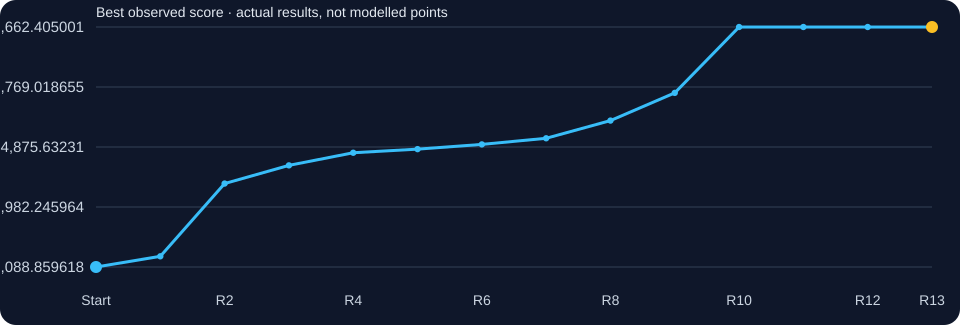
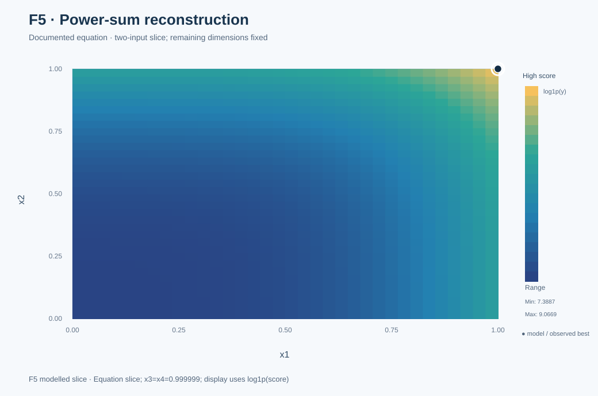
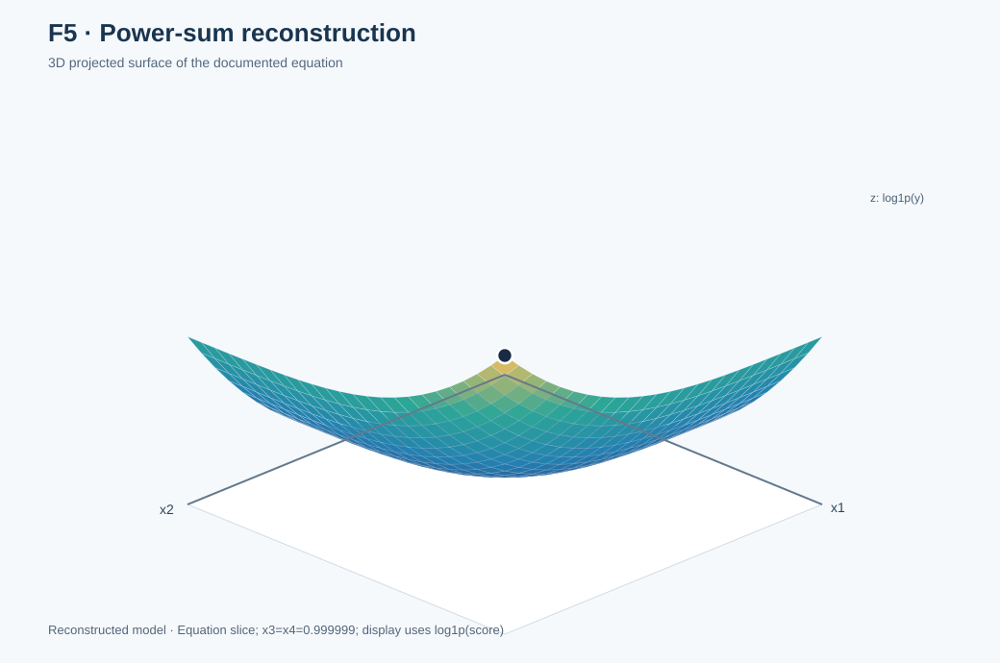

# Function 5 · Controlled steps to a productive boundary

**Function navigation (5/8):** [← Previous: F4](../F4/README.md) · [All eight functions](../README.md) · [Next: F6 →](../F6/README.md)
[← All functions](../README.md) · [Project home](../../README.md) · [Observed inputs and outputs](observations.csv) · [Complete decision ledger](selection_history.csv)

**4 inputs · 20 starting observations · 13 rounds**

| Initial best | Final best | First achieved | Best input |
|---:|---:|:---:|---|
| `1088.8596181962705` | **`8662.405001248297`** | **Round 10** | `0.999999-0.999999-0.999999-0.999999` |

## Understanding this function

F5 had a strong directional signal. A sequence of controlled coordinate changes showed increasing scores towards the legal upper boundary; R10 tested (0.999999)⁴ and returned 8662.405. A power-sum mathematical reconstruction, examined below, helps explain the measured boundary trend.

### Score progression from real evaluations

The chart tracks measured best-so-far results. A flat interval means no improvement to the incumbent, not that a model predicted a constant function.

## Weekly development · expand a round

<strong>Round 1 · Opening hypothesis</strong> — 1426.08976 ★ new best

**Why this input:** My original Round 1 reflection used chemical yield as a working analogy and hypothesised one prominent peak. I chose to exploit a stronger area in the supplied observations rather than search globally. The analogy is not verified as the programme's official F5 scenario, and the peak hypothesis was not established by the data.

**Approach considered:** Exploitation near high-scoring initial observations; a single prominent peak was a working hypothesis, not a verified property of the hidden objective.

**Submitted input:** `0.1-0.75-0.9-0.98`  
**Actual portal result:** `1426.0897645116545`  
**Best observed before → after:** `1088.8596181962705` → `1426.0897645116545`.

**What I learnt:** The first input improved the starting best and supported investigating the higher-coordinate region.

**Code and data:** [Round notes](../../journey/round_01/README.md) · [Inputs](../../journey/round_01/queries.txt) · [Outputs](../../journey/round_01/outputs.txt) · [Coursework notebook](../../journey/round_01/supporting_coursework/Required_assignment_12_1_Tamer_ready.ipynb).

<strong>Round 2 · GP and UCB working package</strong> — 3722.27447 ★ new best

**Why this input:** After R1 improved to 1426.09, Week 2 gave F5 the exploitative UCB κ=1.0 and noted that later coordinates near their upper bounds were important.

**Approach considered:** GP/UCB with κ=1.0 favoured exploitation after the largest first-round improvement, while checking high later-coordinate values.

**Submitted input:** `0.522156-0.922246-0.999259-0.99589`  
**Actual portal result:** `3722.27447382346`  
**Best observed before → after:** `1426.0897645116545` → `3722.27447382346`.

**What I learnt:** The GP/UCB candidate produced a substantial gain and strengthened the evidence for high input values.

**Code and data:** [Round notes](../../journey/round_02/README.md) · [Inputs](../../journey/round_02/queries.txt) · [Outputs](../../journey/round_02/outputs.txt) · [GP/UCB Python code](../../journey/round_02/week2_ucb_course_aligned.py) · [Saved candidates](../../journey/round_02/week2_ucb_results.csv) · [Notebook](../../journey/round_02/Capstone_BBO_Week2_UCB_only.ipynb).

<strong>Round 3 · Function-specific EI or wider search</strong> — 4295.86773 ★ new best

**Why this input:** The Week 3 strategy used local Expected Improvement because the prior queries kept increasing the best.

**Approach considered:** Local Expected Improvement refined the productive boundary-leaning region, with normalised GP targets and controlled uncertainty.

**Submitted input:** `0.508373-0.970147-0.999999-0.999999`  
**Actual portal result:** `4295.86773060836`  
**Best observed before → after:** `3722.27447382346` → `4295.86773060836`.

**What I learnt:** Refinement improved the score again, with the later coordinates already near their upper limits.

**Code and data:** [Round notes](../../journey/round_03/README.md) · [Inputs](../../journey/round_03/queries.txt) · [Outputs](../../journey/round_03/outputs.txt).

<strong>Round 4 · GP, SVM and neural-network diagnostics</strong> — 4694.31731 ★ new best

**Why this input:** The preceding input already placed x3 and x4 at the upper bound. I tested moving x2 to its own maximum while keeping the other coordinates controlled.

**Approach considered:** GP remained primary; SVM classification and neural-network gradients were secondary diagnostics while x2 was tested at its legal upper bound.

**Submitted input:** `0.508373-0.999999-0.999999-0.999999`  
**Actual portal result:** `4694.317308235808`  
**Best observed before → after:** `4295.86773060836` → `4694.317308235808`.

**What I learnt:** Pushing x2 to the permitted upper value raised the score while the other coordinates remained controlled.

**Code and data:** [Round notes](../../journey/round_04/README.md) · [Inputs](../../journey/round_04/queries.txt) · [Outputs](../../journey/round_04/outputs.txt) · [Python analysis](../../journey/round_04/capstone_bbo_week4_module15.py) · [Notebook](../../journey/round_04/Capstone_BBO_Week4_Module15.ipynb).

<strong>Round 5 · Controlled coordinate probes</strong> — 4807.98608 ★ new best

**Why this input:** After Round 4 increased the score, I changed x1 while holding the other coordinates fixed near their upper values.

**Approach considered:** Controlled x1 refinement held x2–x4 at their previously tested upper bounds; the earlier isolated x2 change supported that direction.

**Submitted input:** `0.558373-0.999999-0.999999-0.999999`  
**Actual portal result:** `4807.986076589498`  
**Best observed before → after:** `4694.317308235808` → `4807.986076589498`.

**What I learnt:** A further controlled x1 change produced another improvement along the same path.

**Code and data:** [Round notes](../../journey/round_05/README.md) · [Inputs](../../journey/round_05/queries.txt) · [Outputs](../../journey/round_05/outputs.txt).

<strong>Round 6 · GP, ridge and MLP comparison; controlled local fit</strong> — 4957.57171 ★ new best

**Why this input:** Original Week 6 work describes the contrast between a large early breakthrough and incremental local improvement on F5.

**Approach considered:** Incremental x1 refinement followed a measured boundary trend; added neural-network complexity was not justified without better held-out evidence.

**Submitted input:** `0.608373-0.999999-0.999999-0.999999`  
**Actual portal result:** `4957.571711515816`  
**Best observed before → after:** `4807.986076589498` → `4957.571711515816`.

**What I learnt:** The score rose again, supporting more tests of the directional trend rather than a premature stop.

**Code and data:** [Round notes](../../journey/round_06/README.md) · [Inputs](../../journey/round_06/queries.txt) · [Outputs](../../journey/round_06/outputs.txt) · [Notebook](../../journey/round_06/Capstone_BBO_Module17_Week6.ipynb) · [Eight selected inputs](../../journey/round_06/results/round6_queries.csv) · [Decision notes](../../journey/round_06/results/round6_query_rationale.csv).

<strong>Round 7 · ARD and local forecast investigations</strong> — 5151.04773 ★ new best

**Why this input:** Seventh round: compare RBF and Matérn, ARD, noise and rolling-origin forecast accuracy rather than fitting alone.

**Approach considered:** RBF/Matérn kernel, noise and restart comparisons included an output-scale/log-transform check, while maintaining the observed boundary trajectory.

**Submitted input:** `0.658373-0.999999-0.999999-0.999999`  
**Actual portal result:** `5151.047725485012`  
**Best observed before → after:** `4957.571711515816` → `5151.047725485012`.

**What I learnt:** The measured improvement continued, although the size of future gains remained uncertain.

**Code and data:** [Round notes](../../journey/round_07/README.md) · [Inputs](../../journey/round_07/queries.txt) · [Outputs](../../journey/round_07/outputs.txt) · [Forecast comparison](../../journey/round_08/results/week7_audit.csv).

<strong>Round 8 · Extending the improving x1 trajectory</strong> — 5709.36132 ★ new best

**Why this input:** The controlled x1 series had improved repeatedly, so I tested a larger step while retaining the other coordinates near the upper bound.

**Approach considered:** The controlled x1 series remains monotonic with accelerating gains. Increase x1 by 0.10 while retaining x2-x4 at the validated upper boundary.

**Submitted input:** `0.758373-0.999999-0.999999-0.999999`  
**Actual portal result:** `5709.3613198927205`  
**Best observed before → after:** `5151.047725485012` → `5709.3613198927205`.

**Pre-result forecast:** approximately `5654.123` (local quadratic; see [Round 8 forecast table](../../journey/round_08/README.md)).

**What I learnt:** A larger x1 step produced a substantial gain. The saved forecast was directionally helpful but not exact.

**Code and data:** [Round notes](../../journey/round_08/README.md) · [Inputs](../../journey/round_08/queries.txt) · [Outputs](../../journey/round_08/outputs.txt) · [Python analysis](../../journey/round_08/capstone_bbo_module19_round8.py) · [Saved candidates](../../journey/round_08/results/round8_queries.csv).

<strong>Round 9 · Another step towards the upper boundary</strong> — 6583.56145 ★ new best

**Why this input:** Week 9 emphasised that the prior F5 gain of 558.31 justified another larger step, rather than a default diminishing-returns assumption.

**Approach considered:** Continue the validated boundary trajectory with a 0.10 x1 step. Marginal gain per unit x1 has been increasing, and independent local quadratic / GP checks both forecast roughly 6454.

**Submitted input:** `0.858373-0.999999-0.999999-0.999999`  
**Actual portal result:** `6583.56144525802`  
**Best observed before → after:** `5709.3613198927205` → `6583.56144525802`.

**Pre-result forecast:** `6454.0` (recorded before return).

**What I learnt:** The next x1 step exceeded the pre-result forecast and strengthened the case for testing the legal corner.

**Code and data:** [Round notes](../../journey/round_09/README.md) · [Inputs](../../journey/round_09/queries.txt) · [Outputs](../../journey/round_09/outputs.txt) · [Candidate forecasts](../../journey/round_09/results/round9_queries.csv) · [Original controlled local-fitting code](../../journey/round_09/round9_controlled_fits.py).

<strong>Round 10 · Upper-bound exploitation supported by nine observed gains and cubic challenger</strong> — 8662.40500 ★ new best

**Why this input:** The original Round 10 decision says that nine successive gains justified testing every coordinate at the legal upper corner, with external cubic/challenger support.

**Approach considered:** Test the legal upper corner.

**Submitted input:** `0.999999-0.999999-0.999999-0.999999`  
**Actual portal result:** `8662.405001248297`  
**Best observed before → after:** `6583.56144525802` → `8662.405001248297`.

**What I learnt:** Testing the maximum permitted coordinates delivered 8662.405, the best recorded score.

**Code and data:** [Round notes](../../journey/round_10/README.md) · [Inputs](../../journey/round_10/queries.txt) · [Outputs](../../journey/round_10/outputs.txt) · [Candidate list](../../journey/round_10/round10_candidates.csv) · [Search plan](../../journey/round_10/optimisation.yaml) · [Related optimiser code](../../src/bbo/optimizer.py).

<strong>Round 11 · Repeating the legal upper corner</strong> — 8662.40500

**Why this input:** The legal upper-corner query returned 8662.405 in Round 10. I repeated the input to check consistency.

**Approach considered:** Repeat at the measured best.

**Submitted input:** `0.999999-0.999999-0.999999-0.999999`  
**Actual portal result:** `8662.405001248297`  
**Best observed before → after:** `8662.405001248297` → `8662.405001248297`.

**What I learnt:** The same upper-corner input returned the same result; this checks consistency without exploring elsewhere.

**Code and data:** [Round notes](../../journey/round_11/README.md) · [Portal results](../../data/portal_rounds_11_12.csv) · [Clustering analysis (later reproduction)](../../research/diagnostics/clustering/clustering_audit.py).

<strong>Round 12 · Checking the boundary result again</strong> — 8662.40500

**Why this input:** After matching upper-corner returns in Rounds 10 and 11, I retained the same vector.

**Approach considered:** Repeat at the upper boundary.

**Submitted input:** `0.999999-0.999999-0.999999-0.999999`  
**Actual portal result:** `8662.405001248297`  
**Best observed before → after:** `8662.405001248297` → `8662.405001248297`.

**What I learnt:** Another repeat retained the incumbent but provided no new information about alternative locations.

**Code and data:** [Round notes](../../journey/round_12/README.md) · [Candidate rationale](../../journey/round_12/original/week12_full_review_2026-11-02.md).

<strong>Round 13 · Final boundary repeat</strong> — 8662.40500

**Why this input:** The upper-corner query remained the best measured location. I chose to repeat it in the final round.

**Approach considered:** Final repeat of the boundary best.

**Submitted input:** `0.999999-0.999999-0.999999-0.999999`  
**Actual portal result:** `8662.405001248297`  
**Best observed before → after:** `8662.405001248297` → `8662.405001248297`.

**What I learnt:** The final repeat confirmed the measured boundary result, without establishing an unseen global optimum.

**Code and data:** [Round notes](../../journey/round_13/README.md) · [Inputs](../../journey/round_13/queries.txt) · [Outputs](../../journey/round_13/outputs.txt) · [Final reflection](../../journey/final_reflection/README.md).

## Visual analysis

<table><tr><td width="50%"></td><td width="50%"></td></tr></table>

**Model slices, not additional observations:** the two charts vary x1 and x2, holding **x3=x4=0.999999**. The graph shows **log1p(output)** to make the steep response readable. The real measured points are in the ledger above.

[How the visualisations were produced](../../docs/functions.md) · [Graph-generation code](../../results/figures/build_visual_gallery.mjs)

## Mathematical evidence and its limits

A retrospective reconstruction of F5 is the interacting power-sum expression:

$$
\hat f_5(\mathbf{x}) = 0.01\sum_{k=1}^{4}\left[\sum_{j=1}^{4}(4x_j)^k-b_k\right]^2,\quad\mathbf{b}=(7.5,16,40,120).
$$

At the legal upper input of **(0.999999)⁴**, the equation returns **8662.405001248297**, matching the portal. At the unpermitted (1,1,1,1), it predicts 8662.4825. **This equation was reconstructed after R10 and did not select the original boundary query.** It is corroborated on tested inputs, not proven to be the undisclosed implementation globally.

## Lessons to carry forward

Boundary tests proved productive when supported by successive measured gains. A high boundary score is not a substitute for testing competing regions.

[← All eight functions](../README.md) · [Dataset description](../../DATASHEET.md) · [Model card](../../MODEL_CARD.md)

**Function navigation (5/8):** [← Previous: F4](../F4/README.md) · [All eight functions](../README.md) · [Next: F6 →](../F6/README.md)
