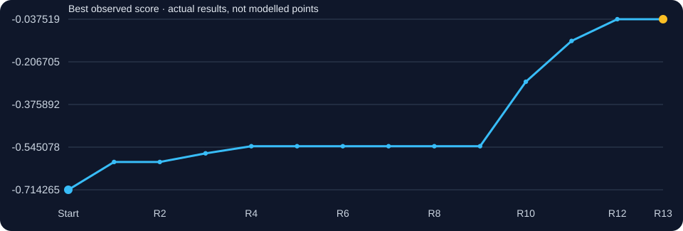
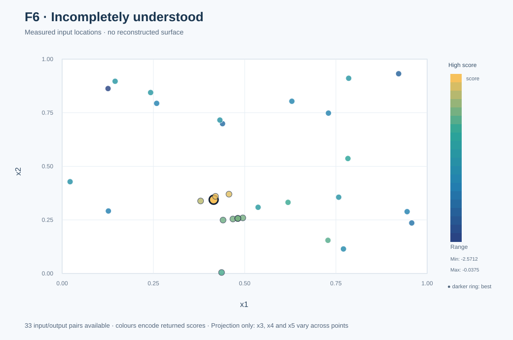
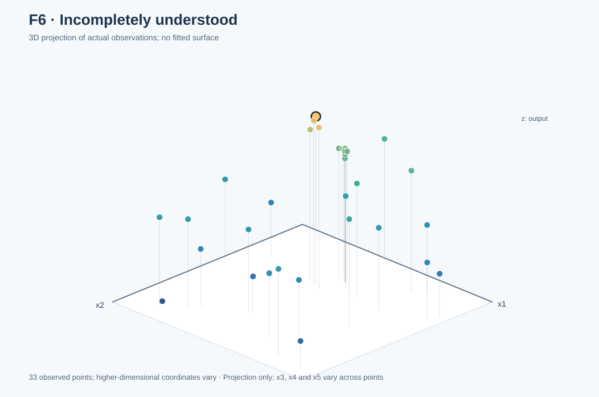

# Function 6 · Escaping an unstable local region

[← All functions](../README.md) · [Project home](../../README.md) · [Observed inputs and outputs](observations.csv) · [Complete decision ledger](selection_history.csv)

**5 inputs · 20 starting observations · 13 rounds**

| Initial best | Final best | First achieved | Best input |
|---:|---:|:---:|---|
| `-0.7142649478202404` | **`-0.03751864724436928`** | **Round 12** | `0.415080-0.344119-0.644062-0.776818-0.076258` |

## Understanding this function

F6's negative response should be maximised towards zero. Close points initially gave surprisingly different results, causing local models and forecast intervals to lose credibility. Switching to an alternative region in R10 and subsequent refinement produced a much better best of -0.037519 in R12. No full equation was recovered.

### Score progression from real evaluations

The chart tracks measured best-so-far results. A flat interval means no improvement to the incumbent, not that a model predicted a constant function.

## Weekly development · expand a round

Each round shows **what was known or being tested, what was submitted, what returned, and what was learnt**. The original 52-page weekly reflection is the narrative foundation; the decision ledger, surviving code and official portal records establish what was actually submitted. An exact historic kernel/seed/forecast appears only if retained. Where early rationale was reconstructed later, it is explicitly labelled in the ledger.

**How to read the evidence:** Each round links to its saved inputs, portal returns and the actual code or analysis available for that period. An original script, a notebook with recorded selections, and a later reconstruction are different kinds of evidence. The [round-by-round source audit](../../docs/WEEKLY_SUBMISSION_EVIDENCE.md#original-code-and-decision-evidence) explains those distinctions.

<strong>Round 1 · Opening hypothesis</strong> — -0.603980627 ★ new best

**Original learning context:** Week 1 observed that raising selected coordinates and lowering another could help, and deliberately chose a relatively bold vector.

**Strategy / candidate-selection evidence:** GP and acquisition baseline (retrospective) *(early-round attribution partly retrospective)*.

**Submitted input:** `0.440752-0.249118-0.839948-0.999999-1e-06`  
**Actual portal result:** `-0.6039806265819045`  
**Best observed before → after:** `-0.7142649478202404` → `-0.6039806265819045`.

**Pre-result numerical forecast:** Not retained as a numerical forecast in the original decision ledger; no value has been invented.

**After the result:** The submitted point established a new personal best. Second round: GP/UCB with per-function exploration weights; deterministic candidate grids or pools.

**Code and evidence:** [Round 1 reflection and portal evidence](../../journey/round_01/README.md) · [Submitted inputs](../../journey/round_01/queries.txt) · [Returned scores](../../journey/round_01/outputs.txt) · [Original coursework notebook](../../journey/round_01/supporting_coursework/Required_assignment_12_1_Tamer_ready.ipynb) (coursework, not a verified portal generator) · No separate candidate-generator source authenticated · [Function-specific decision ledger](selection_history.csv).

<strong>Round 2 · GP and UCB working package</strong> — -0.752987893

**Original learning context:** The Week 1 result rose from -0.7143 to -0.6040, so Week 2 used UCB κ=1.0 with stronger exploitation and a high x4/low x5 hypothesis.

**Strategy / candidate-selection evidence:** GP and UCB working package *(early-round attribution partly retrospective)*.

**Submitted input:** `0.436716-0.004631-0.398416-0.895113-0.03487`  
**Actual portal result:** `-0.7529878928551597`  
**Best observed before → after:** `-0.6039806265819045` → `-0.6039806265819045`.

**Pre-result numerical forecast:** Not retained as a numerical forecast in the original decision ledger; no value has been invented.

**After the result:** The submitted point did not beat the incumbent. The early Week 3 local-EI policy followed the stronger observed region but did not yet establish coordinate-wise causality.

**Code and evidence:** [Round 2 reflection and portal evidence](../../journey/round_02/README.md) · [Submitted inputs](../../journey/round_02/queries.txt) · [Returned scores](../../journey/round_02/outputs.txt) · [Original GP/UCB selection script](../../journey/round_02/week2_ucb_course_aligned.py) · [Eight saved selections](../../journey/round_02/week2_ucb_results.csv) (all eight saved portal values match the submitted record) · [Notebook](../../journey/round_02/Capstone_BBO_Week2_UCB_only.ipynb) · [Function-specific decision ledger](selection_history.csv).

<strong>Round 3 · Function-specific EI or wider search (retrospective)</strong> — -0.569779050 ★ new best

**Original learning context:** The early Week 3 local-EI policy followed the stronger observed region but did not yet establish coordinate-wise causality.

**Strategy / candidate-selection evidence:** Function-specific EI or wider search (retrospective) *(early-round attribution partly retrospective)*.

**Submitted input:** `0.467823-0.254239-0.82281-0.999999-0.03819`  
**Actual portal result:** `-0.5697790503980307`  
**Best observed before → after:** `-0.6039806265819045` → `-0.5697790503980307`.

**Pre-result numerical forecast:** Not retained as a numerical forecast in the original decision ledger; no value has been invented.

**After the result:** The submitted point established a new personal best. Fourth round: GP paired with SVM good/bad checks and small neural-network gradient challengers, not hard classifier exclusion.

**Code and evidence:** [Round 3 reflection and portal evidence](../../journey/round_03/README.md) · [Submitted inputs](../../journey/round_03/queries.txt) · [Returned scores](../../journey/round_03/outputs.txt) · The original reflection records function-specific acquisition choices; no standalone original query generator is preserved for this round · [Function-specific decision ledger](selection_history.csv).

<strong>Round 4 · GP, SVM and neural-network diagnostics</strong> — -0.541447832 ★ new best

**Original learning context:** Fourth round: GP paired with SVM good/bad checks and small neural-network gradient challengers, not hard classifier exclusion.

**Strategy / candidate-selection evidence:** GP, SVM and neural-network diagnostics *(early-round attribution partly retrospective)*.

**Submitted input:** `0.481359-0.2568-0.814241-0.999999-0.057285`  
**Actual portal result:** `-0.5414478319707962`  
**Best observed before → after:** `-0.5697790503980307` → `-0.5414478319707962`.

**Pre-result numerical forecast:** Not retained as a numerical forecast in the original decision ledger; no value has been invented.

**After the result:** The submitted point established a new personal best. The Week 6 source reflects on how continuing the earlier controlled direction lowered F6 from -0.54145 to -0.57299.

**Code and evidence:** [Round 4 reflection and portal evidence](../../journey/round_04/README.md) · [Submitted inputs](../../journey/round_04/queries.txt) · [Returned scores](../../journey/round_04/outputs.txt) · [Original analysis code](../../journey/round_04/capstone_bbo_week4_module15.py) · [Executed notebook](../../journey/round_04/Capstone_BBO_Week4_Module15.ipynb) (final eight inputs stored explicitly; hybrid selection, not an autonomous selector) · [Function-specific decision ledger](selection_history.csv).

<strong>Round 5 · Controlled coordinate probes (retrospective)</strong> — -0.572992776

**Original learning context:** The Week 6 source reflects on how continuing the earlier controlled direction lowered F6 from -0.54145 to -0.57299.

**Strategy / candidate-selection evidence:** Controlled coordinate probes (retrospective) *(early-round attribution partly retrospective)*.

**Submitted input:** `0.494895-0.259361-0.805672-0.999999-0.07638`  
**Actual portal result:** `-0.5729927758567235`  
**Best observed before → after:** `-0.5414478319707962` → `-0.5414478319707962`.

**Pre-result numerical forecast:** Not retained as a numerical forecast in the original decision ledger; no value has been invented.

**After the result:** The submitted point did not beat the incumbent. The Week 7 reflection recorded a large forecasting miss for F6, with prediction near -0.5621 but return around -0.6980, outside stated uncertainty.

**Code and evidence:** [Round 5 reflection and portal evidence](../../journey/round_05/README.md) · [Submitted inputs](../../journey/round_05/queries.txt) · [Returned scores](../../journey/round_05/outputs.txt) · Contemporary reflection and submitted measurements preserved; no standalone selection code authenticated · [Function-specific decision ledger](selection_history.csv).

<strong>Round 6 · GP, ridge and MLP comparison; controlled local fit</strong> — -0.698029551

**Original learning context:** The Week 7 reflection recorded a large forecasting miss for F6, with prediction near -0.5621 but return around -0.6980, outside stated uncertainty.

**Strategy / candidate-selection evidence:** GP, ridge and MLP comparison; controlled local fit *(early-round attribution partly retrospective)*.

**Submitted input:** `0.480996-0.256731-0.814471-0.999999-0.056773`  
**Actual portal result:** `-0.6980295508727566`  
**Best observed before → after:** `-0.5414478319707962` → `-0.5414478319707962`.

**Pre-result numerical forecast:** Not retained as a numerical forecast in the original decision ledger; no value has been invented.

**After the result:** The submitted point did not beat the incumbent. After that failure, the original Week 7 plan explicitly tested near the incumbent rather than make another large model-led jump.

**Code and evidence:** [Round 6 reflection and portal evidence](../../journey/round_06/README.md) · [Submitted inputs](../../journey/round_06/queries.txt) · [Returned scores](../../journey/round_06/outputs.txt) · [Original Module 17 notebook](../../journey/round_06/Capstone_BBO_Module17_Week6.ipynb) · [Eight selected inputs](../../journey/round_06/results/round6_queries.csv) · [Decision rationale](../../journey/round_06/results/round6_query_rationale.csv) (standalone fitter source not retained) · [Function-specific decision ledger](selection_history.csv).

<strong>Round 7 · ARD and local forecast investigations (retrospective)</strong> — -0.590379290

**Original learning context:** After that failure, the original Week 7 plan explicitly tested near the incumbent rather than make another large model-led jump.

**Strategy / candidate-selection evidence:** ARD and local forecast investigations (retrospective) *(early-round attribution partly retrospective)*.

**Submitted input:** `0.48136-0.2568-0.814241-0.999999-0.057285`  
**Actual portal result:** `-0.5903792900833394`  
**Best observed before → after:** `-0.5414478319707962` → `-0.5414478319707962`.

**Pre-result numerical forecast:** Not retained as a numerical forecast in the original decision ledger; no value has been invented.

**After the result:** The submitted point did not beat the incumbent. Original late-week notes treated tiny perturbations as a local stability test, not proof of a smooth gradient.

**Code and evidence:** [Round 7 reflection and portal evidence](../../journey/round_07/README.md) · [Submitted inputs](../../journey/round_07/queries.txt) · [Returned scores](../../journey/round_07/outputs.txt) · [Next-round audit of Week 7 forecasts](../../journey/round_08/results/week7_audit.csv) (subsequent analysis, not the original Round 7 generator) · No authenticated standalone Round 7 selector · [Function-specific decision ledger](selection_history.csv).

<strong>Round 8 · Week 7 changed x1 by only +0.000001 from the Week 4 incumbent but lost about…</strong> — -0.633781715

**Original learning context:** Original late-week notes treated tiny perturbations as a local stability test, not proof of a smooth gradient.

**Strategy / candidate-selection evidence:** Week 7 changed x1 by only +0.000001 from the Week 4 incumbent but lost about 0.049. Test the symmetric -0.000001 side to distinguish a razor-sharp local feature from instability/noise..

**Submitted input:** `0.481358-0.2568-0.814241-0.999999-0.057285`  
**Actual portal result:** `-0.6337817154897656`  
**Best observed before → after:** `-0.5414478319707962` → `-0.5414478319707962`.

**Pre-result numerical forecast:** Not retained as a numerical forecast in the original decision ledger; no value has been invented.

**After the result:** The submitted point did not beat the incumbent. The Week 9 paper noted that F6 needed a stability test around an unusually sharp incumbent.

**Code and evidence:** [Round 8 reflection and portal evidence](../../journey/round_08/README.md) · [Submitted inputs](../../journey/round_08/queries.txt) · [Returned scores](../../journey/round_08/outputs.txt) · [Original Module 19 Python analysis](../../journey/round_08/capstone_bbo_module19_round8.py) · [Original eight-input decision record](../../journey/round_08/results/round8_queries.csv) (all eight match portal inputs) · [Function-specific decision ledger](selection_history.csv).

<strong>Round 9 · Hold the razor-sharp x1 incumbent exactly and move only x5 by +0.000001. Thi…</strong> — -0.551286448

**Original learning context:** The Week 9 paper noted that F6 needed a stability test around an unusually sharp incumbent.

**Strategy / candidate-selection evidence:** Hold the razor-sharp x1 incumbent exactly and move only x5 by +0.000001. This tests whether the Week 4 high value lies on a narrow ridge rather than repeating the same point..

**Submitted input:** `0.481359-0.2568-0.814241-0.999999-0.057286`  
**Actual portal result:** `-0.5512864477685001`  
**Best observed before → after:** `-0.5414478319707962` → `-0.5414478319707962`.

**Pre-result numerical forecast:** Not retained as a numerical forecast in the original decision ledger; no value has been invented.

**After the result:** The submitted point did not beat the incumbent. The Round 10 plan investigated a peer-informed GP model and competing region, with predicted mean -0.192 against -0.262 for the older proposal; neither forecast was an observed result.

**Code and evidence:** [Round 9 reflection and portal evidence](../../journey/round_09/README.md) · [Submitted inputs](../../journey/round_09/queries.txt) · [Returned scores](../../journey/round_09/outputs.txt) · [Dated eight-input decision and forecast ledger](../../journey/round_09/results/round9_queries.csv) (all eight match portal inputs) · The preserved local-fitting script does not generate F6's recorded query · [Function-specific decision ledger](selection_history.csv).

<strong>Round 10 · Peer-informed GP regional exploration; model forecast only</strong> — -0.285656144 ★ new best

**Original learning context:** The Round 10 plan investigated a peer-informed GP model and competing region, with predicted mean -0.192 against -0.262 for the older proposal; neither forecast was an observed result.

**Strategy / candidate-selection evidence:** Peer-informed GP regional exploration; model forecast only.

**Submitted input:** `0.379322-0.338275-0.586412-0.727790-0.036539`  
**Actual portal result:** `-0.28565614419980845`  
**Best observed before → after:** `-0.5414478319707962` → `-0.28565614419980845`.

**Pre-result numerical forecast:** Not retained as a numerical forecast in the original decision ledger; no value has been invented.

**After the result:** The submitted point established a new personal best. An alternative point continued a useful trajectory away from the earlier unstable neighbourhood.

**Code and evidence:** [Round 10 reflection and portal evidence](../../journey/round_10/README.md) · [Submitted inputs](../../journey/round_10/queries.txt) · [Returned scores](../../journey/round_10/outputs.txt) · [Dated final candidate list](../../journey/round_10/round10_candidates.csv) · [Pre-result planning snapshot](../../journey/round_10/optimisation.yaml) · [GP/HEBO-inspired/TuRBO-style challenger code](../../src/bbo/optimizer.py) (not proof of the exact final per-function generator) · [Function-specific decision ledger](selection_history.csv).

<strong>Round 11 · Alternative-region exploration and structural investigations</strong> — -0.123761480 ★ new best

**Original learning context:** An alternative point continued a useful trajectory away from the earlier unstable neighbourhood.

**Strategy / candidate-selection evidence:** Alternative-region exploration and structural investigations.

**Submitted input:** `0.457000-0.370000-0.642000-0.738000-0.020000`  
**Actual portal result:** `-0.12376148016289273`  
**Best observed before → after:** `-0.28565614419980845` → `-0.12376148016289273`.

**Pre-result numerical forecast:** Not retained as a numerical forecast in the original decision ledger; no value has been invented.

**After the result:** The submitted point established a new personal best. The new R12 point returned -0.037519, the personal best. Several coordinates changed, so a causal single-feature attribution is not supported.

**Code and evidence:** [Round 11 reflection and portal evidence](../../journey/round_11/README.md) · [Portal inputs/outputs for R11](../../data/portal_rounds_11_12.csv) · [Later reproducible DBSCAN diagnostic](../../research/diagnostics/clustering/clustering_audit.py) (the clustering study was contemporary; this script was assembled later and was not the original query generator) · [Function-specific decision ledger](selection_history.csv).

<strong>Round 12 · Controlled probes, repeats and structural investigations</strong> — -0.0375186472 ★ new best

**Original learning context:** The new R12 point returned -0.037519, the personal best. Several coordinates changed, so a causal single-feature attribution is not supported.

**Strategy / candidate-selection evidence:** Controlled probes, repeats and structural investigations.

**Submitted input:** `0.415080-0.344119-0.644062-0.776818-0.076258`  
**Actual portal result:** `-0.03751864724436928`  
**Best observed before → after:** `-0.12376148016289273` → `-0.03751864724436928`.

**Pre-result numerical forecast:** Not retained as a numerical forecast in the original decision ledger; no value has been invented.

**After the result:** The submitted point established a new personal best. The final query returned -0.076980, below the incumbent: prefer best-so-far, not final-query value.

**Supporting material:** [Round 12 evidence](../../journey/round_12/README.md) · [Original Round 12 model and candidate-selection code](../../journey/round_12/original/review_round12.py) · [Original robustness and warping tests](../../journey/round_12/original/robust_and_warp.py) · [Original trust-region/Thompson-sampling tests](../../journey/round_12/original/trust_region_ts.py) · [Dated F6 candidate rationale](../../journey/round_12/original/week12_full_review_2026-11-02.md) · [Numerical provenance](selection_history.csv).

<strong>Round 13 · Final decision</strong> — -0.0769802870

**Original learning context:** The final query returned -0.076980, below the incumbent: prefer best-so-far, not final-query value.

**Strategy / candidate-selection evidence:** Final exploitation and regional probes.

**Submitted input:** `0.420000-0.360000-0.650000-0.770000-0.100000`  
**Actual portal result:** `-0.07698028695699928`  
**Best observed before → after:** `-0.03751864724436928` → `-0.03751864724436928`.

**Pre-result numerical forecast:** Not retained as a numerical forecast in the original decision ledger; no value has been invented.

**After the result:** The submitted point did not beat the incumbent. Repeatedly fitting a local model does not fix a locally unreliable response. Change region or representation when forecasts and nearby probes consistently disagree.

**Code and evidence:** [Round 13 reflection and portal evidence](../../journey/round_13/README.md) · [Submitted inputs](../../journey/round_13/queries.txt) · [Returned scores](../../journey/round_13/outputs.txt) · [Final thirteen-round reflection](../../journey/final_reflection/README.md) (final reasoning, not a surviving standalone selector) · [Function-specific decision ledger](selection_history.csv).

## Visual analysis

<table><tr><td width="50%"></td><td width="50%"></td></tr></table>

**Observed points only.** These 2D/3D views project the real inputs and their returned scores; no smooth objective surface has been invented. Only x1 and x2 appear on the horizontal axes; x3–x5 vary across observations and the plots do not control for them.

[How the visualisations were produced](../../docs/functions.md) · [Graph-generation code](../../results/figures/build_visual_gallery.mjs)

## Mathematical evidence and its limits

**No validated hidden-function equation is available.** RBF and Matérn GPs, local fits and neural-network challengers are approximate predictive tools, not claims to know the underlying source. The observed maximum in the table is **a personal best**, not a proved global optimum.

## Lessons to carry forward

Repeatedly fitting a local model does not fix a locally unreliable response. Change region or representation when forecasts and nearby probes consistently disagree.

**Source discipline:** The originally submitted weekly reflections informed the learning context; the portal results and preserved files establish what actually happened. Historical experiments, post-outcome explanations and model-generated graph values are not interchangeable.

[← All eight functions](../README.md) · [Dataset description](../../DATASHEET.md) · [Model card](../../MODEL_CARD.md)
