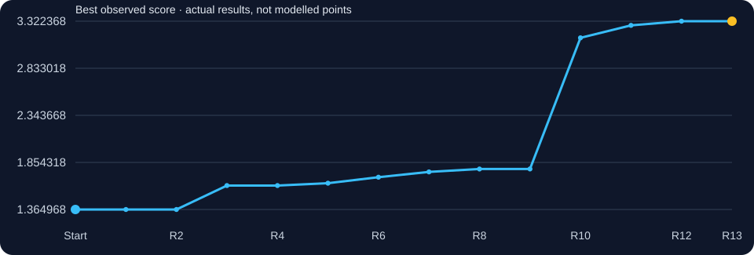
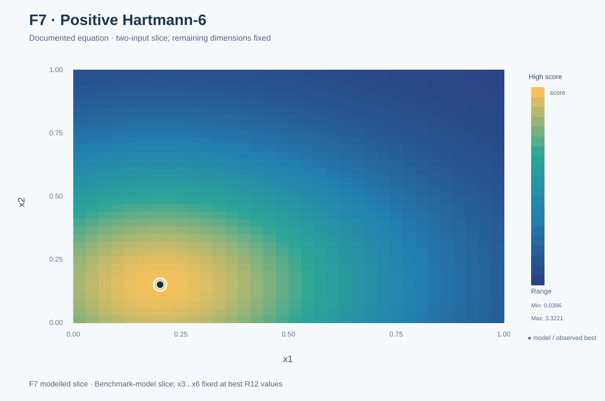
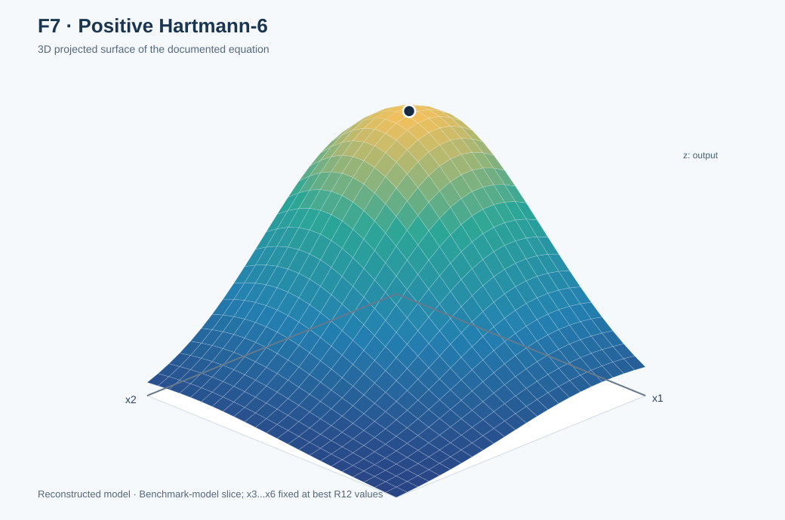

# Function 7 · From one-coordinate refinement to structural prediction

[← All functions](../README.md) · [Project home](../../README.md) · [Observed inputs and outputs](observations.csv) · [Complete decision ledger](selection_history.csv)

**6 inputs · 30 starting observations · 13 rounds**

| Initial best | Final best | First achieved | Best input |
|---:|---:|:---:|---|
| `1.3649683044991994` | **`3.3223680113931557`** | **Round 12** | `0.201689-0.150011-0.476874-0.275332-0.311652-0.657301` |

## Understanding this function

F7 initially rewarded a controlled one-coordinate path, with x1 changes improving a local best to 1.786338 by R9. Moving to a different multi-coordinate region in R10 produced 3.149459. A positive Hartmann-6 reconstruction then forecast 3.32236801 *before* R12, which the portal confirmed to high precision. The close match gave a useful test of the structural hypothesis.

### Score progression from real evaluations

The chart tracks measured best-so-far results. A flat interval means no improvement to the incumbent, not that a model predicted a constant function.

## Weekly development · expand a round

<strong>Round 1 · Opening hypothesis</strong> — 1.36055550

**Why this input:** The Week 1 reflection started from strong observed configurations but changed several coordinates to test whether the good region extended further.

**Approach considered:** Manual exploration informed by the starting observations.

**Submitted input:** `0.034737-0.246867-0.265123-0.307852-0.362506-0.937209`  
**Actual portal result:** `1.3605555033645358`  
**Best observed before → after:** `1.3649683044991994` → `1.3649683044991994`.

**What I learnt:** The first exploratory query was slightly below the initial best.

**Code and data:** [Round notes](../../journey/round_01/README.md) · [Inputs](../../journey/round_01/queries.txt) · [Outputs](../../journey/round_01/outputs.txt) · [Coursework notebook](../../journey/round_01/supporting_coursework/Required_assignment_12_1_Tamer_ready.ipynb).

<strong>Round 2 · GP and UCB working package</strong> — 1.02040228

**Why this input:** After R1 returned 1.3606, only slightly below the original best, Week 2 used UCB κ=2.0 to balance exploration and exploitation.

**Approach considered:** GP and UCB working package

**Submitted input:** `0.074002-0.315323-0.247287-0.026732-0.35885-0.832838`  
**Actual portal result:** `1.020402279048806`  
**Best observed before → after:** `1.3649683044991994` → `1.3649683044991994`.

**What I learnt:** The broader GP/UCB proposal was worse, so the search still needed a more productive direction.

**Code and data:** [Round notes](../../journey/round_02/README.md) · [Inputs](../../journey/round_02/queries.txt) · [Outputs](../../journey/round_02/outputs.txt) · [GP/UCB Python code](../../journey/round_02/week2_ucb_course_aligned.py) · [Saved candidates](../../journey/round_02/week2_ucb_results.csv) · [Notebook](../../journey/round_02/Capstone_BBO_Week2_UCB_only.ipynb).

<strong>Round 3 · Function-specific EI or wider search</strong> — 1.61379630 ★ new best

**Why this input:** Original Week 3 methodology used a local EI approach as the signal became clearer.

**Approach considered:** Function-specific EI or wider search

**Submitted input:** `0.046316-0.36927-0.256273-0.262985-0.391467-0.834089`  
**Actual portal result:** `1.6137963046751616`  
**Best observed before → after:** `1.3649683044991994` → `1.6137963046751616`.

**What I learnt:** The next query improved the best and provided a better region for local investigation.

**Code and data:** [Round notes](../../journey/round_03/README.md) · [Inputs](../../journey/round_03/queries.txt) · [Outputs](../../journey/round_03/outputs.txt).

<strong>Round 4 · GP, SVM and neural-network diagnostics</strong> — 1.55163248

**Why this input:** The Week 4 reflection reported that neural-network gradients highlighted x1 and x6 as potentially influential, alongside SVM and GP challengers.

**Approach considered:** GP, SVM and neural-network diagnostics

**Submitted input:** `0.015-0.36927-0.256273-0.262985-0.391467-0.834089`  
**Actual portal result:** `1.5516324818204723`  
**Best observed before → after:** `1.6137963046751616` → `1.6137963046751616`.

**What I learnt:** The alternative-model candidate did not improve the incumbent, despite suggesting useful directions to test.

**Code and data:** [Round notes](../../journey/round_04/README.md) · [Inputs](../../journey/round_04/queries.txt) · [Outputs](../../journey/round_04/outputs.txt) · [Python analysis](../../journey/round_04/capstone_bbo_week4_module15.py) · [Notebook](../../journey/round_04/Capstone_BBO_Week4_Module15.ipynb).

<strong>Round 5 · Controlled coordinate probes</strong> — 1.63844015 ★ new best

**Why this input:** The early probes suggested x1 was worth isolating, so I varied that coordinate while holding the others fixed.

**Approach considered:** Controlled coordinate probes

**Submitted input:** `0.06-0.36927-0.256273-0.262985-0.391467-0.834089`  
**Actual portal result:** `1.638440146032503`  
**Best observed before → after:** `1.6137963046751616` → `1.638440146032503`.

**What I learnt:** A controlled move improved the best, supporting further tests of the x1 direction.

**Code and data:** [Round notes](../../journey/round_05/README.md) · [Inputs](../../journey/round_05/queries.txt) · [Outputs](../../journey/round_05/outputs.txt).

<strong>Round 6 · GP, ridge and MLP comparison; controlled local fit</strong> — 1.70065969 ★ new best

**Why this input:** Five-fold cross-validation after R5 showed GP NRMSE 0.112 compared with 0.314 for the small MLP, supporting the simpler GP on F7.

**Approach considered:** GP, ridge and MLP comparison; controlled local fit

**Submitted input:** `0.1-0.36927-0.256273-0.262985-0.391467-0.834089`  
**Actual portal result:** `1.7006596900158717`  
**Best observed before → after:** `1.638440146032503` → `1.7006596900158717`.

**What I learnt:** The next controlled query improved the score again, strengthening the local trend.

**Code and data:** [Round notes](../../journey/round_06/README.md) · [Inputs](../../journey/round_06/queries.txt) · [Outputs](../../journey/round_06/outputs.txt) · [Notebook](../../journey/round_06/Capstone_BBO_Module17_Week6.ipynb) · [Eight selected inputs](../../journey/round_06/results/round6_queries.csv) · [Decision notes](../../journey/round_06/results/round6_query_rationale.csv).

<strong>Round 7 · ARD and local forecast investigations</strong> — 1.75571821 ★ new best

**Why this input:** Seventh round: compare RBF and Matérn, ARD, noise and rolling-origin forecast accuracy rather than fitting alone.

**Approach considered:** ARD and local forecast investigations

**Submitted input:** `0.15-0.36927-0.256273-0.262985-0.391467-0.834089`  
**Actual portal result:** `1.7557182120997592`  
**Best observed before → after:** `1.7006596900158717` → `1.7557182120997592`.

**What I learnt:** A further x1 adjustment improved the best, though only within the restricted path being tested.

**Code and data:** [Round notes](../../journey/round_07/README.md) · [Inputs](../../journey/round_07/queries.txt) · [Outputs](../../journey/round_07/outputs.txt) · [Forecast comparison](../../journey/round_08/results/week7_audit.csv).

<strong>Round 8 · Testing the x1-path quadratic</strong> — 1.78586255 ★ new best

**Why this input:** A one-dimensional quadratic through the x1 trajectory suggested a local vertex near 0.234, but this concerned only a restricted path.

**Approach:** The x1-only controlled path continues to fit a stable concave quadratic. The last three points place the estimated vertex at x1≈0.234070.

**Submitted input:** `0.23407-0.36927-0.256273-0.262985-0.391467-0.834089`  
**Actual portal result:** `1.785862549726479`  
**Best observed before → after:** `1.7557182120997592` → `1.785862549726479`.

**Forecast preserved before the Round 8 return:** approximately `1.791396` (local quadratic; see [Round 8 forecast table](../../journey/round_08/README.md)).

**What I learnt:** The local-path query improved the score, while its pre-result quadratic forecast remained approximate.

**Code and data:** [Round notes](../../journey/round_08/README.md) · [Inputs](../../journey/round_08/queries.txt) · [Outputs](../../journey/round_08/outputs.txt) · [Python analysis](../../journey/round_08/capstone_bbo_module19_round8.py) · [Saved candidates](../../journey/round_08/results/round8_queries.csv).

<strong>Round 9 · Refining the x1 local vertex</strong> — 1.78633820 ★ new best

**Why this input:** The measured local progression began to flatten; further one-coordinate adjustments offered little upside.

**Approach:** The updated quadratic across the controlled x1 series places the local vertex near x1=0.228702, with only about 0.00055 predicted headroom. This is deliberate precision, not broad exploration.

**Submitted input:** `0.228702-0.36927-0.256273-0.262985-0.391467-0.834089`  
**Actual portal result:** `1.786338197796892`  
**Best observed before → after:** `1.785862549726479` → `1.786338197796892`.

**Pre-result numerical forecast:** `1.786415130748528` (recorded before return).

**What I learnt:** A small x1 adjustment produced only a marginal gain, suggesting little headroom in that one-coordinate path.

**Code and data:** [Round notes](../../journey/round_09/README.md) · [Inputs](../../journey/round_09/queries.txt) · [Outputs](../../journey/round_09/outputs.txt) · [Candidate forecasts](../../journey/round_09/results/round9_queries.csv) · [Original controlled local-fitting code](../../journey/round_09/round9_controlled_fits.py).

<strong>Round 10 · Alternative basin; peer-informed ensemble; substantial uncertainty</strong> — 3.14945880 ★ new best

**Why this input:** The original Round 10 plan explicitly stopped polishing the local vertex and proposed a different multi-coordinate region, whose expected mean was about 2.79 versus 1.73 locally.

**Approach:** Alternative basin; peer-informed ensemble; substantial uncertainty.

**Submitted input:** `0.190478-0.171014-0.347582-0.283057-0.283946-0.639922`  
**Actual portal result:** `3.149458800087033`  
**Best observed before → after:** `1.786338197796892` → `3.149458800087033`.

**What I learnt:** Moving to another multi-coordinate region returned about 3.149459, far above the earlier local vertex.

**Code and data:** [Round notes](../../journey/round_10/README.md) · [Inputs](../../journey/round_10/queries.txt) · [Outputs](../../journey/round_10/outputs.txt) · [Candidate list](../../journey/round_10/round10_candidates.csv) · [Search plan](../../journey/round_10/optimisation.yaml) · [Related optimiser code](../../src/bbo/optimizer.py).

<strong>Round 11 · Testing the alternative region again</strong> — 3.27896793 ★ new best

**Why this input:** Round 10's alternative region returned 3.149459, far above the earlier one-coordinate path. I tested another input in this broader region.

**Approach:** Another test in a stronger alternative region.

**Submitted input:** `0.233000-0.128000-0.522000-0.276000-0.310000-0.667000`  
**Actual portal result:** `3.278967926227992`  
**Best observed before → after:** `3.149458800087033` → `3.278967926227992`.

**What I learnt:** Another point in the alternative region improved the best to approximately 3.278968.

**Code and data:** [Round notes](../../journey/round_11/README.md) · [Portal results](../../data/portal_rounds_11_12.csv) · [Clustering analysis (later reproduction)](../../research/diagnostics/clustering/clustering_audit.py) · [F7 mathematical check (later)](../../src/bbo/f7_reconstruction.py).

<strong>Round 12 · Testing the Hartmann-6 forecast</strong> — 3.32236801 ★ new best

**Why this input:** I used a positive Hartmann-6 structural hypothesis to forecast approximately 3.32236801 for this input, then submitted it to test the prediction.

**Approach:** Prospective Hartmann-6 structural prediction.

**Submitted input:** `0.201689-0.150011-0.476874-0.275332-0.311652-0.657301`  
**Actual portal result:** `3.3223680113931557`  
**Best observed before → after:** `3.278967926227992` → `3.3223680113931557`.

**Pre-result numerical forecast:** `3.32236801` (approximate pre result forecast in round 12 notes).

**What I learnt:** The positive Hartmann-6 forecast of about 3.32236801 closely matched the subsequent portal result.

**Code and data:** [Round notes](../../journey/round_12/README.md) · [Candidate rationale](../../journey/round_12/original/week12_full_review_2026-11-02.md).

<strong>Round 13 · Testing one-millionth x1 sensitivity</strong> — 3.32236801

**Why this input:** With the Round 12 result at 3.322368, I changed x1 by one millionth while keeping the other coordinates fixed to test local sensitivity.

**Approach:** One-millionth change to x1.

**Submitted input:** `0.201690-0.150011-0.476874-0.275332-0.311652-0.657301`  
**Actual portal result:** `3.322368011392718`  
**Best observed before → after:** `3.3223680113931557` → `3.3223680113931557`.

**What I learnt:** Changing x1 by one millionth returned a marginally lower value; the Round 12 input remained the best.

**Code and data:** [Round notes](../../journey/round_13/README.md) · [Inputs](../../journey/round_13/queries.txt) · [Outputs](../../journey/round_13/outputs.txt) · [Final reflection](../../journey/final_reflection/README.md).

## Visual analysis

<table><tr><td width="50%"></td><td width="50%"></td></tr></table>

**Positive Hartmann-6 model slices:** vary x1 and x2 while **x3=0.476874, x4=0.275332, x5=0.311652 and x6=0.657301** remain fixed. The resulting surface is a model reconstruction, not a new set of portal observations.

[How the visualisations were produced](../../docs/functions.md) · [Graph-generation code](../../results/figures/build_visual_gallery.mjs)

## Mathematical evidence and its limits

The tested candidate was based on the **positive Hartmann-6** benchmark response (the sign-reversed form of the standard minimisation example). A **pre-result** forecast for R12 was **3.32236801**; the portal returned **3.3223680113931557**. The Round 13 change of x1 by one millionth returned **3.322368011392718**, marginally worse. [Benchmark definition](https://www.sfu.ca/~ssurjano/hart6.html) · [Implementation of the plotted form](../../results/figures/build_visual_gallery.mjs).

The matching tested outputs support the reconstructed family but do not establish identity at all untested six-dimensional inputs.

## Lessons to carry forward

Controlled probes explain local coordinate effects, but alternative regions can dominate. A genuine pre-result structural prediction is more persuasive than post-hoc curve fitting.

[← All eight functions](../README.md) · [Dataset description](../../DATASHEET.md) · [Model card](../../MODEL_CARD.md)
