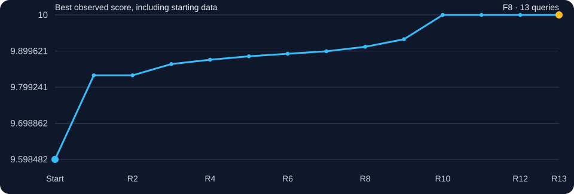
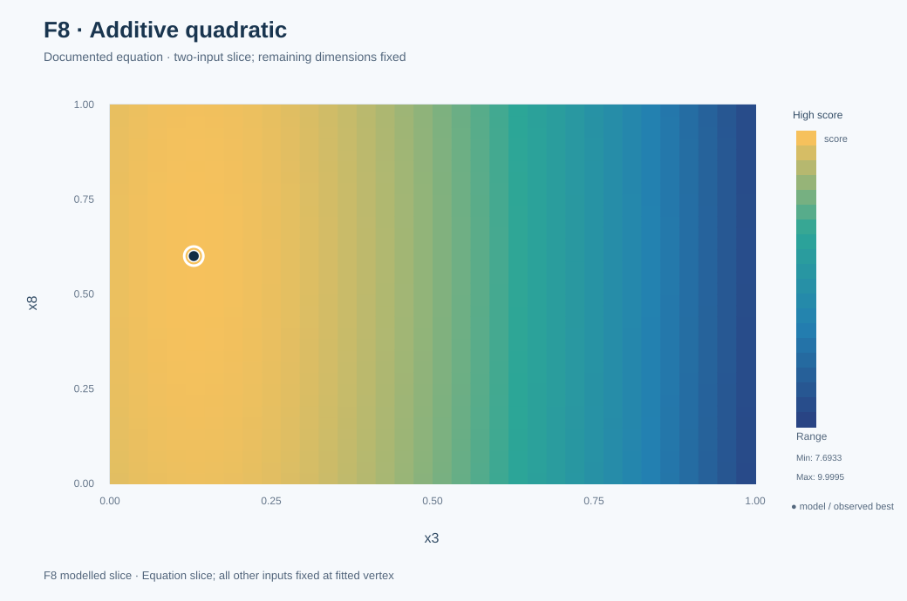
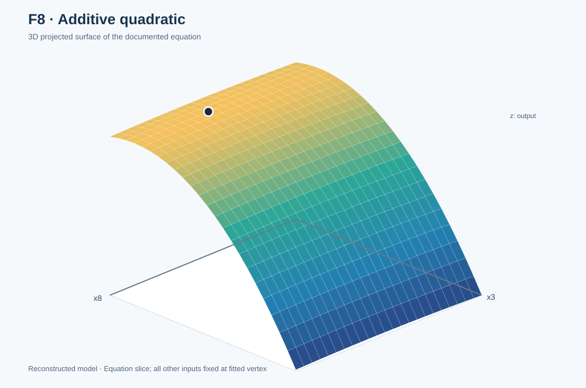

# Function 8 · From GP refinement to an exact fitted quadratic

[← All functions](../README.md) · [Project home](../../README.md) · [Source observations](observations.csv) · [Full decision ledger](selection_history.csv)

**8 inputs · 40 starting observations · 13 evaluated rounds**

| Initial best | Final best | First achieved | Actual final input |
|---:|---:|:---:|---|
| `9.598482002566342` | **`10`** | **Round 10** | `0.100000-0.150000-0.130000-0.150000-0.800000-0.500000-0.200000-0.600000` |

## Understanding this function

Eight inputs made global exploration expensive. GP-guided local steps raised the initial best from **9.598482** to **9.932443**. By Round 10, a fitted 17-coefficient additive quadratic explained the recorded response, identified an interior maximum of **10**, and the portal confirmed it. The equation is a strongly validated reconstruction, not an authenticated copy of the undisclosed function.

### Best-so-far performance

The line uses **real observed scores only**, starting with the course-provided best. A flat section means the incumbent did not improve, not that the proposed model predicted a flat surface.

## Weekly development · open any round

The titles below show the **actual portal return**, with a star for each new best. Each section distinguishes original reasoning, predictions made *before* the result, observations and what the outcome taught me. Model settings are listed only when supported by a historical record; missing original scripts or parameters are not reconstructed as fact.

**How to read the evidence:** Each round links to its saved inputs, portal returns and the actual code or analysis available for that period. An original script, a notebook with recorded selections, and a later reconstruction are different kinds of evidence. The [round-by-round source audit](../../docs/WEEKLY_SUBMISSION_EVIDENCE.md#original-code-and-decision-evidence) explains those distinctions.

<strong>Round 1 · How to explore with eight inputs and only 40 observations?</strong> — 9.83211236 ★ new best

**Question and context:** **Historical evidence:** My first reflection described F8 as the most uncertain query: even 40 starting records provide sparse coverage in eight dimensions. I retained coordinate patterns from stronger observations but deliberately explored.

**Submitted input:** `0.088526-0.03196-0.048494-0.063991-0.991333-0.224689-0.073759-0.537568`  
**Actual portal output:** `9.8321123600691`  
**Best before → after:** `9.598482002566342` → `9.8321123600691`.

**Numeric pre-result forecast:** Not retained in the selection ledger. Broad modelling discussion is not represented as a precise prospective prediction.

**Evaluation:** The first returned query improved to 9.832112, identifying a more useful region.

**What changed for the next round:** Shift towards local exploitation while retaining some uncertainty-driven search.

**Code and evidence:** [Round 1 reflection and portal evidence](../../journey/round_01/README.md) · [Submitted inputs](../../journey/round_01/queries.txt) · [Returned scores](../../journey/round_01/outputs.txt) · [Original coursework notebook](../../journey/round_01/supporting_coursework/Required_assignment_12_1_Tamer_ready.ipynb) (coursework, not a verified portal generator) · No separate candidate-generator source authenticated · [Function-specific decision ledger](selection_history.csv).

<strong>Round 2 · Does the early good region justify lower exploration?</strong> — 9.49774899

**Question and context:** **Historical evidence:** The Week 2 reflection set **UCB κ=1.5** for F8 and used a reproducible random pool of 300,000 candidates for higher-dimensional functions.

**Submitted input:** `0.321822-0.045429-0.355724-0.015612-0.965914-0.090106-0.138377-0.028859`  
**Actual portal output:** `9.4977489881389`  
**Best before → after:** `9.8321123600691` → `9.8321123600691`.

**Numeric pre-result forecast:** Not retained in the selection ledger. Broad modelling discussion is not represented as a precise prospective prediction.

**Evaluation:** The exploratory candidate returned 9.497749, below the standing best.

**What changed for the next round:** Move to a function-specific, more local Expected Improvement search.

**Code and evidence:** [Round 2 reflection and portal evidence](../../journey/round_02/README.md) · [Submitted inputs](../../journey/round_02/queries.txt) · [Returned scores](../../journey/round_02/outputs.txt) · [Original GP/UCB selection script](../../journey/round_02/week2_ucb_course_aligned.py) · [Eight saved selections](../../journey/round_02/week2_ucb_results.csv) (all eight saved portal values match the submitted record) · [Notebook](../../journey/round_02/Capstone_BBO_Week2_UCB_only.ipynb) · [Function-specific decision ledger](selection_history.csv).

<strong>Round 3 · Can local EI recover after a poor broad step?</strong> — 9.86347856 ★ new best

**Question and context:** **Historical evidence:** The Week 3 strategy used local EI on F8, with output normalisation and multiple optimiser restarts in the GP pipeline.

**Submitted input:** `0.099253-0.051531-0.055571-0.074437-0.985751-0.228722-0.118577-0.53735`  
**Actual portal output:** `9.8634785625365`  
**Best before → after:** `9.8321123600691` → `9.8634785625365`.

**Numeric pre-result forecast:** Not retained in the selection ledger. Broad modelling discussion is not represented as a precise prospective prediction.

**Evaluation:** The query produced 9.863479, a new personal best.

**What changed for the next round:** Keep refining while challenging the GP with alternative models.

**Code and evidence:** [Round 3 reflection and portal evidence](../../journey/round_03/README.md) · [Submitted inputs](../../journey/round_03/queries.txt) · [Returned scores](../../journey/round_03/outputs.txt) · The original reflection records function-specific acquisition choices; a standalone generator was not recovered · [Function-specific decision ledger](selection_history.csv).

<strong>Round 4 · Does model complexity improve the query?</strong> — 9.87547078 ★ new best

**Question and context:** **Historical evidence:** The Week 4 reflections compared GP, SVM decision boundaries and small neural-network gradients. The GP remained primary because it supplied predictive uncertainty; alternative models were secondary checks.

**Submitted input:** `0.104617-0.061316-0.05911-0.07966-0.98296-0.230739-0.140986-0.537241`  
**Actual portal output:** `9.8754707823449`  
**Best before → after:** `9.8634785625365` → `9.8754707823449`.

**Numeric pre-result forecast:** Not retained in the selection ledger. Broad modelling discussion is not represented as a precise prospective prediction.

**Evaluation:** The submitted point improved to 9.875471.

**What changed for the next round:** Use controlled local changes rather than automatically following more complex challengers.

**Code and evidence:** [Round 4 reflection and portal evidence](../../journey/round_04/README.md) · [Submitted inputs](../../journey/round_04/queries.txt) · [Returned scores](../../journey/round_04/outputs.txt) · [Original analysis code](../../journey/round_04/capstone_bbo_week4_module15.py) · [Executed notebook](../../journey/round_04/Capstone_BBO_Week4_Module15.ipynb) (final eight inputs stored explicitly; hybrid selection, not an autonomous selector) · [Function-specific decision ledger](selection_history.csv).

<strong>Round 5 · Are repeated small steps productive?</strong> — 9.88500213 ★ new best

**Question and context:** **Historical evidence:** The Week 5 reflection favoured progressive empirical changes and warned against inventing feature hierarchies for ordinary continuous inputs.

**Submitted input:** `0.109981-0.071101-0.062649-0.084883-0.980169-0.232756-0.163395-0.537132`  
**Actual portal output:** `9.8850021313761`  
**Best before → after:** `9.8754707823449` → `9.8850021313761`.

**Numeric pre-result forecast:** Not retained in the selection ledger. Broad modelling discussion is not represented as a precise prospective prediction.

**Evaluation:** The output reached 9.885002, continuing a measured improvement trend.

**What changed for the next round:** Compare cross-validated GP and neural-network accuracy before changing model families.

**Code and evidence:** [Round 5 reflection and portal evidence](../../journey/round_05/README.md) · [Submitted inputs](../../journey/round_05/queries.txt) · [Returned scores](../../journey/round_05/outputs.txt) · Contemporary reflection and submitted measurements preserved; no standalone selection code authenticated · [Function-specific decision ledger](selection_history.csv).

<strong>Round 6 · Do GPs outperform the neural-network challenger?</strong> — 9.89207261 ★ new best

**Question and context:** **Historical evidence:** Five-fold cross-validation after Round 5 gave **GP NRMSE 0.051** versus **small-MLP 0.157** on F8. The GP retained the main decision role.

**Submitted input:** `0.115345-0.080886-0.066188-0.090106-0.977378-0.234773-0.185804-0.537023`  
**Actual portal output:** `9.8920726096301`  
**Best before → after:** `9.8850021313761` → `9.8920726096301`.

**Numeric pre-result forecast:** Not retained in the selection ledger. Broad modelling discussion is not represented as a precise prospective prediction.

**Evaluation:** The submitted point returned 9.89207261; the pre-result forecast quoted later was about 9.892098, an error near 0.000025.

**What changed for the next round:** Audit future forecasts chronologically instead of trusting fit quality alone.

**Code and evidence:** [Round 6 reflection and portal evidence](../../journey/round_06/README.md) · [Submitted inputs](../../journey/round_06/queries.txt) · [Returned scores](../../journey/round_06/outputs.txt) · [Original Module 17 notebook](../../journey/round_06/Capstone_BBO_Module17_Week6.ipynb) · [Eight selected inputs](../../journey/round_06/results/round6_queries.csv) · [Decision rationale](../../journey/round_06/results/round6_query_rationale.csv) (standalone fitter source not retained) · [Function-specific decision ledger](selection_history.csv).

<strong>Round 7 · Does the local forecast remain reliable?</strong> — 9.89900201 ★ new best

**Question and context:** **Historical evidence:** The Week 7 reflection compared RBF and Matérn kernels, ARD lengthscales, noise and chronological forecasts. The previous F8 error was only 0.000025.

**Submitted input:** `0.128076-0.104109-0.074587-0.102502-0.970754-0.23956-0.238989-0.536764`  
**Actual portal output:** `9.8990020095864`  
**Best before → after:** `9.8920726096301` → `9.8990020095864`.

**Numeric pre-result forecast:** Not retained in the selection ledger. Broad modelling discussion is not represented as a precise prospective prediction.

**Evaluation:** The observed value rose to **9.899002010**; the recorded prediction of roughly 9.899002015 was almost exact.

**What changed for the next round:** Test whether moving off the established path along a single coordinate improves the score.

**Code and evidence:** [Round 7 reflection and portal evidence](../../journey/round_07/README.md) · [Submitted inputs](../../journey/round_07/queries.txt) · [Returned scores](../../journey/round_07/outputs.txt) · [Next-round audit of Week 7 forecasts](../../journey/round_08/results/week7_audit.csv) (subsequent analysis, not the original Round 7 generator) · No authenticated standalone Round 7 selector · [Function-specific decision ledger](selection_history.csv).

<strong>Round 8 · Can an orthogonal coordinate improve a near-plateau?</strong> — 9.91139901 ★ new best

**Question and context:** **Historical evidence:** The Round 8 decision kept seven coordinates fixed and increased **x6 by 0.025**, with agreement among GP-kernel challengers on potential gain.

**Submitted input:** `0.128076-0.104109-0.074587-0.102502-0.970754-0.26456-0.238989-0.536764`  
**Actual portal output:** `9.9113990095864`  
**Best before → after:** `9.8990020095864` → `9.9113990095864`.

**Prospective GP-kernel predictions:** approximately `9.902821`, `9.906066` and `9.907368` from three kernels (not a single agreed scalar forecast; see [Round 8 forecast table](../../journey/round_08/README.md)).

**Evaluation:** The output rose from 9.899002 to **9.911399**. A controlled one-coordinate test produced interpretable evidence.

**What changed for the next round:** Try a larger x6 step while monitoring predictive stability.

**Code and evidence:** [Round 8 reflection and portal evidence](../../journey/round_08/README.md) · [Submitted inputs](../../journey/round_08/queries.txt) · [Returned scores](../../journey/round_08/outputs.txt) · [Original Module 19 Python analysis](../../journey/round_08/capstone_bbo_module19_round8.py) · [Original eight-input decision record](../../journey/round_08/results/round8_queries.csv) (all eight match portal inputs) · [Function-specific decision ledger](selection_history.csv).

<strong>Round 9 · Will the x6 direction keep improving?</strong> — 9.93244301 ★ new best

**Question and context:** **Historical evidence:** Three GP kernels supported increasing **x6 by 0.05**, with a saved mean forecast around **9.9335**. The original Week 9 reflection treated this as an instance where extra modelling earned its cost.

**Submitted input:** `0.128076-0.104109-0.074587-0.102502-0.970754-0.31456-0.238989-0.536764`  
**Actual portal output:** `9.9324430095864`  
**Best before → after:** `9.9113990095864` → `9.9324430095864`.

**Forecast preserved before the return:** `9.933511308824693` (recorded before return).

**Evaluation:** The portal returned **9.932443**, close to the challenger forecast.

**What changed for the next round:** Test whether a simpler global mathematical form explains the data rather than continue tuning the same local GP.

**Code and evidence:** [Round 9 reflection and portal evidence](../../journey/round_09/README.md) · [Submitted inputs](../../journey/round_09/queries.txt) · [Returned scores](../../journey/round_09/outputs.txt) · [Dated eight-input decision and forecast ledger](../../journey/round_09/results/round9_queries.csv) (all eight match portal inputs) · Three-kernel F8 forecast recorded in the ledger; not calculated by the five-function local-fitting script · [Function-specific decision ledger](selection_history.csv).

<strong>Round 10 · Can 17 coefficients replace an eight-dimensional search?</strong> — 10.0000000 ★ new best

**Question and context:** **Historical evidence:** The Week 10 original submission reported fitting an **additive quadratic with 17 coefficients** to 49 personal-plus-initial observations and testing five published external inputs (errors around 10⁻¹⁰). Its vertex forecast **10** before the portal result.

**Submitted input:** `0.100000-0.150000-0.130000-0.150000-0.800000-0.500000-0.200000-0.600000`  
**Actual portal output:** `10`  
**Best before → after:** `9.9324430095864` → `10`.

**Forecast preserved before the return:** `10` (recorded structural prediction before return).

**Evaluation:** Submitting the fitted vertex returned **10.000000**. This is the decisive prospective structural result.

**What changed for the next round:** Retain the tested vertex and validate the model separately against withheld historical points.

**Code and evidence:** [Round 10 reflection and portal evidence](../../journey/round_10/README.md) · [Submitted inputs](../../journey/round_10/queries.txt) · [Returned scores](../../journey/round_10/outputs.txt) · [Dated final candidate list](../../journey/round_10/round10_candidates.csv) · [Pre-result planning snapshot](../../journey/round_10/optimisation.yaml) · [GP/HEBO-inspired/TuRBO-style challenger code](../../src/bbo/optimizer.py) (not proof of the exact final per-function generator) · [Later reproducible F8 structural validation](../../src/bbo/structural_validation.py) (retrospective verification of the quadratic) · [Function-specific decision ledger](selection_history.csv).

<strong>Round 11 · Does dense sampling imply high performance?</strong> — 10.0000000

**Question and context:** **Historical evidence:** The Week 11 reflection investigated DBSCAN and found cluster membership depended on the radius. The quadratic still explained the observations at floating-point precision.

**Submitted input:** `0.100000-0.150000-0.130000-0.150000-0.800000-0.500000-0.200000-0.600000`  
**Actual portal output:** `10`  
**Best before → after:** `10` → `10`.

**Numeric pre-result forecast:** Not retained in the selection ledger. Broad modelling discussion is not represented as a precise prospective prediction.

**Evaluation:** The exact same vertex returned **10**. This confirmed repeatability at that setting but did not explore a new region.

**What changed for the next round:** Assess model sensitivity and whether dimensionality reduction preserves the maximum.

**Code and evidence:** [Round 11 reflection and portal evidence](../../journey/round_11/README.md) · [Portal inputs/outputs for R11](../../data/portal_rounds_11_12.csv) · [Later reproducible DBSCAN diagnostic](../../research/diagnostics/clustering/clustering_audit.py) (the clustering study was contemporary; this script was assembled later and was not the original query generator) · [Function-specific decision ledger](selection_history.csv).

<strong>Round 12 · Would PCA simplify the model safely?</strong> — 10.0000000

**Question and context:** **Historical evidence:** The original Week 12 work found **48.8%** of input variance in two principal components, but restricting the fitted quadratic to two PCs reduced its modelled maximum to **9.955973**. The full eight-input vertex remained stronger.

**Submitted input:** `0.100000-0.150000-0.130000-0.150000-0.800000-0.500000-0.200000-0.600000`  
**Actual portal output:** `10`  
**Best before → after:** `10` → `10`.

**Numeric pre-result forecast:** Not retained in the selection ledger. Broad modelling discussion is not represented as a precise prospective prediction.

**Evaluation:** The portal again returned **10 at precisely the same input**. PCA variance was not a substitute for objective sensitivity.

**What changed for the next round:** Keep the full coordinates where compression would reduce the objective.

**Code and evidence:** [Round 12 records](../../journey/round_12/README.md) · [Dated Round 12 recommendations](../../journey/round_12/original/week12_full_review_2026-11-02.md) (records the F8 quadratic-vertex repeat; the recovered four-script suite does not establish a separate F8 generator) · [Machine-readable provenance](selection_history.csv).

<strong>Round 13 · What is the defensible final decision?</strong> — 10.0000000

**Question and context:** **Historical evidence:** The Week 13 reflection discussed a proposed distinct local step. **The authoritative final portal record instead shows an exact repeat of the Round 10 vertex.** This discrepancy is preserved rather than described as a new sensitivity experiment.

**Submitted input:** `0.100000-0.150000-0.130000-0.150000-0.800000-0.500000-0.200000-0.600000`  
**Actual portal output:** `10`  
**Best before → after:** `10` → `10`.

**Numeric pre-result forecast:** Not retained in the selection ledger. Broad modelling discussion is not represented as a precise prospective prediction.

**Evaluation:** The unchanged input returned **10** again. No new headroom or neighbouring behaviour was measured.

**What changed for the next round:** A model supported by analytical and held-out checks can justify stopping; repeated inputs need an explicit validation purpose.

**Code and evidence:** [Round 13 reflection and portal evidence](../../journey/round_13/README.md) · [Submitted inputs](../../journey/round_13/queries.txt) · [Returned scores](../../journey/round_13/outputs.txt) · [Final thirteen-round reflection](../../journey/final_reflection/README.md) (final reasoning, not a surviving standalone selector) · [Function-specific decision ledger](selection_history.csv).

## Visual analysis

<table><tr><td width="50%"></td><td width="50%"></td></tr></table>

**Left and right:** validated quadratic slices, varying **x3 and x8** while all other inputs stay fixed at the fitted vertex. These are **model predictions**, not extra portal evaluations. The recorded inputs and observed returns remain in the history above.

[Visualisation methodology](../../docs/functions.md) · [Rebuild the gallery](../../results/figures/build_visual_gallery.mjs)

## Equation and strength of evidence

The reconstructed additive quadratic is:

$$
\hat f_8(\mathbf{x}) = 10 - \sum_{i=1}^{8} w_i(x_i-c_i)^2
$$

with \(\mathbf{c}=(0.10,0.15,0.13,0.15,0.80,0.50,0.20,0.60)\) and \(\mathbf{w}=(2,1,3,1,0.5,1,2,0.1)\).

For each input, \(\partial\hat f_8/\partial x_i=-2w_i(x_i-c_i)\). The diagonal Hessian has entries \(-2w_i<0\), so the fitted model has a **unique maximum of 10** at \(\mathbf{c}\). The portal confirmed that location in R10. Equal displacements in x3 reduce the fitted score **30 times more** than equal displacements in x8.

**Validation:** fitted to 49 accumulated personal-plus-starting observations by R10, checked against five external published input/output examples. A later **retrospective experiment** fitted the same 17-parameter form using **only the original 40 observations** and predicted 13 subsequent returns to floating-point precision. Neither check authenticates the undisclosed source function everywhere. [Reproduce the held-out test](../../src/bbo/structural_validation.py) · [Coefficients](../../results/f8_additive_quadratic_coefficients.csv).

## What this function taught me

**Representation can matter more than optimiser complexity.** The original 40 observations already contained enough information to identify a simple model, but I recognised it late. PCA compression preserved input variance without preserving the model's optimum.

**Provenance:** The *original weekly course reflections* (Weeks 1–13), historical code where available, the official portal results and retrospective mathematical checks have been reviewed separately. The reflection describes intentions; the portal record establishes what was actually evaluated. This page uses no unverified original GP parameter values.

[← Function index](../README.md) · [Data provenance](../../DATASHEET.md) · [Model limitations](../../MODEL_CARD.md)
