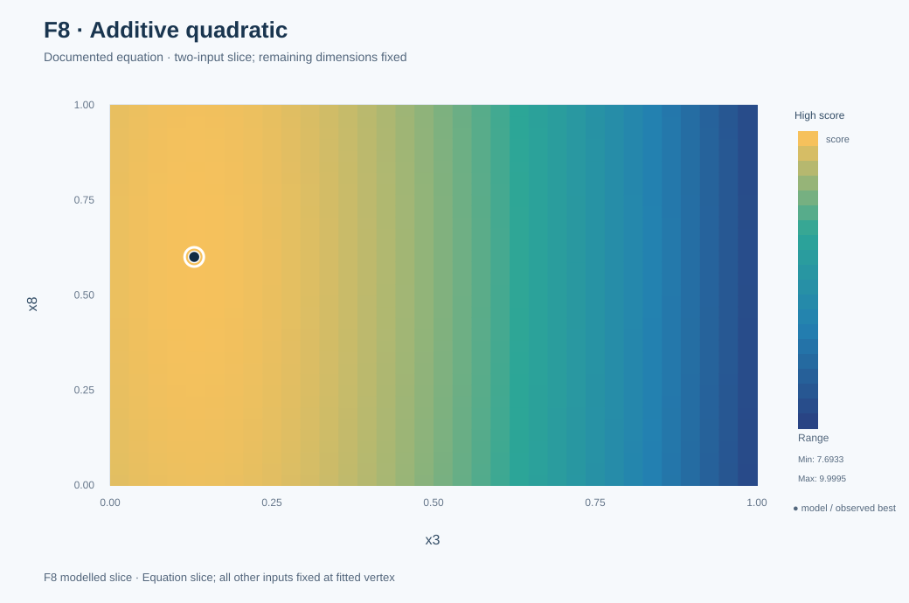
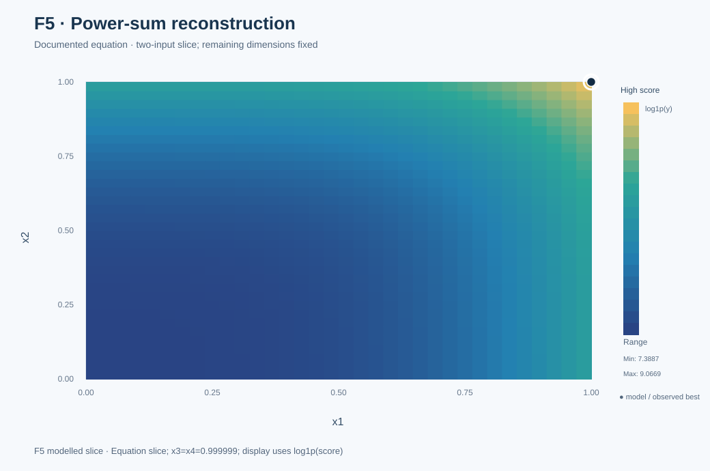
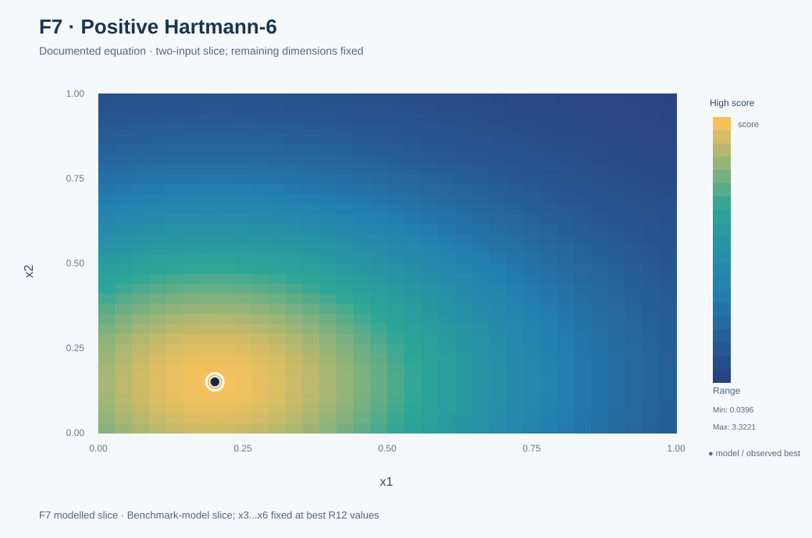

# Mathematical reconstruction

[← Project overview](../README.md) · [Eight functions](../functions/README.md) · [Graph methodology](../docs/functions.md)

Black-box optimisation searches for good inputs **without knowing the equation**. Mathematical reconstruction asks a different question: *what functional form, if any, explains the observations?*

The equations below describe **supported reconstructions or hypotheses**, not authenticated copies of the undisclosed source implementations. A finite set of matches cannot prove equality everywhere.

## Status by function

| Function | Evidence status | Equation / analysis / graph |
|---|---|---|
| [F1](../functions/F1/README.md) | Gaussian-modulated oscillatory reconstruction informed by supplementary published points; full coefficients not published | [F1 research and observed plot](../functions/F1/README.md) |
| [F2](../functions/F2/README.md) | No complete equation validated | [Observed behaviour](../functions/F2/README.md) |
| [F3](../functions/F3/README.md) | Local hypotheses, not a validated global equation | [Observed projections](../functions/F3/README.md) |
| [F4](../functions/F4/README.md) | Local sensitivity investigation; no complete equation validated | [Observed projections](../functions/F4/README.md) |
| [F5](../functions/F5/README.md) | Retrospective interacting power-sum representation | [Equation and model slices](../functions/F5/README.md) |
| [F6](../functions/F6/README.md) | Local/regional models; no complete equation validated | [Observed projections](../functions/F6/README.md) |
| [F7](../functions/F7/README.md) | Positive Hartmann-6 reconstruction with a confirmed prospective R12 forecast | [Evidence and model slices](../functions/F7/README.md) |
| [F8](../functions/F8/README.md) | Strongly validated 17-parameter additive quadratic | [Equation and model slices](../functions/F8/README.md) |

## F8: an explicitly testable quadratic

The fitted function is

$$
\hat f_8(\mathbf{x})=10-\sum_{i=1}^{8}w_i(x_i-c_i)^2,
$$

where

$$
\mathbf{c}=(0.10,0.15,0.13,0.15,0.80,0.50,0.20,0.60),
\qquad
\mathbf{w}=(2,1,3,1,0.5,1,2,0.1).
$$

The fitted quadratic has a maximum of **10** at its centre; the portal returned **10** for that setting in Round 10. A separate retrospective fit using only the 40 supplied starting observations predicted the 13 later returns to floating-point precision. This does **not** establish the full hidden function globally.

[Full F8 narrative](../functions/F8/README.md) · [Validation script](../src/bbo/structural_validation.py) · [Fitted coefficients](../results/f8_additive_quadratic_coefficients.csv)

## F5: a power-sum reconstruction

A later reconstruction uses

$$
\hat f_5(\mathbf{x})=
0.01\sum_{k=1}^{4}\left[\sum_{j=1}^{4}(4x_j)^k-b_k\right]^2,
\qquad \mathbf{b}=(7.5,16,40,120).
$$

It reproduces the recorded value **8662.405001248297** at the permitted boundary `(0.999999, 0.999999, 0.999999, 0.999999)`. The equation was developed **after** the successful Round 10 boundary query, so it explains but did not cause that decision.

[Full F5 narrative](../functions/F5/README.md) · [Validation code](../src/bbo/structural_validation.py)

## F7: a prospective structural forecast

The positive Hartmann-6 reconstruction forecast approximately **3.32236801** before Round 12. The portal returned **3.3223680113931557** at the proposed input. This is more persuasive than a post-result fit, although the hidden function remains unauthenticated at untested points.

[Full F7 narrative](../functions/F7/README.md) · [Plotted model implementation](../results/figures/build_visual_gallery.mjs)

## Evidence and attribution

- **Portal returns** show what was evaluated and observed, not what any model predicted.
- **Prospective forecasts** are identified as such only where there is retained pre-result evidence.
- **Retrospective reconstructions** are labelled to avoid changing the historical research narrative.
- **Published observations from other participants** are external supporting evidence and must be credited to their original sources when identifiable. They are not counted as the author's 104 personal portal evaluations.
- **Graph surfaces** from reconstructed models are model predictions. For 3D or higher-dimensional functions, a 2D/3D plot shows selected coordinates or a fixed-coordinate slice, not the entire landscape.

[Datasheet and provenance](../DATASHEET.md) · [Evidence rules](../docs/EVIDENCE_RULES.md) · [All visualisations](../visualisations/README.md)
