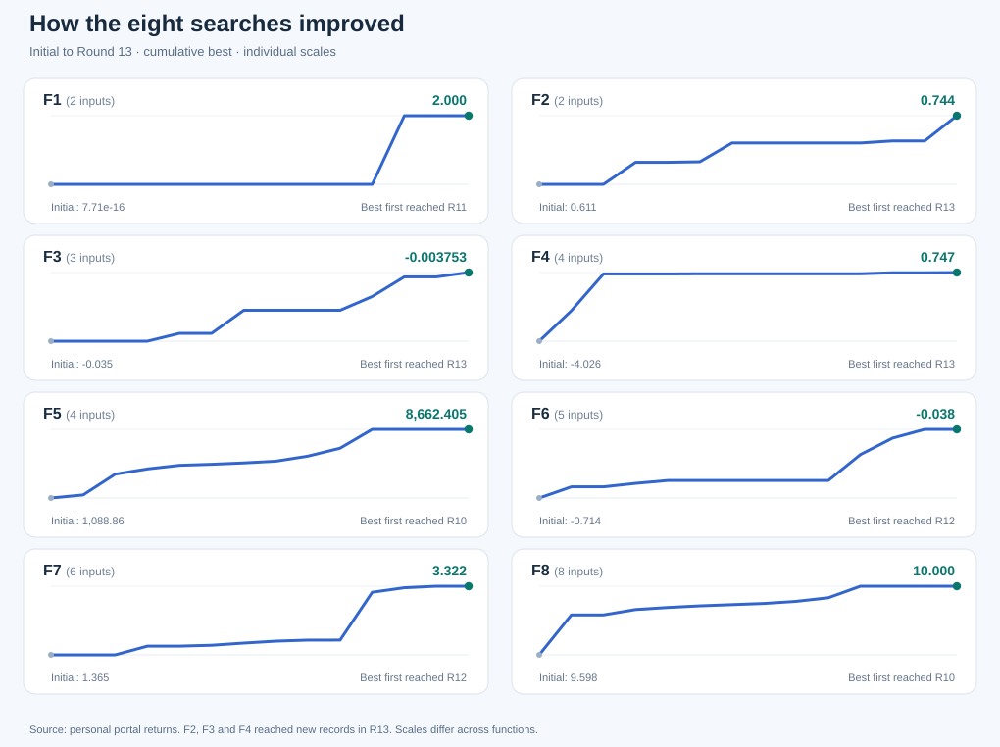

# Results and diagnostic reports

**Current source of truth:** [best confirmed through Round 12](current_best_after_week12.csv), based only on returned personal portal outputs.

| Report | Read it for |
|---|---|
| [Current bests (CSV)](current_best_after_week12.csv) | Initial / R9 / R12 best; best input; first-achieved round |
| [Current bests (narrative)](final_summary.md) | A concise eight-function summary |
| [F8 fitted coefficients](f8_additive_quadratic_coefficients.csv) | Independent mathematical-reconstruction details |
| [Week 9 forecast audit](week9_forecast_audit.csv) | Forecast versus actual values and observed errors |
| [Round 10 revision audit](round10_revision_audit.md) | Why some provisional candidates changed |
| [HEBO-inspired committee comparison](hebo_inspired_committee.csv) | Experimental mechanisms; not official HEBO |
| [TuRBO-style challenger comparison](turbo_style_challengers.csv) | Experimental mechanisms; not official TuRBO |
| [Structural challengers](structural_challengers.csv) | Alternative representations and comparisons |
| [Round 10 candidates](round10_candidates.csv) | Historical candidate proposals, not all observed scores |

## Reading the figures

This graph is generated from [historical personal outputs](../data/accumulated/history_through_week10.csv) and [returned R11–R12 outputs](../data/portal_rounds_11_12.csv). Each mini-chart uses its own y-axis scale. The raw values are given in the [current bests](current_best_after_week12.csv).

## Evidence vocabulary

**Observed:** a returned personal portal output. **Forecast:** expectation made before a return. **Retrospective:** fitted or analysed later. **External:** public results used for research or validation, not personal outcomes.

[Read the case studies](../docs/function_guide.md) · [Data and methodological limits](../docs/evidence_provenance.md)
