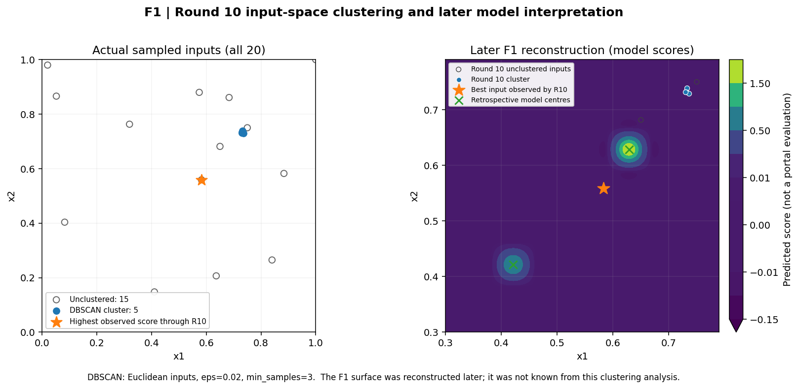

# Input-space clustering and DBSCAN experiments

[← Methods and experiments](../../../docs/methods.md) · [Round 11 investigation](../../../journey/round_11/README.md) · [F1 research](../../../functions/F1/README.md)

This experiment explores the input locations tested during the first ten rounds using DBSCAN. The linked Python script reproduces the cluster analysis and adds a later visual explanation of the F1 response shape.


The analysis uses **only my 255 historical observations**: 175 course-supplied starting evaluations and 80 personal portal evaluations (10 rounds × 8 functions). No peer observations or additional oracle queries enter this clustering analysis. The source CSVs stay in their existing [`data/accumulated/function_N/` folders](../../../data/accumulated/), **not duplicated here**.

## Method and results

The reproducible [DBSCAN code](clustering_audit.py) clusters **input coordinates only**, using Euclidean distance and `min_samples=3`. It tests seven values of `eps` (`0.005, 0.01, 0.02, 0.03, 0.05, 0.08, 0.12`) for each of the eight functions, measuring the number of clusters and unclustered points. It also reports the highest **observed** score in each cluster and whether the best observed score through Round 10 is a DBSCAN noise point. The latter is not a prediction of score from clustering.

### Results at the original script's selected `eps`

| Function | Inputs | `eps` | Clusters | Unclustered | Best observed point unclustered? |
|---|---:|---:|---:|---:|---|
| F1 | 20 | 0.020 | 1 | 15 | **Yes** |
| F2 | 20 | 0.005 | 1 | 13 | No |
| F3 | 25 | 0.020 | 1 | 20 | Yes |
| F4 | 40 | 0.020 | 1 | 32 | No |
| F5 | 30 | 0.050 | 0 | 30 | Yes |
| F6 | 30 | 0.030 | 1 | 23 | Yes |
| F7 | 40 | 0.050 | 1 | 35 | Yes |
| F8 | 50 | 0.050 | 2 | 43 | Yes |

**Interpretation:** before Round 11, F1's best recorded value came from an isolated input rather than the five-point cluster near `(0.732, 0.733)`; the latter had extremely small scores. The F8 score of 10 was likewise outside both clusters. F2 and F4 had repeated investigation of productive local neighbourhoods. These are **descriptive observations** under the chosen density thresholds, not evidence that DBSCAN itself optimised the functions.

The full [sensitivity table](dbscan_eps_sensitivity.csv) shows that detected clusters depend on `eps`. Particularly in higher dimensions, fixed Euclidean neighbourhoods and a small sample size can label many points as noise without implying that those samples are unusual in the underlying objective. Changing `eps`, the distance metric or input scaling can change the result. The script analyses all 255 recorded points at this cutoff.

## F1 diagnostic figure



The **left panel** shows only the 20 actual starting and portal inputs available through Round 10, including DBSCAN membership and the best recorded input. The **right panel** overlays those inputs on the **retrospectively reconstructed** two-peak F1 model from the canonical [F1 reconstruction](../../../src/bbo/f1_reconstruction.py). Model contours and fitted centres are not measured evaluations and **must not be interpreted as information available when Round 11 candidates were selected**. They simply help readers understand why input-space density did not coincide with high response.

## Reproduce

From the repository root, after `pip install -r requirements.txt`:

```bash
python research/diagnostics/clustering/clustering_audit.py --repo .
```

This writes three files beside the script:

- [`dbscan_eps_sensitivity.csv`](dbscan_eps_sensitivity.csv): 56 rows covering all seven radii and eight functions.
- [`selected_cluster_summary.csv`](selected_cluster_summary.csv): the 8 best observed points and 8 selected density clusters, with observed score summaries.
- [`f1_clustering_diagnostic.png`](f1_clustering_diagnostic.png): regenerated, clearly separated observed input and later model views.

This script uses the existing [F1 reconstruction](../../../src/bbo/f1_reconstruction.py) for the explanatory background; the observed and modelled values remain separate.

[Round 11 research](../../../journey/round_11/README.md) · [Observed dataset](../../../data/all_observations.csv).
